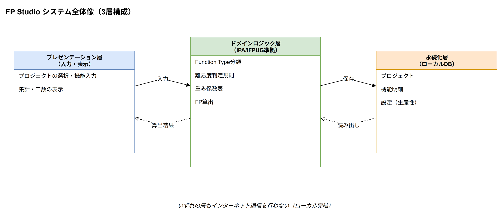
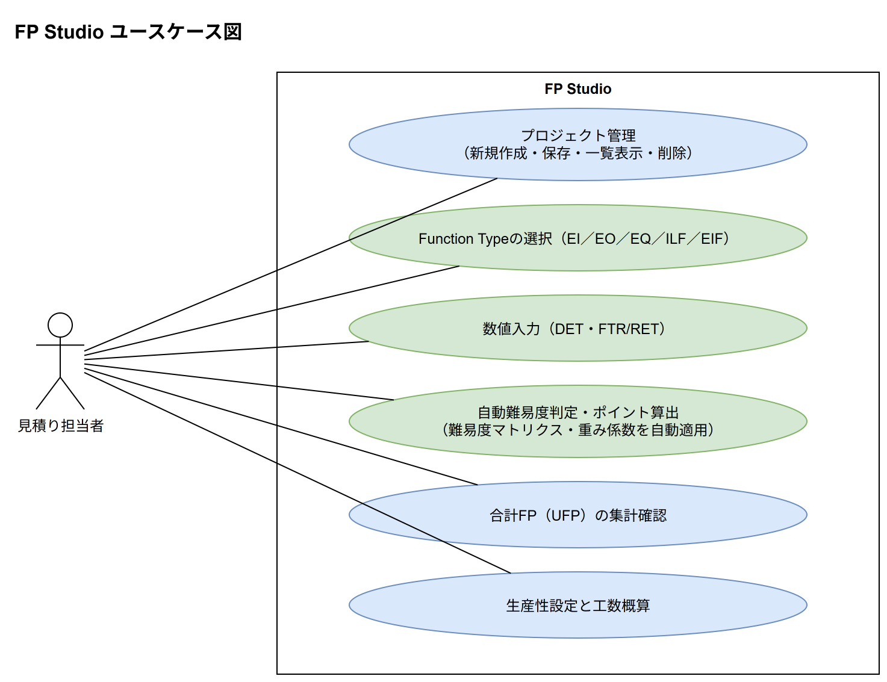
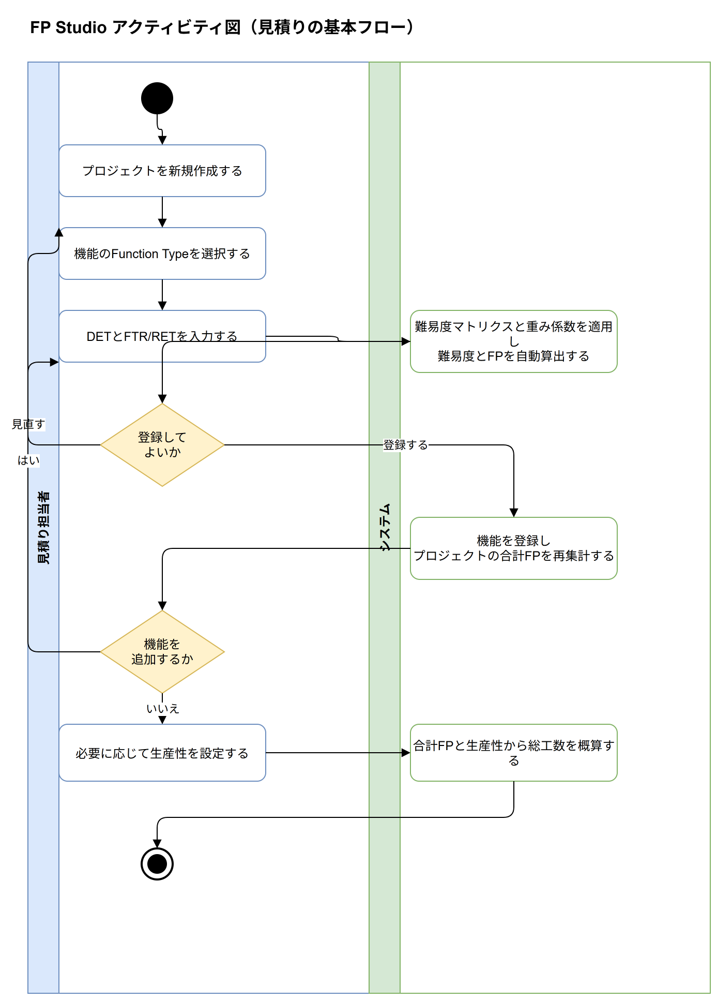
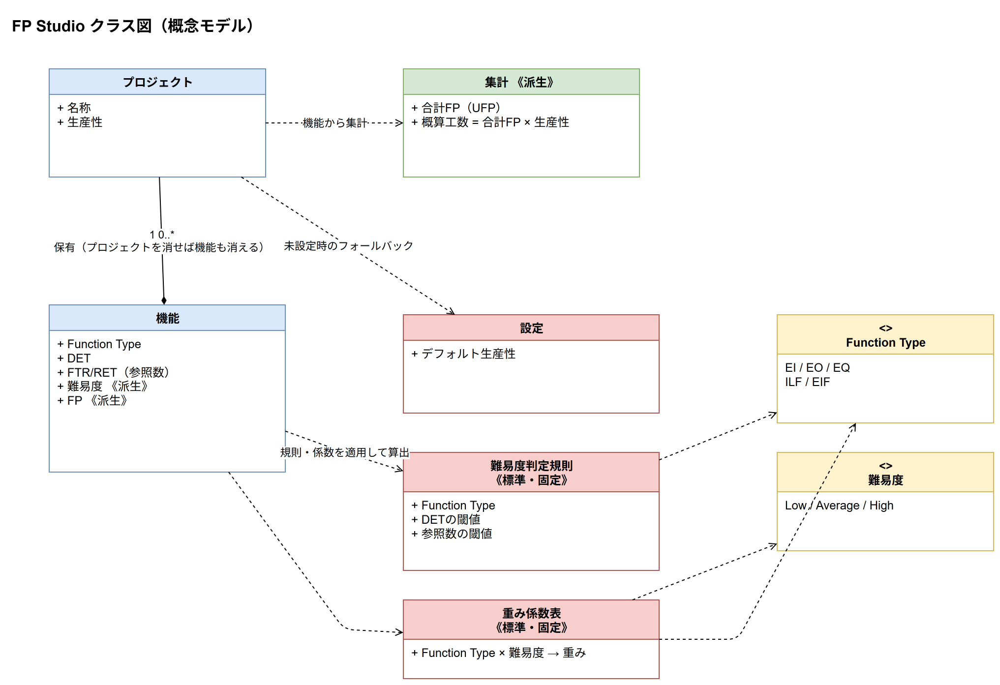
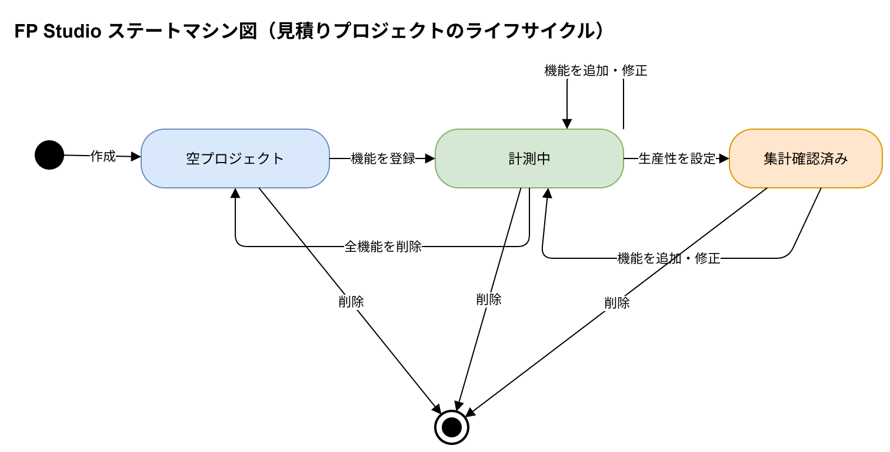
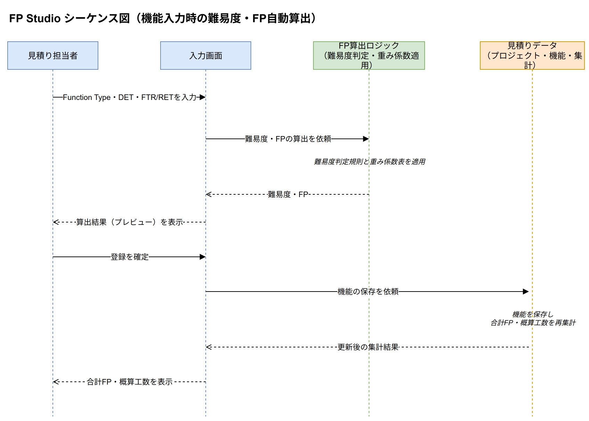

# FP Studio アーキテクチャ設計書

本書はFP Studioの設計をUMLで示すものです。実装の詳細ではなく、システムとしてあるべき構造と振る舞い、すなわち責務とその関係に焦点を当てて記述します。各図の元データは[docs/uml](uml)配下にdraw.io形式（`.drawio`）で置いてあり、draw.ioで編集できます。

本書は[docs/Concept.md](Concept.md)（企画書）に記載された背景・課題・業務要件・機能要件を出発点に、あるべきシステム構造を導いたものです。現行コードの実装詳細（ファイル名・関数名・処理の内部構造）には立ち入りません。

## 1. システム全体像

FP Studioは、IPA/IFPUGが定めるファンクションポイント（FP）法に準拠した、単一利用者・単一デバイス向けの見積り支援デスクトップアプリケーションです。企業独自のテーラリングによって見積り根拠が主観化しやすいという課題に対し、公的な標準に基づいた見積りを誰でも同じ基準で行えるようにすることを目的とします。

設計原則（ゆずれない前提）:

- **標準準拠**: IPA/IFPUGの計算ロジック（難易度判定・重み係数）に忠実に従い、独自のテーラリングを混在させない。これにより見積り根拠の属人化を防ぐ
- **簡略化**: 補正係数（VAF）等の複雑な係数計算は対象外とし、機能の抽出とカウント（UFP）に特化する。これにより学習コストを抑え、見積りのスピードを上げる
- **資産化**: 見積もりデータをローカルに保存し、いつでも参照・修正できるようにする。散逸していた過去の見積りデータを一元化する
- **オフライン完結**: 秘匿性の高い見積もりデータを扱うため、インターネットを介さずローカル完結で動作する
- **可搬性**: Windows／Macを問わずデスクトップアプリとして配布・実行できる

構成方針:

- 見積り担当者が触れる**プレゼンテーション**（入力・表示）、IPA/IFPUGの計算規則を体現する**ドメインロジック**（Function Type分類・難易度判定・重み係数・FP算出）、見積りデータを永続化する**永続化**（ローカルDB）の3つの関心事に分離する
- ドメインロジックは、担当者が「難易度マトリクス」を都度参照して手計算する必要がないよう、入力から難易度・FP・総工数を自動で導出する
- 画面は「見積り計測」（プロジェクトの選択・機能の入力）と「設定」（生産性など）の2つに大別される

---

## 2. ユースケース図

要件（誰が何をしたいか）を表します。アクターは「見積り担当者」ただ1人で、外部システムや他者は関与しません（単独利用）。

- **プロジェクト管理**: 見積り対象プロジェクトの新規作成・保存・一覧表示・削除
- **Function Typeの選択**: 機能ごとにEI・EO・EQ・ILF・EIFの5種から分類する
- **数値入力**: 分類した機能のDET（項目数）とFTR/RET（参照ファイル数）を入力する
- **自動難易度判定・ポイント算出**: 入力値からIPA標準の難易度マトリクスと重み係数を適用し、「Low／Average／High」の難易度とFPを自動算出する。担当者は難易度マトリクスを都度参照して手計算する必要がない
- **集計確認**: プロジェクト全体の合計FP（UFP）をリアルタイムに集計・確認する
- **生産性設定と工数概算**: デフォルトの生産性（例: 1.0人日/FP）を設定し、合計FPから総工数を概算する

---

## 3. アクティビティ図

処理・業務の流れを表します。見積り担当者とシステムの2レーンで、プロジェクト作成から工数概算確認までの基本フローを示します。

ポイント:

- 難易度・FP・総工数の計算はすべてシステムが自動で行い、担当者は機能の分類と数値入力に集中できる
- 既存ツールで手間だった「難易度マトリクスの都度参照・手計算」を排除する
- 生産性はいつでも調整でき、都度、総工数概算が更新される

---

## 4. クラス図

静的な構造（骨格）を表します。ここでは記録対象の概念とその関係を示す概念モデルであり、保存形式や型といった実装上の詳細は捨象しています。

主な概念と関係:

- **プロジェクト**は見積り対象の単位で、名称・生産性・登録した**機能**の集合を持つ
- **機能**はプロジェクトに紐づく計測単位。Function Type・DET・FTR/RET（参照数）を入力値として持ち、**難易度**と**FP**を派生値として持つ
- **難易度判定規則**はFunction Typeごとに定められた、DETと参照数の閾値。IPA/IFPUG標準として固定される
- **重み係数表**はFunction Typeと難易度の組み合わせごとに定められた重み。IPA標準値として固定される
- **集計**はプロジェクトが保有する機能群から導出される、合計FP（UFP）と概算工数（合計FP×生産性）。独立に保持しない派生値である
- **設定**はデフォルトの生産性を持ち、プロジェクト個別の値が未設定の場合のフォールバックとして使う
- プロジェクトと機能は**コンポジション**（プロジェクトを消せば機能も消える）
- Function Type（EI/EO/EQ/ILF/EIFの5種）と難易度（Low/Average/Highの3種）は固定の列挙値である

---

## 5. ステートマシン図

動的な振る舞い①：状態の変化を表します。1件の見積りプロジェクトが、計測作業の進行に伴ってたどるライフサイクルを示します。これは記録の充足度から導かれる概念的な状態であり、明示的な状態区分をデータとして持つわけではありません。

- **空プロジェクト**: 作成直後で、機能が1件も登録されていない段階（合計FPは0）
- **計測中**: 機能を入力し、合計FP・概算工数が積み上がっていく段階
- **集計確認済み**: 生産性を設定し、総工数の概算値を確認できる段階
- いずれの段階からもプロジェクトは削除できる

各段階は前後に自由に行き来でき、後から機能や生産性を修正できる柔軟さを持たせています。

---

## 6. シーケンス図

動的な振る舞い②：やり取りの順番を表します。本アプリを特徴づける「機能入力時の難易度・FP自動算出」を取り上げます。

- 担当者が入力した値は、登録前に難易度・FPのプレビューとして確認できる。難易度マトリクスを手作業で引き合わせる必要がない
- 登録が確定すると、見積りデータ側でプロジェクトの合計FP・概算工数が再集計され、その結果が担当者に返る
- 常に最新の集計結果を見ながら、機能の追加・入力の見直しを繰り返せる

---

## 7. アーキテクチャ上の申し送り事項

- **補正係数（VAF）の将来拡張**: IPAの14項目による補正係数や、プロジェクト特性係数を「掛け算」できる機能の追加が将来検討されている。追加する場合も、現在のUFP算出ロジックとは独立した掛け算のレイヤーとして組み込み、既存の見積り資産（UFPベースの記録）に影響を与えない設計とすべきである
- **エクスポート機能**: 現状はアプリ内閲覧のみだが、将来的にCSVやExcelでの見積書出力が必要になる可能性がある。出力は既存の計測結果を書き出すものに留め、出力形式の追加が計測ロジック自体に影響を与えないようにする
- **マスター化（重みテーブルの差し替え）**: 現在はIPA標準値を固定としているが、将来的に企業独自の重みテーブルに差し替えられる「マスター管理画面」の追加が検討されている。差し替え可能にする場合も、IPA標準値をデフォルトとして残し、標準準拠での見積りと企業カスタム値での見積りを区別できるようにする（標準準拠という価値を失わないため）
- **オフライン・可搬性の維持**: 上記いずれの拡張であっても、インターネットを介さずローカル完結で動作するという前提、およびWindows/Mac双方で配布・実行できるという前提を損なわない
- **操作性の維持**: 拡張によって入力ステップが増える場合も、「1つの機能を10秒以内に追加できる」という操作性を損なわないよう、入力の自動化・省略可能な項目の設計に配慮する
