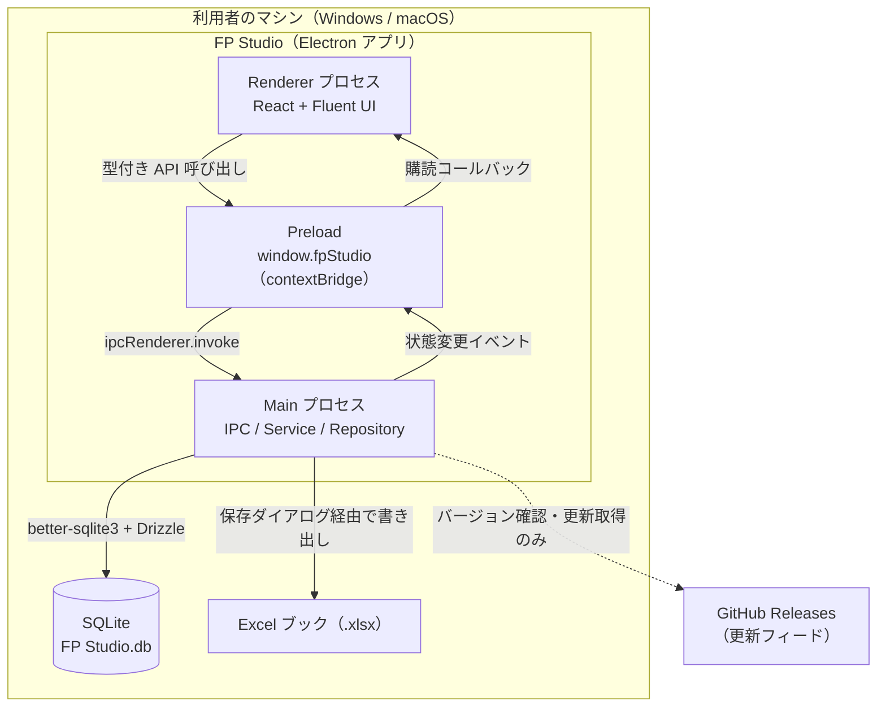
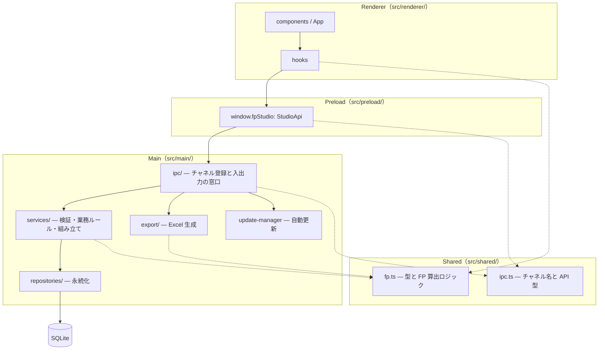
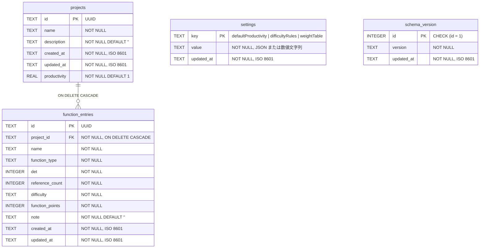

# アーキテクチャ

「どの構造・制約で実現するか、なぜか」を定める文書。開発者と AI エージェントが**常時読む**。利用者に見える動作は [specification.md](specification.md)、目的と目標は [requirements.md](requirements.md) を参照する。現在のモジュール・関数一覧や内部呼び出し順序は保守対象とせず、必要時に現在のコードから確認する。

## 全体構成と境界

Electron の三プロセス構成。1台のマシンで完結し、業務データはローカルの SQLite ファイルから出ない。

データ格納先（`app.getPath('appData')/FP Studio/`）。

| OS | パス |
| :--- | :--- |
| macOS | `~/Library/Application Support/FP Studio/` |
| Windows | `~/AppData/Roaming/FP Studio/` |

同ディレクトリに DB 本体（`FP Studio.db`）とスキーマ移行時のバックアップ（`migration-backups/`）を置く。環境変数 `FP_STUDIO_APP_DATA_PATH` を設定すると格納先を差し替えられる（E2E テストで使用）。

### 不変条件と意図的な不在

このシステムで常に成り立つ約束。

**存在しないもの（意図的な不在）**

- **業務データを送る外部 API 呼び出しは存在しない。** 唯一の外部通信は更新フィードへのバージョン確認とパッケージ取得（[ADR-006](#adr-006-自動アップデートを-electron-updater-と-github-releases-で行う)）
- **難易度ルール・重み表を編集する UI は存在しない。** 復活させないこと（[ADR-007](#adr-007-難易度ルールと重み表を読み取り専用にする)）
- **VAF の計算は存在しない。** 合計は常に UFP（[ADR-002](#adr-002-ufp-のカウントに特化しvaf-を除外する)）
- **ログイン・権限・マルチユーザーは存在しない。** アクターは単一
- **Renderer から SQLite への経路は存在しない。** DB は Main プロセスだけが触る

**計算に関する不変条件**

- **`analyzeFunctionPoint()`（`shared/fp.ts`）が難易度・FP 算出の唯一の正。** 入力中のプレビュー（Renderer）と確定時の保存値（Main）の双方で同じ関数を呼び出し、別の場所で計算を書き直さない
- **例外は Excel 出力の数式だけで、これは意図的な二重実装。** 変更時は必ず両方を同期させる（[ADR-005](#adr-005-excel-出力は値ではなく数式で書き出す)）
- **DET は `<`、参照数は `<=` でバケット判定する。** `DifficultyRule.det` は `[中の開始値, 大の開始値]`、`reference` は `[小の上限, 中の上限]` と意味が違う。ここを揃えてしまうと境界値だけが静かにずれる
- **合計 UFP と概算工数は永続化しない。** 常に機能エントリから導出する。DB に集計値を持たせない
- **`difficulty` と `function_points` は入力値の変更に必ず追随する。** 入力を書き換えたのに派生値が古いまま、という状態を作らない

**データに関する不変条件**

- **プロジェクトを消せば、属する機能も消える**（`ON DELETE CASCADE`）。孤児レコードは存在しない
- **プロジェクト一覧は `updated_at` 降順、機能一覧は `created_at` 降順。** この並び順は仕様であり、機能の追加・編集・削除やプロジェクト更新時には必ず親プロジェクトの `updated_at` を更新する
- **生産性は小数第2位に丸めて保存する。** プロジェクト個別値が無い／非数のときのみ `settings.defaultProductivity` にフォールバックする
- **`settings` テーブルの `difficultyRules` / `weightTable` は JSON 文字列。** 型のスキーマを変えるときは移行と、`settings-parsing.ts` の後方互換の扱いをセットで考える
- **スキーマ移行は既存データを消さない。** 版数が変わるときは全テーブルを JSON へ書き出して `migration-backups/` に保存してから作り直し、トランザクションで戻す

## 責務と依存方向

依存は常に**上から下へ**の一方向。逆流させない。

### 層をまたぐ呼び出しのルール

- **Renderer の境界**: Renderer は Electron の API を直接触らない。外部との接点は `window.fpStudio` だけ。状態・副作用と例外のメッセージ化は `useFpStudioApp`（`runAction`）を単一窓口とし、個々のアクションに `try/catch` を分散させない
- **IPC 層の薄さ**: `ipc/` はチャネル登録と入出力の窓口に徹し、業務ルールと検証は `services/` に置く。唯一の例外は Excel 出力で、OS の保存ダイアログ制御を `ipc/` に置く
- **永続化の隔離**: `services/` は SQL を書かない。永続化は `repositories/` 経由とする。ネイティブバインディングに依存しない設定パース処理だけは `repositories/settings-parsing.ts` へ純粋関数として切り出す
- **Shared の独立性**: `shared/` はどの層からも参照されるが、**どの層にも依存しない**。Electron・React・DB のいずれも import しない
- **機能追加の実装順序**: `shared/fp.ts`（型・ロジック）→ `shared/ipc.ts`（チャネルと API 型）→ `main/ipc/handlers.ts` → `preload/index.ts` → Renderer の hooks / components の順で実装する。型が先に通り、経路の付け忘れを防げる

### 制約の強制手段

| 制約 | 担保方法 |
| :--- | :--- |
| Preload と IPC の入出力契約 | 構造で強制（`shared/ipc.ts` の `StudioApi` 型と TypeScript 型検査） |
| Renderer から Electron API / DB への遮断 | 構造で強制（`contextBridge` による `window.fpStudio` 公開とプロセス分離） |
| TypeScript 算出ロジックと Excel 数式の同期 | テストで強制（`project-excel.test.ts` の数式完全一致アサーション） |
| `shared/` の無依存、`ipc/` の薄さ、`services/` の SQL 禁止、IFPUG 編集 UI の不在 | PR レビューで照合 |

## 設計判断と理由（ADR）

**追記のみのログ。** 一度書いた決定内容は編集しない。決定が変わったら新しい番号の ADR を追記し、新旧の ADR を相互参照する。ADR 番号は決定した順（git 履歴上の実装順）に振っている。

### ADR-001: デスクトップアプリ（Electron）を選ぶ

#### ステータス（Status）

Accepted

#### 意思決定内容（Decision）

Web アプリではなく Electron 製デスクトップアプリとして作る。ビルドは `electron-vite` を使用する。

#### 背景（Context）

見積りデータは秘匿性が高く、インターネット接続なしで扱えることが要件である。かつ Windows / macOS 双方へ配布したい。

#### 影響（Consequences）

配布サイズと起動時間で不利になる。ネイティブモジュール（`better-sqlite3`）の ABI 管理という手間を引き受ける（[ADR-003](#adr-003-永続化は-sqlitebetter-sqlite3--drizzle-orm)）。

#### 他に検討したもの（Alternatives Considered）

- **Web アプリ**: サーバーを置くと業務データが利用者の管理外へ出る。ローカルファイル（SQLite・Excel）への直接アクセスも得られないため却下。
- **OS ネイティブ（WinUI / SwiftUI）**: 2プラットフォーム分の実装を個人開発で維持できないため却下。

### ADR-002: UFP のカウントに特化し、VAF を除外する

#### ステータス（Status）

Accepted

#### 意思決定内容（Decision）

補正係数（VAF）とプロジェクト特性係数を扱わない。合計は UFP のみとする。

#### 背景（Context）

14 項目の補正は学習コストが高く、見積りのスピードを損なう。まず「標準どおりに数えられる」ことに価値を置いた。

#### 影響（Consequences）

自社見積りとの突き合わせは UFP 段階までに限られる。将来 VAF を足す場合も、**UFP の算出ロジックとは独立した掛け算のレイヤー**として組み込み、既存の見積り資産（UFP ベースの記録）に影響を与えないこと。

#### 他に検討したもの（Alternatives Considered）

- **フル FP 対応**: 初回リリースの範囲として大きすぎ、利用者に 14 項目の判断を強いるため却下。

### ADR-003: 永続化は SQLite（better-sqlite3 + Drizzle ORM）

#### ステータス（Status）

Accepted

#### 意思決定内容（Decision）

ローカルの SQLite ファイル 1 つに保存する。ドライバは `better-sqlite3`、クエリ構築は Drizzle ORM を使用する。

#### 背景（Context）

オフライン完結と、プロジェクト／機能の 1 対多を素直に扱えることが必要だった。同期 API のほうが Electron の Main プロセスで扱いやすい。

#### 影響（Consequences）

`better-sqlite3` はネイティブモジュールで、Electron 用にビルドされる（`electron-builder install-app-deps`）。そのため Vitest を動かす Node とは ABI が合わず、**DB クエリ層は単体テストできない**（[検証方針と重点リスク](#検証方針と重点リスク)）。

#### 他に検討したもの（Alternatives Considered）

- **JSON ファイル**: 集計と部分更新のたびに全体を読み書きすることになり、破損時の被害が大きいため却下。
- **クラウド DB**: 要件（オフライン・機密性）と正面から衝突するため却下。

### ADR-004: UI に Fluent UI React Components を使う

#### ステータス（Status）

Accepted

#### 意思決定内容（Decision）

画面は React + `@fluentui/react-components` で作る。

#### 背景（Context）

見積り担当者が業務で使うツールであり、表・フォーム・ダイアログの品質と、キーボード操作・スクリーンリーダー対応が要る。

#### 影響（Consequences）

見た目が Fluent の様式に固定される。デザイントークン（`tokens.*`）に沿わないスタイルは書きづらい。

#### 他に検討したもの（Alternatives Considered）

- **自前コンポーネント**: アクセシビリティを自力で満たすコストが高いため却下。
- **汎用 CSS フレームワーク**: デスクトップアプリらしい情報密度の高い表・ダイアログが不足するため却下。

### ADR-005: Excel 出力は値ではなく数式で書き出す

#### ステータス（Status）

Accepted

#### 意思決定内容（Decision）

難易度・FP・合計を固定値ではなく Excel 数式（`LET` / `INDEX` / `MATCH`）として出力し、難易度ルールと重み表をブックに同梱する。

#### 背景（Context）

出力後に Excel 上で DET を調整して感触を見たい、という使われ方が想定される。値だけを書き出すと、そこから先は標準準拠が保証されない。

#### 影響（Consequences）

**算出ロジックが TypeScript と Excel 数式の 2 箇所に存在する。** 片方だけ直すと静かに食い違う（`AGENTS.md` の Gotchas 参照）。数式は `project-excel.test.ts` の完全一致アサーションで固定し、計算規則を変えるときは必ず両方を直す。

#### 他に検討したもの（Alternatives Considered）

- **計算済みの値のみ出力**: ブックが「そのときのスナップショット」に留まり、編集すると壊れるため却下。

### ADR-006: 自動アップデートを electron-updater と GitHub Releases で行う

#### ステータス（Status）

Accepted

#### 意思決定内容（Decision）

`electron-updater` を使い、更新フィードを GitHub Releases（`neko3cs/FP-Studio`）に置く。

#### 背景（Context）

個人開発で配布インフラを持たずに Windows / macOS へ更新を届けたい。

#### 影響（Consequences）

これが唯一の外部通信になる。**業務データは一切送らない**という境界を保つこと。確認処理で Main プロセスをブロックしない。

#### 他に検討したもの（Alternatives Considered）

- **手動ダウンロード案内のみ**: 更新が行き渡らないため却下。
- **自前の配信サーバー**: 運用負荷に見合わないため却下。

### ADR-007: 難易度ルールと重み表を読み取り専用にする

#### ステータス（Status）

Accepted

#### 意思決定内容（Decision）

難易度ルールと重み表を編集する UI を持たない。設定画面では参照表示のみとする。

#### 背景（Context）

一度は編集 UI を実装したが、Issue #1 で意図的に差し戻した。独自値を許すと「IPA/IFPUG 標準に準拠していること」というプロダクトの中核価値が崩れ、本来解決したかった属人化を自ら持ち込むことになる。

#### 影響（Consequences）

企業独自の重み表を使いたい要求には応えられない。将来マスター管理を入れる場合も、IPA 標準値をデフォルトとして残し、**標準準拠の見積りと企業カスタム値の見積りを区別できる**ことを条件とする。`settings` テーブルは既に `difficultyRules` / `weightTable` を JSON で保持しており、基盤だけは残っている。

#### 他に検討したもの（Alternatives Considered）

- **編集 UI を残す**: 標準準拠と非標準テーラリングが同じ画面に同居し、見積り値がどちらの規則で出たのか判別できなくなるため却下。

### ADR-008: 設計ドキュメントの図を draw.io から Mermaid へ移す

#### ステータス（Status）

Accepted

#### 意思決定内容（Decision）

設計ドキュメントの図はすべて Markdown 内の Mermaid で書く。`.drawio` と書き出し `.png` の運用をやめる。

#### 背景（Context）

draw.io 形式は差分が読めず、図を直すたびに PNG を書き出して 2 ファイルを揃える必要があった。片方だけ更新されて図と説明がずれる。

#### 影響（Consequences）

Mermaid はユースケース図をネイティブに描けないため、フローチャートで代用する。込み入ったレイアウトの細かい制御はできない。

#### 他に検討したもの（Alternatives Considered）

- **draw.io 継続**: レビューで図の変更点を確認できないため却下。
- **画像を手描き**: 更新されなくなるため却下。

### ADR-009: リリースを GitHub Actions で行い、当面はコード署名しない

#### ステータス（Status）

Accepted

#### 意思決定内容（Decision）

`release-*` タグの push を起点に、[Release ワークフロー](../.github/workflows/release.yml) が Windows / macOS / Linux それぞれのランナーでパッケージングし、`electron-builder --publish always` で GitHub Releases の draft に成果物と更新情報（`latest*.yml`・`.blockmap`）を上げる。公開（draft 解除）は手動で行う。コード署名・公証は行わない。

#### 背景（Context）

手動アップロードでは `latest*.yml` が添付されず、[ADR-006](#adr-006-自動アップデートを-electron-updater-と-github-releases-で行う) の自動更新が機能していなかった。`better-sqlite3` はネイティブモジュールのためクロスビルドできず、OS ごとのランナーが必要。署名証明書（Apple Developer Program、Windows のコード署名証明書）は費用がかかるため個人開発の現段階では見送る。

#### 影響（Consequences）

未署名のため、Windows では初回起動時に SmartScreen の警告が出る（自動更新は動く）。macOS では Gatekeeper の許可操作が必要で、**Squirrel.Mac が署名を要求するため自動更新は動かない**。署名を導入するときは新しい ADR を足し、シークレット登録と `mac.notarize` / `win.sign` の設定を追加する。成果物名はスペースを含む `productName` ではなく `name`（`fp-studio`）を使い、GitHub 上のファイル名と `latest*.yml` の URL を一致させる。

#### 他に検討したもの（Alternatives Considered）

- **手動ビルドとアップロードの継続**: 更新情報の添付漏れが起きるため却下。
- **タグ名を electron-builder 既定の `vx.y.z` に変える**: 既存の `release-x.y.z` と並びが崩れる。`tagNamePrefix` で接頭辞を合わせられるため変える理由がない。
- **最初から署名する**: 費用に見合う利用者規模がまだないため却下。

## 永続化・整合性・移行

データの意味・関連は [specification.md](specification.md#データ定義) を参照する。ここでは SQLite の物理構成と整合・移行の方式を定める。

### 物理スキーマ

### 接続・集計・整合性の方針

- **SQLite 設定**: 接続時に `PRAGMA journal_mode = WAL` と `PRAGMA foreign_keys = ON` を有効化する
- **同期 API と単一接続**: `better-sqlite3` は同期呼び出しとし、`StudioService` も同期で統一する（非同期性は IPC 境界のみ）。接続はアプリ起動時に 1 本開き、終了時（`before-quit`）に閉じる。単一プロセス・単一利用者のため接続プールや排他制御は持たない
- **削除の整合性**: プロジェクト削除に伴う子機能の削除は外部キーの `ON DELETE CASCADE` に委ねる
- **アプリ側集計**: SQL に `SUM` を書かず、取得した機能エントリ一覧を `shared/fp.ts` の `buildProjectTotals` へ渡す。算出規則を 1 箇所に集めるための選択であり、想定件数（1 プロジェクトあたり数十〜数百件）では性能上問題にならない
- **設定の安全な読み取り**: `settings` テーブルは KV 形式で保持し、`settings-parsing.ts` の純粋関数でパースする。値が壊れている・欠けている場合は既定値へフォールバックし、設定破損だけでアプリが起動不能になることを防ぐ
- **トランザクション境界**: トランザクションを張るのはスキーマ移行時のデータ復元のみ。通常操作のうち、機能エントリの追加・編集・削除（エントリ更新＋親プロジェクトの `updated_at` 更新）およびプロジェクト複製（親作成＋子機能件数分の挿入）は複数書き込みを順次実行する構造であり、途中失敗時の原子性はトランザクションで保証していない（ローカル単一プロセス前提の割り切り）

### スキーマ移行とバックアップ

起動時に `ensureDatabaseSchema` が以下の順序で移行を行う。

1. 不足テーブルを作成する（`CREATE TABLE IF NOT EXISTS`）
2. `schema_version` テーブルから記録済み版数を読み取る
3. 記録済み版数が現在版数と異なり、かつ「いずれかのデータテーブルに既存行がある」または「版数が記録済みである」場合のみ移行を実行する
4. 移行時は全テーブル（`projects` / `function_entries` / `settings`）を JSON へ書き出し、`migration-backups/migration-backup-<timestamp>.json` に保存する（バックアップは削除しない）
5. 外部キー制約を一時無効化してテーブルを再作成し、単一トランザクション内でデータを復元する（`productivity` が数値として読めない行は `1` に寄せる）
6. `schema_version` を現在版数へ更新する

## 共通実装規約

| 対象 | 規約 |
| :--- | :--- |
| ID | `crypto.randomUUID()` による UUID 文字列 |
| 日時 | ISO 8601 文字列（`new Date().toISOString()`）で保存。DB の型は `TEXT` |
| DB カラム名 | スネークケース（`created_at`）。TypeScript 側はキャメルケース（`createdAt`）とし、Drizzle のスキーマ定義で対応付ける |
| パス操作 | 必ず `path.join()` を使う。区切り文字 `/` を直書きすると Windows 環境のテスト・実行で壊れる（`AGENTS.md` の Gotchas 参照） |
| エラー伝播 | `services/` が日本語メッセージを持つ `Error` を throw し、IPC 越しに Renderer へ伝える。Renderer は `useFpStudioApp` の `runAction` で一元捕捉してメッセージバーに表示し、文面を組み立て直さない |
| 利用者向け文言 | 日本語とする。文面の正は [specification.md](specification.md#エラー通知仕様) とする |
| スタイル | Fluent UI の `makeStyles` と `tokens.*` を使用し、色・余白の直値を書かない |
| 共有型 | Renderer と Main が共有する型は `shared/` に置く。`preload` は `StudioApi` 型に完全に従う |
| テスト名 | `describe` / `it` を日本語の自然文で書き、入れ子の `describe` で機能・操作ごとに束ねて仕様書として読める形にする |

## 非機能の実現方式

各目標の定義は [requirements.md](requirements.md#非機能要件) を参照する。

### 操作性

- 入力中の難易度・FP プレビューを Renderer 内で `shared/fp.ts` から即時算出し、IPC 往復を待たずにフィードバックする
- プロジェクト選択・集計サマリー・機能入力・機能一覧を単一画面に収め、画面遷移なしで連続登録できるようにする

### オフライン完結・機密性

- 業務データの入出力先はローカルの SQLite ファイルと、利用者が保存先を指定した `.xlsx` のみとする
- Renderer は `contextBridge` 経由の `window.fpStudio` しか持たず、Node API を画面へ露出しない
- 外部リンクは `shell.openExternal` で既定ブラウザへ委譲し、アプリ内で別ウィンドウを開かない

### 可搬性

- `electron-builder` で Windows / macOS / Linux 向けにビルドする
- パス操作は `path.join()` を徹底する

### データ保全

- 起動時のスキーマ版数確認と、JSON バックアップを先に出力してからトランザクションで復元する移行手順で既存データを守る（詳細は [永続化・整合性・移行](#スキーマ移行とバックアップ)）

### 見積り精度

- FP 算出ロジックを純粋関数として `shared/fp.ts` に隔離し、単体テストとプロパティベーステスト（`fast-check`）の両方で検証する
- Excel 数式との同期は、生成される数式文字列の完全一致アサーションで固定する

## 検証方針と重点リスク

### 設計文書と検証の対応

| 設計文書 | 検証手段 | 担保範囲 |
| :--- | :--- | :--- |
| [requirements.md](requirements.md) の業務要件 | シナリオテスト（Playwright E2E）＋受け入れテスト（人手確認） | 起動→プロジェクト作成→機能登録→集計→再起動後の永続化までを通しで確認。業務全体の最終判断は人が行う |
| [requirements.md](requirements.md) の非機能要件 | 要件目標を合否条件とする検証 | オフライン動作・永続化・標準精度・配布動作を確認（操作性「10秒以内」は人手確認） |
| [specification.md](specification.md) | インテグレーションテスト（Vitest）＋計算規則の単体・PBT | `services/` の検証・更新規則、`ipc/` の窓口、Excel 出力、UI コンポーネントの表示分岐と操作可否、FP 算出の境界・全組み合わせ |
| [architecture.md](architecture.md) | 構造による強制＋PR レビュー | TypeScript 型検査・プロセス分離・数式完全一致アサーション、および層依存・意図的不在のレビュー |
| 詳細設計（文書にしない） | ユニットテスト（Vitest）＋変異テスト（Stryker） | 純粋ロジック・フック・エラー境界の内部仕様とテスト強度 |

### テストレベルとツール

| レベル | 対象 | ツール |
| :--- | :--- | :--- |
| 単体 | `shared/` の算出ロジック、`services/` の検証と組み立て、`ipc/` の窓口、Renderer の hooks、`repositories/settings-parsing.ts` | Vitest |
| プロパティベース | `analyzeFunctionPoint` の広い入力域にわたる性質 | Vitest + fast-check |
| コンポーネント | Fluent UI コンポーネントの表示分岐と操作可否 | Vitest + Testing Library（jsdom） |
| 変異 | 純粋ロジックのテスト強度 | Stryker |
| E2E（シナリオ） | Electron を実際に起動した通し動作（実 SQLite を含む） | Playwright |

- 閾値と対象ファイル一覧の正は設定ファイルとする（`src/vitest.config.ts` の `coverage.thresholds`、`src/stryker.config.json` の `thresholds`）
- テストケース・手順そのものは文書化せず、テストコードを正とする
- 実行コマンドと品質ゲートの手順は `AGENTS.md` および `test-code` スキルを参照する

### 重点リスクと検証限界

- **DET（`<`）と参照数（`<=`）の非対称境界と Excel 数式同期**: 境界値の 1 ずれと TypeScript／Excel 数式の乖離が最大の品質リスク。単体・PBT で全 Function Type × 境界両側を検証し、Excel 側は `project-excel.test.ts` の数式文字列完全一致アサーションで同期を担保する
- **DB クエリ層の単体テスト不可**: `better-sqlite3` が Electron 用 ABI でビルドされており、Vitest を動かす Node と ABI が合わないため（[ADR-003](#adr-003-永続化は-sqlitebetter-sqlite3--drizzle-orm)）、実 SQLite を通るクエリ・外部キー削除・スキーマ移行は Playwright E2E に委ねる。純粋な設定パース処理だけは `repositories/settings-parsing.ts` へ切り出し、単体・変異テストでカバーする
- **変異テストの対象外**: Fluent UI コンポーネントと Excel ブック組み立てはカバレッジ計測には含めるが変異対象からは外す（レイアウトや書式の変異が意味のある生存変異体にならないため）
- **E2E の OS 範囲**: CI の E2E は Windows / macOS のみで実行しており、Linux での Electron 通し動作は CI で自動検証していない
- **自動更新の実配信検証**: GitHub Releases を介した実際のアップデート適用（ダウンロード〜再起動）はローカル・CI の自動テスト対象外であり、リリース時の draft 検証と実機確認に依存する
- **操作性目標の計測**: 「1つの機能を 10 秒以内に追加できる」という非機能目標を自動計測する仕組みは無く、人手確認とする

### CI での実行

[Tests ワークフロー](../.github/workflows/test.yml) は、PR の作成・更新、`main` への push、手動実行（`workflow_dispatch`）、Release ワークフローからの呼び出し（`workflow_call`）を起点とする。ローカルの検証と同じスクリプトを使用し、独立した検証にはジョブ間の依存を設けず、以下の 10 ジョブを並列に実行する。

| ジョブ | 環境 | 検証内容 |
| :--- | :--- | :--- |
| format / lint / typecheck / pbt（4ジョブ） | Ubuntu 24.04 | 書式、静的解析、型、PBT |
| unit（3ジョブ） | Ubuntu 24.04 / Windows 2025 / macOS 15 | 全単体テストとカバレッジ（PBT を含む） |
| mutation（1ジョブ） | Ubuntu 24.04 | 純粋ロジックの変異テスト。ジョブ内は 2 ワーカー |
| e2e（2ジョブ） | Windows 2025 / macOS 15 | フルビルドと Electron の通し動作（実 SQLite を含む） |

- **失敗しても他の検証結果を収集する。** matrix の `fail-fast` は無効。同じブランチの新しい実行が始まった場合は古い実行をキャンセルし、更新前の検証にランナーを使い続けない
- **環境を揃え、ネイティブ依存を混在させない。** 共通の [セットアップ Action](../.github/actions/setup/action.yml) で Node.js を固定し、`package.json` の `packageManager` に指定した pnpm とロックファイルで復元する。キャッシュは pnpm ストアに限定し、OS と Electron ABI に依存する `node_modules` はジョブ間で共有しない
- **取得時間を E2E のテスト時間に含めない。** Electron バイナリは最初のテストより前に取得し、ネイティブ依存を Electron 向けに再構築してからビルド・テストする
- **書式検査はファイルを書き換えない。** アプリと `.github/` を検査し、カバレッジ・変異レポート・E2E 結果・Stryker の一時ファイルは除外する
- **合否の基準はローカルと共通。** カバレッジと変異スコアは既存の設定ファイルに従う。全単体テストはカバレッジ計測時に実行し、同じジョブで重複実行しない
- **失敗を調査できる成果物を残す。** カバレッジ、変異レポート、E2E 結果（失敗時の trace を含む）は失敗時もアップロードを試み、7 日間保存する
- **実行権限を限定する。** 標準の GitHub ホストランナーを使用し、権限は `contents: read`、外部 Actions はコミット SHA に固定する

実行コマンドと結果の確認方法は [AGENTS.md](../AGENTS.md#commands) を参照する。ジョブ構成、ランナー、バージョン、タイムアウト、保存期間の正はワークフローと共通セットアップ Action とする。
