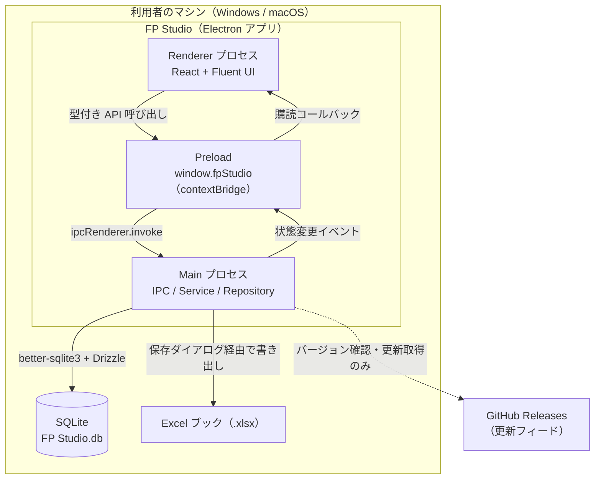
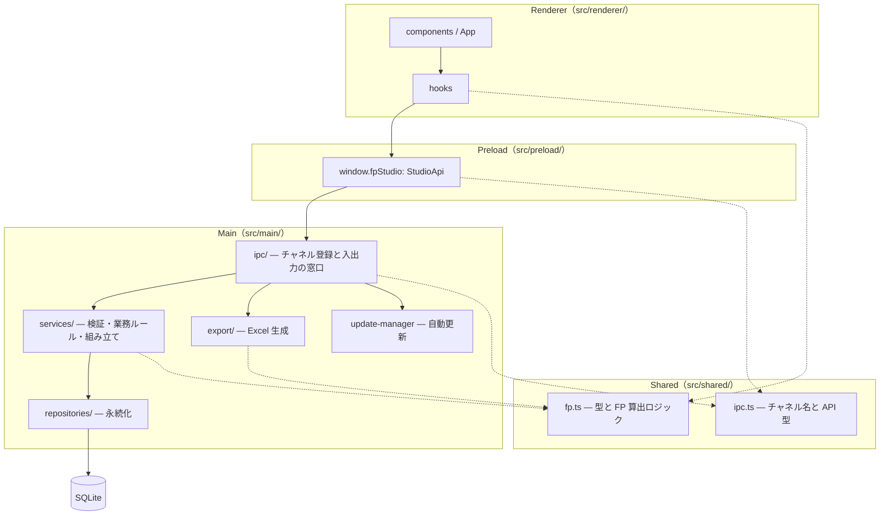

# アーキテクチャ

「どの構造・制約で実現するか、なぜか」を定める文書。開発者と AI エージェントが**常時読む**。全体方針に加え、機能固有でも守るべき責務・制約・設計理由を置く。

利用者に見える動作は [specification.md](specification.md)、目的と受け入れ基準は [requirements.md](requirements.md)、テストの範囲・環境・品質ゲート・重点リスクは [tests.md](tests.md) に書く。**現在のクラス・関数の一覧や内部の呼び出し順序はこの文書に書かない。** 必要になったら、その時点のコードを読んで説明する（[ADR-010](#adr-010-詳細設計書を廃止し内部構造は必要時にコードから説明する)）。

## 全体構成と境界

Electron の三プロセス構成。1台のマシンで完結し、業務データはローカルの SQLite ファイルから出ない。

データ格納先（`app.getPath('appData')/FP Studio/`）。

| OS | パス |
| :--- | :--- |
| macOS | `~/Library/Application Support/FP Studio/` |
| Windows | `~/AppData/Roaming/FP Studio/` |

同ディレクトリに DB 本体（`FP Studio.db`）とスキーマ移行時のバックアップ（`migration-backups/`）を置く。環境変数 `FP_STUDIO_APP_DATA_PATH` を設定すると格納先を差し替えられる（E2E テストで使用）。

### 不変条件・境界

このシステムで常に成り立つ約束。

**存在しないもの（意図的な不在）**

- **業務データを送る外部 API 呼び出しは存在しない。** 唯一の外部通信は更新フィードへのバージョン確認とパッケージ取得（[ADR-006](#adr-006-自動アップデートを-electron-updater-と-github-releases-で行う)）
- **難易度ルール・重み表を編集する UI は存在しない。** 復活させないこと（[ADR-007](#adr-007-難易度ルールと重み表を読み取り専用にする)）
- **VAF の計算は存在しない。** 合計は常に UFP（[ADR-002](#adr-002-ufp-のカウントに特化しvaf-を除外する)）
- **ログイン・権限・マルチユーザーは存在しない。** アクターは単一
- **Renderer から SQLite への経路は存在しない。** DB は Main プロセスだけが触る

**計算に関する不変条件**

- **`analyzeFunctionPoint()`（`shared/fp.ts`）が難易度・FP 算出の唯一の正。** 同じ計算を別の場所で書き直さない
- **例外は Excel 出力の数式だけで、これは意図的な二重実装。** 変更時は必ず両方を同期させる（[ADR-005](#adr-005-excel-出力は値ではなく数式で書き出す)）
- **DET は `<`、参照数は `<=` でバケット判定する。** `DifficultyRule.det` は `[中の開始値, 大の開始値]`、`reference` は `[小の上限, 中の上限]` と意味が違う。ここを揃えてしまうと境界値だけが静かにずれる
- **合計 UFP と概算工数は永続化しない。** 常に機能エントリから導出する。DB に集計値を持たせない
- **`difficulty` と `function_points` は入力値の変更に必ず追随する。** 入力を書き換えたのに派生値が古いまま、という状態を作らない

**データに関する不変条件**

- **プロジェクトを消せば、属する機能も消える**（`ON DELETE CASCADE`）。孤児レコードは存在しない
- **プロジェクト一覧は `updated_at` 降順、機能一覧は `created_at` 降順。** この並び順は仕様であり、実装都合で変えない
- **生産性は小数第2位に丸めて保存する。** プロジェクト個別値が無い／非数のときのみ `settings.defaultProductivity` にフォールバックする
- **`settings` テーブルの `difficultyRules` / `weightTable` は JSON 文字列。** 型のスキーマを変えるときは移行と、`settings-parsing.ts` の後方互換の扱いをセットで考える
- **スキーマ移行は既存データを消さない。** 版数が変わるときは全テーブルを JSON へ書き出して `migration-backups/` に保存してから作り直し、トランザクションで戻す

## 責務と依存方向

依存は常に**上から下へ**の一方向。逆流させない。

**層をまたぐ呼び出しのルール**

- Renderer は Electron の API を直接触らない。外部との接点は `window.fpStudio` だけ
- `ipc/` は薄く保つ。業務ルールと検証は `services/` に置く
- `services/` は SQL を書かない。永続化は `repositories/` 経由
- `shared/` はどの層からも参照されるが、**どの層にも依存しない**。Electron・React・DB のいずれも import しない
- 新しい機能は `shared/fp.ts`（型・ロジック）→ `shared/ipc.ts`（チャネルと API 型）→ `main/ipc/handlers.ts` → `preload/index.ts` → Renderer の hooks / components の順で実装する。この順序を守ると型が先に通り、経路の付け忘れが起きない

### 責務の分担

別の実装へ置き換えても守る分担。現在のメソッド・フックの一覧はコードを参照する。

**Main プロセス**

| 責務 | 置き場所 | 守ること |
| :--- | :--- | :--- |
| チャネルの窓口 | `ipc/` | 業務ルールを持たず、`services/` へ渡すだけにする。**唯一の例外が Excel 出力**で、保存ダイアログの表示・キャンセル判定・ファイル書き込みをここで行う |
| 入力検証・派生値の確定・集計つき結果の組み立て | `services/` | 検証はすべて保存より前に終える。難易度・FP は `shared/fp.ts` に算出させ、ここで確定してから保存を依頼する。機能を操作したら必ずプロジェクトの更新日時も更新する |
| 永続化 | `repositories/` | SQL と ORM の知識をここに閉じる。業務上の判断をしない |
| 設定値の解析 | `repositories/settings-parsing.ts` | ネイティブ依存を持たない純粋関数にする（[tests.md](tests.md#テストスコープ)） |
| 難易度・FP の算出と集計 | `shared/fp.ts` | どの層にも依存しない純粋関数。算出の唯一の正 |
| Excel ブックの生成 | `export/` | `shared/fp.ts` と同じ規則を Excel 数式として書き出す、意図的な二重実装（[ADR-005](#adr-005-excel-出力は値ではなく数式で書き出す)）。ファイルの保存先を知らない |
| 自動更新 | `update-manager` | アップデート状態を1箇所で保持し、変化のたびに全ウィンドウへ通知する。業務データに触れない |

- **業務用の IPC チャネルは、登録の前に必ず解除する。** 多重登録を防ぐため、プロジェクト・機能・設定・Excel 出力の全チャネルについて解除してから登録する。アップデート用のチャネルは解除せずに登録しており、再登録を想定していない

**Renderer**

| 責務 | 守ること |
| :--- | :--- |
| アプリ全体の状態と副作用 | プロジェクト一覧・選択中プロジェクト・設定・アップデート状態の保持と、`window.fpStudio` の呼び出しを1つのフック（`useFpStudioApp`）に集約する。コンポーネントから `window.fpStudio` を直接呼ばない |
| フォームの入力状態 | フォームごとの専用フックに分ける。入力値・プレビュー・送信可否・編集モードはフォーム側のフックが持ち、保存はアプリ全体のフックへ委ねる |
| ビューの切り替えとレイアウト | `App` が担う。業務上の状態を持たない |
| 想定外の例外 | 描画中の想定外の例外は `RendererErrorBoundary` が受け止め、画面全体が白くなる代わりに再読み込みできる表示へ切り替える |

- **プロジェクトと機能に対する操作の実行は、単一の窓口（`runAction`）を通す。** 処理中フラグを立てる、直前のエラー表示を消す、例外を捕捉してメッセージへ変換する、処理中フラグを下ろす、の4つをここに集約する。個々の操作で try/catch を書かない（利用者から見た動作は [specification.md](specification.md#処理中の操作可否とエラー表示)）。アップデートの確認・インストールと起動時の初期読み込みは、この窓口を通らない。アップデートの結果はアップデート状態として通知カードへ、初期読み込みの失敗はメッセージバーへ出す
- **入力中のプレビューと保存時の確定に同じ関数（`analyzeFunctionPoint`）を使う。** 入力中は Renderer 内でプレビューだけを算出し、確定時に Main 側で改めて算出して保存する。プレビュー用の計算を別に書かないことで、表示と保存値の二重管理を避ける。プレビューにも保存時にも、設定に保持された規則・重みを渡す

### 制約の強制手段

| 制約 | 担保方法 |
| :--- | :--- |
| Preload と IPC の入出力契約 | 構造で強制（`shared/ipc.ts` の `StudioApi` 型と TypeScript 型検査） |
| Renderer から Electron API / DB への遮断 | 構造で強制（`contextBridge` による `window.fpStudio` 公開とプロセス分離） |
| TypeScript 算出ロジックと Excel 数式の同期 | テストで強制（`project-excel.test.ts` の数式完全一致アサーション） |
| `shared/` の無依存、`ipc/` の薄さ、`services/` の SQL 禁止、IFPUG 編集 UI の不在 | PR レビューで照合 |

## 設計判断と理由（ADR）

**追記のみのログ。** 一度書いた決定内容は編集しない。決定が変わったら新しい番号の ADR を追記し、新旧の ADR を相互参照する。ADR 番号は決定した順（git 履歴上の実装順）に振っている。

### ADR-001: デスクトップアプリ（Electron）を選ぶ

#### ステータス（Status）

Accepted

#### 意思決定内容（Decision）

Web アプリではなく Electron 製デスクトップアプリとして作る。ビルドは `electron-vite` を使用する。

#### 背景（Context）

見積りデータは秘匿性が高く、インターネット接続なしで扱えることが要件である。かつ Windows / macOS 双方へ配布したい。

#### 影響（Consequences）

配布サイズと起動時間で不利になる。ネイティブモジュール（`better-sqlite3`）の ABI 管理という手間を引き受ける（[ADR-003](#adr-003-永続化は-sqlitebetter-sqlite3--drizzle-orm)）。

#### 他に検討したもの（Alternatives Considered）

- **Web アプリ**: サーバーを置くと業務データが利用者の管理外へ出る。ローカルファイル（SQLite・Excel）への直接アクセスも得られないため却下。
- **OS ネイティブ（WinUI / SwiftUI）**: 2プラットフォーム分の実装を個人開発で維持できないため却下。

### ADR-002: UFP のカウントに特化し、VAF を除外する

#### ステータス（Status）

Accepted

#### 意思決定内容（Decision）

補正係数（VAF）とプロジェクト特性係数を扱わない。合計は UFP のみとする。

#### 背景（Context）

14 項目の補正は学習コストが高く、見積りのスピードを損なう。まず「標準どおりに数えられる」ことに価値を置いた。

#### 影響（Consequences）

自社見積りとの突き合わせは UFP 段階までに限られる。将来 VAF を足す場合も、**UFP の算出ロジックとは独立した掛け算のレイヤー**として組み込み、既存の見積り資産（UFP ベースの記録）に影響を与えないこと。

#### 他に検討したもの（Alternatives Considered）

- **フル FP 対応**: 初回リリースの範囲として大きすぎ、利用者に 14 項目の判断を強いるため却下。

### ADR-003: 永続化は SQLite（better-sqlite3 + Drizzle ORM）

#### ステータス（Status）

Accepted

#### 意思決定内容（Decision）

ローカルの SQLite ファイル 1 つに保存する。ドライバは `better-sqlite3`、クエリ構築は Drizzle ORM を使用する。

#### 背景（Context）

オフライン完結と、プロジェクト／機能の 1 対多を素直に扱えることが必要だった。同期 API のほうが Electron の Main プロセスで扱いやすい。

#### 影響（Consequences）

`better-sqlite3` はネイティブモジュールで、Electron 用にビルドされる（`electron-builder install-app-deps`）。そのため Vitest を動かす Node とは ABI が合わず、**DB クエリ層は単体テストできない**（[tests.md](tests.md#テストスコープ)）。

#### 他に検討したもの（Alternatives Considered）

- **JSON ファイル**: 集計と部分更新のたびに全体を読み書きすることになり、破損時の被害が大きいため却下。
- **クラウド DB**: 要件（オフライン・機密性）と正面から衝突するため却下。

### ADR-004: UI に Fluent UI React Components を使う

#### ステータス（Status）

Accepted

#### 意思決定内容（Decision）

画面は React + `@fluentui/react-components` で作る。

#### 背景（Context）

見積り担当者が業務で使うツールであり、表・フォーム・ダイアログの品質と、キーボード操作・スクリーンリーダー対応が要る。

#### 影響（Consequences）

見た目が Fluent の様式に固定される。デザイントークン（`tokens.*`）に沿わないスタイルは書きづらい。

#### 他に検討したもの（Alternatives Considered）

- **自前コンポーネント**: アクセシビリティを自力で満たすコストが高いため却下。
- **汎用 CSS フレームワーク**: デスクトップアプリらしい情報密度の高い表・ダイアログが不足するため却下。

### ADR-005: Excel 出力は値ではなく数式で書き出す

#### ステータス（Status）

Accepted

#### 意思決定内容（Decision）

難易度・FP・合計を固定値ではなく Excel 数式（`LET` / `INDEX` / `MATCH`）として出力し、難易度ルールと重み表をブックに同梱する。

#### 背景（Context）

出力後に Excel 上で DET を調整して感触を見たい、という使われ方が想定される。値だけを書き出すと、そこから先は標準準拠が保証されない。

#### 影響（Consequences）

**算出ロジックが TypeScript と Excel 数式の 2 箇所に存在する。** 片方だけ直すと静かに食い違う（`AGENTS.md` の Gotchas 参照）。数式は `project-excel.test.ts` の完全一致アサーションで固定し、計算規則を変えるときは必ず両方を直す。

#### 他に検討したもの（Alternatives Considered）

- **計算済みの値のみ出力**: ブックが「そのときのスナップショット」に留まり、編集すると壊れるため却下。

### ADR-006: 自動アップデートを electron-updater と GitHub Releases で行う

#### ステータス（Status）

Accepted

#### 意思決定内容（Decision）

`electron-updater` を使い、更新フィードを GitHub Releases（`neko3cs/FP-Studio`）に置く。

#### 背景（Context）

個人開発で配布インフラを持たずに Windows / macOS へ更新を届けたい。

#### 影響（Consequences）

これが唯一の外部通信になる。**業務データは一切送らない**という境界を保つこと。確認処理で Main プロセスをブロックしない。

#### 他に検討したもの（Alternatives Considered）

- **手動ダウンロード案内のみ**: 更新が行き渡らないため却下。
- **自前の配信サーバー**: 運用負荷に見合わないため却下。

### ADR-007: 難易度ルールと重み表を読み取り専用にする

#### ステータス（Status）

Accepted

#### 意思決定内容（Decision）

難易度ルールと重み表を編集する UI を持たない。設定画面では参照表示のみとする。

#### 背景（Context）

一度は編集 UI を実装したが、Issue #1 で意図的に差し戻した。独自値を許すと「IPA/IFPUG 標準に準拠していること」というプロダクトの中核価値が崩れ、本来解決したかった属人化を自ら持ち込むことになる。

#### 影響（Consequences）

企業独自の重み表を使いたい要求には応えられない。将来マスター管理を入れる場合も、IPA 標準値をデフォルトとして残し、**標準準拠の見積りと企業カスタム値の見積りを区別できる**ことを条件とする。`settings` テーブルは既に `difficultyRules` / `weightTable` を JSON で保持しており、基盤だけは残っている。

#### 他に検討したもの（Alternatives Considered）

- **編集 UI を残す**: 標準準拠と非標準テーラリングが同じ画面に同居し、見積り値がどちらの規則で出たのか判別できなくなるため却下。

### ADR-008: 設計ドキュメントの図を draw.io から Mermaid へ移す

#### ステータス（Status）

Accepted

#### 意思決定内容（Decision）

設計ドキュメントの図はすべて Markdown 内の Mermaid で書く。`.drawio` と書き出し `.png` の運用をやめる。

#### 背景（Context）

draw.io 形式は差分が読めず、図を直すたびに PNG を書き出して 2 ファイルを揃える必要があった。片方だけ更新されて図と説明がずれる。

#### 影響（Consequences）

Mermaid はユースケース図をネイティブに描けないため、フローチャートで代用する。込み入ったレイアウトの細かい制御はできない。

#### 他に検討したもの（Alternatives Considered）

- **draw.io 継続**: レビューで図の変更点を確認できないため却下。
- **画像を手描き**: 更新されなくなるため却下。

### ADR-009: リリースを GitHub Actions で行い、当面はコード署名しない

#### ステータス（Status）

Accepted

#### 意思決定内容（Decision）

`release-*` タグの push を起点に、[Release ワークフロー](../.github/workflows/release.yml) が Windows / macOS / Linux それぞれのランナーでパッケージングし、`electron-builder --publish always` で GitHub Releases の draft に成果物と更新情報（`latest*.yml`・`.blockmap`）を上げる。公開（draft 解除）は手動で行う。コード署名・公証は行わない。

#### 背景（Context）

手動アップロードでは `latest*.yml` が添付されず、[ADR-006](#adr-006-自動アップデートを-electron-updater-と-github-releases-で行う) の自動更新が機能していなかった。`better-sqlite3` はネイティブモジュールのためクロスビルドできず、OS ごとのランナーが必要。署名証明書（Apple Developer Program、Windows のコード署名証明書）は費用がかかるため個人開発の現段階では見送る。

#### 影響（Consequences）

未署名のため、Windows では初回起動時に SmartScreen の警告が出る（自動更新は動く）。macOS では Gatekeeper の許可操作が必要で、**Squirrel.Mac が署名を要求するため自動更新は動かない**。署名を導入するときは新しい ADR を足し、シークレット登録と `mac.notarize` / `win.sign` の設定を追加する。成果物名はスペースを含む `productName` ではなく `name`（`fp-studio`）を使い、GitHub 上のファイル名と `latest*.yml` の URL を一致させる。

#### 他に検討したもの（Alternatives Considered）

- **手動ビルドとアップロードの継続**: 更新情報の添付漏れが起きるため却下。
- **タグ名を electron-builder 既定の `vx.y.z` に変える**: 既存の `release-x.y.z` と並びが崩れる。`tagNamePrefix` で接頭辞を合わせられるため変える理由がない。
- **最初から署名する**: 費用に見合う利用者規模がまだないため却下。

### ADR-010: 詳細設計書を廃止し、内部構造は必要時にコードから説明する

#### ステータス（Status）

Accepted

#### 意思決定内容（Decision）

詳細設計書（`docs/design.md`）を廃止し、設計文書を `requirements.md` / `specification.md` / `architecture.md` の3つにする。情報は更新頻度ではなく性質で分ける。利用者に見える動作・データ・入出力は仕様へ、責務の分担・依存の制約・設計理由・検証上の知識はアーキテクチャへ置く。現在のメソッド一覧・フック一覧、関数呼び出しを逐次追うシーケンス図、Excel ブックの内部組み立て順は保守対象の文書に持たず、必要になった時点のコードを読んで説明する。

#### 背景（Context）

詳細設計書には、現在の内部構造の写しと、仕様・設計判断・検証上の知識が混在していた。構造の写しは実装のたびに古くなり、アップデートの状態遷移の説明など、コードと食い違う記述がすでに生じていた。一方で、同じ文書にしか無い約束と理由（Excel 数式との同期、更新日時を必ず更新する理由、設定の復旧、スキーマ移行の手順、機能ごとのテスト観点）があり、文書ごと捨てることはできなかった。

#### 影響（Consequences）

- 常設の構造説明を保守する負担が無くなる。内部構造の説明は、対象コミットと確認範囲を添えた参考説明として都度作り、設計文書には加えない
- 設計の理由はコードから読み取れない。責務・制約・理由は、機能固有のものでもこの文書に書き続ける必要がある
- 利用者に見える動作を変えるときは仕様を、責務・制約・検証方針を変えるときはこの文書を更新する。更新先に迷う記述は、達成目標・期待動作・実現方式のどれを決めているかで分ける

#### 他に検討したもの（Alternatives Considered）

- **詳細設計書をそのまま削除する** — 更新日時の意図、Excel 出力の約束、設定の復旧、検証上のリスクが失われる
- **全文を `architecture.md` へ連結する** — 仕様と内部説明の混在が残る
- **古い詳細設計書を参考資料として残す** — すでに状態遷移の説明に食い違いがあり、古い前提で読まれる危険が残る

設計文書を3つとした部分は [ADR-011](#adr-011-テスト計画を-testsmd-として独立させる) で4つに改めた。

### ADR-011: テスト計画を tests.md として独立させる

#### ステータス（Status）

Accepted

#### 意思決定内容（Decision）

テストスコープ・テストレベルと使用ツール・テスト環境と外部境界・品質ゲートと基準・終了条件・重点リスクと検証限界を、常設のテスト計画 [tests.md](tests.md) にまとめる。設計文書は `requirements.md` / `specification.md` / `architecture.md` / `tests.md` の4つになる。この文書の「検証方針と重点リスク」の節（CI での実行を含む）は `tests.md` へ移し、この文書には構造による強制の手段（[制約の強制手段](#制約の強制手段)）だけを残す。テストケースそのものは引き続き文書化せず、テストコードを正とする。[ADR-010](#adr-010-詳細設計書を廃止し内部構造は必要時にコードから説明する) のうち、設計文書を3つとした部分をこの ADR で改める。

#### 背景（Context）

設計文書の作成手順（design スキル）が、テスト計画を4つ目の設計文書として扱う方針に改まった。この文書は「どの構造・制約で実現するか、なぜか」に答えるものだが、検証の範囲・環境・合否基準・CI の構成までを抱えており、構造の判断と検証計画が同じ文書に混在していた。

#### 影響（Consequences）

- 検証方針・品質ゲート・CI の構成を変えるときは `tests.md` を更新する。この文書は構造・制約・設計理由の変更時だけ更新すればよくなる
- 「CI での実行」の参照先が `tests.md` に移る。`AGENTS.md` と `src/README.md` の参照も `tests.md` へ向け直す必要がある
- 閾値・対象ファイル・ジョブ構成の正は引き続き設定ファイルとワークフローであり、`tests.md` はそれを参照する

#### 他に検討したもの（Alternatives Considered）

- **この文書に検証方針を残す** — 構造の判断と検証計画の混在が続き、検証だけを変える変更でもこの文書を読み直す必要がある
- **テストケースまで文書化する** — テストコードの写しになり保守できない。ケースはテストコードを正とする方針（[ADR-010](#adr-010-詳細設計書を廃止し内部構造は必要時にコードから説明する)）を変えない

## 永続化・整合性・移行

データの意味と利用者から見た結果は [specification.md](specification.md#データ定義) および「業務ルール」を参照。ここには保存方式と、その理由を置く。

### 物理スキーマ

SQLite のファイル1つに4テーブルを置く。接続時に WAL モードと外部キー制約を有効にする。外部キー制約を有効にしないと `ON DELETE CASCADE` が働かない。

| テーブル | カラム | 型・制約 |
| :--- | :--- | :--- |
| `projects` | `id` | `TEXT` 主キー（UUID） |
| | `name` | `TEXT NOT NULL` |
| | `description` | `TEXT NOT NULL DEFAULT ''` |
| | `created_at` / `updated_at` | `TEXT NOT NULL`（ISO 8601） |
| | `productivity` | `REAL NOT NULL DEFAULT 1` |
| `function_entries` | `id` | `TEXT` 主キー（UUID） |
| | `project_id` | `TEXT NOT NULL`、`projects(id)` への外部キー、`ON DELETE CASCADE` |
| | `name` | `TEXT NOT NULL` |
| | `function_type` | `TEXT NOT NULL`（`EI` / `EO` / `EQ` / `ILF` / `EIF`） |
| | `det` / `reference_count` | `INTEGER NOT NULL` |
| | `difficulty` | `TEXT NOT NULL`（`Low` / `Average` / `High`） |
| | `function_points` | `INTEGER NOT NULL` |
| | `note` | `TEXT NOT NULL DEFAULT ''` |
| | `created_at` / `updated_at` | `TEXT NOT NULL`（ISO 8601） |
| `settings` | `key` | `TEXT` 主キー（`defaultProductivity` / `difficultyRules` / `weightTable`） |
| | `value` | `TEXT NOT NULL`。数値の文字列表現、または JSON 文字列 |
| | `updated_at` | `TEXT NOT NULL`（ISO 8601） |
| `schema_version` | `id` | `INTEGER` 主キー。常に `1`（1行だけを許す） |
| | `version` | `TEXT NOT NULL`。スキーマ版数 |
| | `updated_at` | `TEXT NOT NULL`（ISO 8601） |

機能種別・難易度の区分と、DET・参照数の下限はアプリ側（型と `services/` の検証）で守る。DB の CHECK 制約にはしていない。

### アクセスの方針

- **同期 API を使う。** `better-sqlite3` は同期呼び出しで、`services/` も同期で書く。IPC の窓口だけが非同期の形をとる。Renderer から見た非同期性は IPC 由来であって、DB 由来ではない
- **接続はアプリ起動時に1本開き、終了時に閉じる。** 単一プロセス・単一利用者のため、接続プールも排他制御も持たない
- **プロジェクト削除は外部キーの `ON DELETE CASCADE` に任せる。** 機能を個別に消す処理を重ねて書かない
- **集計はアプリ側で行う。** SQL に `SUM` を書かず、取得した機能の一覧を `shared/fp.ts` の集計関数へ渡す。算出規則を `shared/fp.ts` の1箇所に集めるための意図的な選択で、想定件数（1プロジェクトあたり数十〜数百件）ではこれで十分。件数の前提が変わったら見直す
- **設定はキーと値のテーブルから読み、型のある設定へ組み立てる。** 値が JSON として壊れている・欠けている・型が違う場合は既定値へフォールバックし、例外にしない。設定が読めないだけでアプリが起動不能になることを避けるため
- **難易度ルールと重みの形の検証と、標準値での補完は `shared/fp.ts` の1箇所に置く。** 設定の読み取り・難易度と FP の算出・Excel に同梱する表の3箇所が同じ関数を使う。読み取った設定は、全 Function Type・全難易度がそろった補完後の値として返す。補完の規則が場所ごとに食い違うと、設定ビューの表示・算出結果・Excel の表が一致しなくなるため

### トランザクションと整合性

- **1つの操作に伴う書き込みは、1つのトランザクションにまとめる。** プロジェクトの複製（プロジェクト1行と機能の全行）、機能の追加・編集・削除（機能の行とプロジェクトの更新日時）が複数の書き込みを伴う。途中で失敗したら、その操作の書き込みをすべて取り消す。複製の途中で失敗して、機能の欠けたプロジェクトが残ることを防ぐため
- トランザクションの開始と終了は `repositories/` が提供し、`services/` は1操作分の書き込みをその中で行う。`services/` が SQL を書かないという分担は変えない。同期 API のため、トランザクションの中で非同期処理を挟まない
- スキーマ移行時のデータ復元も1つのトランザクションで行う（[スキーマ移行](#スキーマ移行)）

### スキーマ移行

起動時に次の順で行う。**既存データを消さないこと**を最優先にした順序である。

1. テーブルが無ければ作る
2. 記録されたスキーマ版数を読む
3. 移行の要否を決める。版数が現在値と同じなら行わない。異なる場合は、データが1行でもあるか、版数が記録済みであるときだけ行う（初回起動の空の DB では行わない）
4. 移行する場合は、全テーブルの全行を読み出し、`migration-backups/migration-backup-<タイムスタンプ>.json` として書き出す。**バックアップを書き終えてからテーブルを触る**
5. テーブルを削除して作り直し、読み出した行を1つのトランザクションで戻す。途中で失敗したら戻した分はすべて取り消される
6. 現在の版数を記録する

- バックアップファイルは消さない
- テーブルの削除と作り直しはトランザクションの外にある。復元に失敗した場合に自動で元へ戻す仕組みは無く、バックアップファイルが復旧の手段になる
- 旧データから値を読み替える規則（生産性が数値として読めない行の扱い）は [specification.md](specification.md#旧形式データの引き継ぎ) を参照

## 共通実装規約

| 対象 | 規約 |
| :--- | :--- |
| ID | `crypto.randomUUID()` による UUID 文字列 |
| 日時 | ISO 8601 文字列（`new Date().toISOString()`）で保存。DB の型は `TEXT` |
| DB カラム名 | スネークケース（`created_at`）。TypeScript 側はキャメルケース（`createdAt`）で、Drizzle のスキーマ定義が対応付ける |
| パス操作 | 必ず `path.join()` を使う。区切り文字 `/` を直書きすると Windows 環境のテスト・実行で壊れる（`AGENTS.md` の Gotchas 参照） |
| エラー伝播 | `services/` が日本語のメッセージを持つ `Error` を throw する。IPC 越しに Renderer へ伝わり、`useFpStudioApp` の `runAction` が捕捉してメッセージバーに出す。Renderer 側でメッセージを組み立て直さない |
| 利用者向け文言 | 日本語とする。文面の正は [specification.md](specification.md#エラー通知仕様) とする |
| スタイル | Fluent UI の `makeStyles` と `tokens.*`。色・余白の直値を書かない |
| 共有型 | Renderer と Main が共有する型は `shared/` に置く。`preload` は `StudioApi` 型に完全に従う |
| テスト名 | `describe` / `it` をすべて日本語の自然文で書き、入れ子の `describe` で機能・操作ごとに束ねる。テストスイートが仕様書として読めることを狙っている |

## 非機能の実現方式

各目標の定義は [requirements.md](requirements.md#非機能要件) を参照する。

### 操作性

- 入力中の難易度・FP プレビューを Renderer 内で `shared/fp.ts` から即時算出し、IPC 往復を待たずにフィードバックする
- プロジェクト選択・集計サマリー・機能入力・機能一覧を単一画面に収め、画面遷移なしで連続登録できるようにする

### オフライン完結・機密性

- 業務データの入出力先はローカルの SQLite ファイルと、利用者が保存先を指定した .xlsx のみ
- Renderer は `contextBridge` 経由の `window.fpStudio` しか持たない。Node の API を画面へ直接露出しない
- 外部リンクは既定ブラウザへ委譲し、アプリ内で別ウィンドウを開かない

### 可搬性

- `electron-builder` で要件対象の Windows / macOS 向けにビルドする。Linux（AppImage）向けビルドは要件外のベストエフォート配布として提供する
- パス操作は必ず `path.join()` を使う。区切り文字を直書きするとテストごと Windows で落ちる（`AGENTS.md` の Gotchas 参照）

### データ保全

- スキーマが変わっても既存データを引き継ぐ。移行の要否の判定、バックアップを先に書く手順、その限界は「永続化・整合性・移行」の [スキーマ移行](#スキーマ移行) を参照

### 見積り精度

- FP 算出ロジックは純粋関数として `shared/fp.ts` に隔離し、単体テストとプロパティベーステスト（`fast-check`）の両方をかける
- Excel 数式との同期は、生成される数式文字列の完全一致アサーションで固定する
