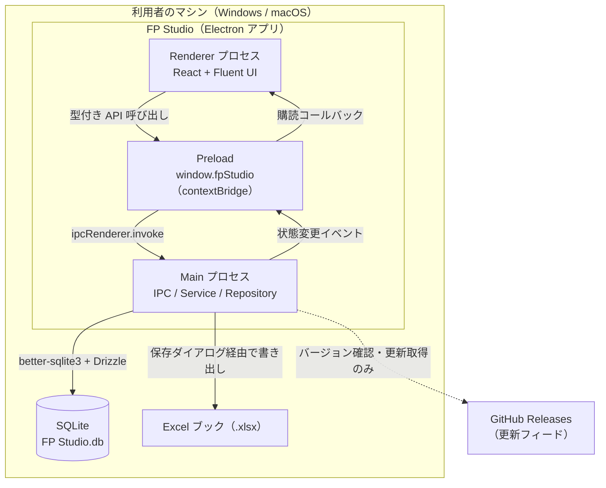
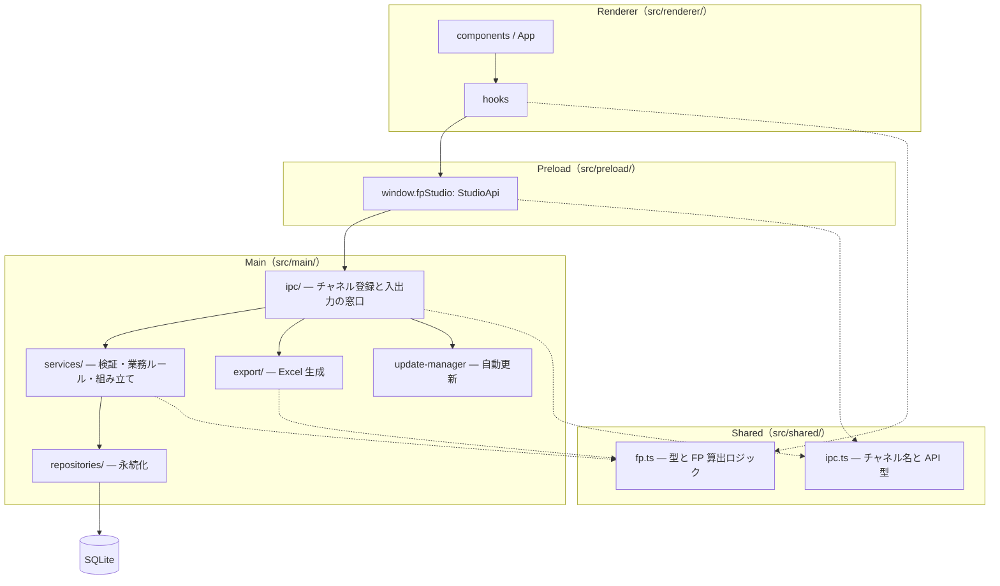

# アーキテクチャ

「どう作るか」の方針。開発者と AI エージェントが**常時読む**文書。頻繁に変わらない内容だけを置く。機能を足すたびに変わる情報は [design.md](design.md) へ。

## 全体構成図

Electron の三プロセス構成。1台のマシンで完結し、業務データはローカルの SQLite ファイルから出ない。

データ格納先（`app.getPath('appData')/FP Studio/`）。

| OS | パス |
| :--- | :--- |
| macOS | `~/Library/Application Support/FP Studio/` |
| Windows | `~/AppData/Roaming/FP Studio/` |

同ディレクトリに DB 本体（`FP Studio.db`）とスキーマ移行時のバックアップ（`migration-backups/`）を置く。環境変数 `FP_STUDIO_APP_DATA_PATH` を設定すると格納先を差し替えられる（E2E テストで使用）。

## 技術選定と理由（ADR）

**追記のみのログ。** 一度書いた記録は編集しない。決定が変わったら新しい記録を足し、古い記録から新しい記録へリンクする。

ADR番号は決定した順（git履歴上の実装順）に振っている。

### ADR-001 デスクトップアプリ（Electron）を選ぶ

- **決定**: Web アプリではなく Electron 製デスクトップアプリとして作る。ビルドは `electron-vite`
- **背景**: 見積りデータは秘匿性が高く、インターネット接続なしで扱えることが要件。かつ Windows / macOS 双方へ配布したい
- **却下した選択肢**: **Web アプリ** — サーバーを置くと業務データが利用者の管理外へ出る。ローカルファイル（SQLite・Excel）への直接アクセスも得られない。**OS ネイティブ（WinUI / SwiftUI）** — 2プラットフォーム分の実装を個人開発で維持できない
- **トレードオフ**: 配布サイズと起動時間で不利。ネイティブモジュール（`better-sqlite3`）の ABI 管理という手間を引き受ける（→ ADR-003）

### ADR-002 UFP のカウントに特化し、VAF を除外する

- **決定**: 補正係数（VAF）とプロジェクト特性係数を扱わない。合計は UFP のみ
- **背景**: 14 項目の補正は学習コストが高く、見積りのスピードを損なう。まず「標準どおりに数えられる」ことに価値を置いた
- **却下した選択肢**: フル FP 対応 — 初回リリースの範囲として大きすぎ、利用者に 14 項目の判断を強いる
- **トレードオフ**: 自社見積りとの突き合わせは UFP 段階までに限られる。将来 VAF を足す場合も、**UFP の算出ロジックとは独立した掛け算のレイヤー**として組み込み、既存の見積り資産（UFP ベースの記録）に影響を与えないこと

### ADR-003 永続化は SQLite（better-sqlite3 + Drizzle ORM）

- **決定**: ローカルの SQLite ファイル1つに保存する。ドライバは `better-sqlite3`、クエリ構築は Drizzle ORM
- **背景**: オフライン完結と、プロジェクト／機能の1対多を素直に扱えること。同期 API のほうが Electron の Main プロセスで扱いやすい
- **却下した選択肢**: **JSON ファイル** — 集計と部分更新のたびに全体を読み書きすることになり、破損時の被害が大きい。**クラウド DB** — 要件（オフライン・機密性）と正面から衝突する
- **トレードオフ**: `better-sqlite3` はネイティブモジュールで、Electron 用にビルドされる（`electron-builder install-app-deps`）。そのため vitest を動かす Node とは ABI が合わず、**DB クエリ層は単体テストできない**（→「非機能の実現方式」）

### ADR-004 UI に Fluent UI React Components を使う

- **決定**: 画面は React + `@fluentui/react-components` で作る
- **背景**: 見積り担当者が業務で使うツールであり、表・フォーム・ダイアログの品質と、キーボード操作・スクリーンリーダー対応が要る
- **却下した選択肢**: 自前コンポーネント — アクセシビリティを自力で満たすコストが高い。**汎用 CSS フレームワーク** — デスクトップアプリらしい情報密度の高い表・ダイアログが不足
- **トレードオフ**: 見た目が Fluent の様式に固定される。デザイントークン（`tokens.*`）に沿わないスタイルは書きづらい

### ADR-005 Excel 出力は値ではなく数式で書き出す

- **決定**: 難易度・FP・合計を固定値ではなく Excel 数式（`LET` / `INDEX` / `MATCH`）として出力し、難易度ルールと重み表をブックに同梱する
- **背景**: 出力後に Excel 上で DET を調整して感触を見たい、という使われ方が想定される。値だけを書き出すと、そこから先は標準準拠が保証されない
- **却下した選択肢**: 計算済みの値のみ出力 — ブックが「そのときのスナップショット」に留まり、編集すると壊れる
- **トレードオフ**: **算出ロジックが TypeScript と Excel 数式の2箇所に存在する。** 片方だけ直すと静かに食い違う（実際に事故った → `AGENTS.md` の Incidents）。数式は `project-excel.test.ts` の完全一致アサーションで固定し、計算規則を変えるときは必ず両方を直す

### ADR-006 自動アップデートを electron-updater と GitHub Releases で行う

- **決定**: `electron-updater` を使い、更新フィードを GitHub Releases（`neko3cs/FP-Studio`）に置く
- **背景**: 個人開発で配布インフラを持たずに Windows / macOS へ更新を届けたい
- **却下した選択肢**: 手動ダウンロード案内のみ — 更新が行き渡らない。**自前の配信サーバー** — 運用負荷に見合わない
- **トレードオフ**: これが唯一の外部通信になる。**業務データは一切送らない**という境界を保つこと。確認処理で Main プロセスをブロックしない

### ADR-007 難易度ルールと重み表を読み取り専用にする

- **決定**: 難易度ルールと重み表を編集する UI を持たない。設定画面では参照表示のみ
- **背景**: 一度は編集 UI を実装したが、Issue #1 で意図的に差し戻した。独自値を許すと「IPA/IFPUG 標準に準拠していること」というプロダクトの中核価値が崩れ、本来解決したかった属人化を自ら持ち込むことになる
- **却下した選択肢**: 編集 UI を残す — 標準準拠と非標準テーラリングが同じ画面に同居し、見積り値がどちらの規則で出たのか判別できなくなる
- **トレードオフ**: 企業独自の重み表を使いたい要求には応えられない。将来マスター管理を入れる場合も、IPA 標準値をデフォルトとして残し、**標準準拠の見積りと企業カスタム値の見積りを区別できる**ことを条件とする。`settings` テーブルは既に `difficultyRules` / `weightTable` を JSON で保持しており、基盤だけは残っている

### ADR-008 設計ドキュメントの図を draw.io から Mermaid へ移す

- **決定**: 設計ドキュメントの図はすべて Markdown 内の Mermaid で書く。`.drawio` と書き出し `.png` の運用をやめる
- **背景**: draw.io 形式は差分が読めず、図を直すたびに PNG を書き出して2ファイルを揃える必要があった。片方だけ更新されて図と説明がずれる
- **却下した選択肢**: draw.io 継続 — レビューで図の変更点を確認できない。**画像を手描き** — 更新されなくなる
- **トレードオフ**: Mermaid はユースケース図をネイティブに描けないため、フローチャートで代用する。込み入ったレイアウトの細かい制御はできない

### ADR-009 リリースを GitHub Actions で行い、当面はコード署名しない

- **決定**: `v*` タグの push を起点に、[Release ワークフロー](../.github/workflows/release.yml) が Windows / macOS / Linux それぞれのランナーでパッケージングし、`electron-builder --publish always` で GitHub Releases の draft に成果物と更新情報（`latest*.yml`・`.blockmap`）を上げる。公開（draft 解除）は手動で行う。コード署名・公証は行わない
- **背景**: 手動アップロードでは `latest*.yml` が添付されず、ADR-006 の自動更新が機能していなかった。`better-sqlite3` はネイティブモジュールのためクロスビルドできず、OS ごとのランナーが必要。署名証明書（Apple Developer Program、Windows のコード署名証明書）は費用がかかるため個人開発の現段階では見送る
- **却下した選択肢**: **手動ビルドとアップロードの継続** — 更新情報の添付漏れが起きる。**タグ名 `release-x.y.z` の継続** — electron-builder は `v` 付きタグを前提とする。**最初から署名する** — 費用に見合う利用者規模がまだない
- **トレードオフ**: 未署名のため、Windows では初回起動時に SmartScreen の警告が出る（自動更新は動く）。macOS では Gatekeeper の許可操作が必要で、**Squirrel.Mac が署名を要求するため自動更新は動かない**。署名を導入するときは新しい ADR を足し、シークレット登録と `mac.notarize` / `win.sign` の設定を追加する。成果物名はスペースを含む `productName` ではなく `name`（`fp-studio`）を使い、GitHub 上のファイル名と `latest*.yml` の URL を一致させる

## レイヤー構成と依存の方向

依存は常に**上から下へ**の一方向。逆流させない。

**層をまたぐ呼び出しのルール**

- Renderer は Electron の API を直接触らない。外部との接点は `window.fpStudio` だけ
- `ipc/` は薄く保つ。業務ルールと検証は `services/` に置く
- `services/` は SQL を書かない。永続化は `repositories/` 経由
- `shared/` はどの層からも参照されるが、**どの層にも依存しない**。Electron・React・DB のいずれも import しない
- 新しい機能は `shared/fp.ts`（型・ロジック）→ `shared/ipc.ts`（チャネルと API 型）→ `main/ipc/handlers.ts` → `preload/index.ts` → Renderer の hooks / components の順で実装する。この順序を守ると型が先に通り、経路の付け忘れが起きない

## 不変条件・境界

**このシステムで常に成り立つ約束。ここが最も価値の高い節。**

### 存在しないもの（意図的な不在）

- **業務データを送る外部 API 呼び出しは存在しない。** 唯一の外部通信は更新フィードへのバージョン確認とパッケージ取得（ADR-006）
- **難易度ルール・重み表を編集する UI は存在しない。** 復活させないこと（ADR-007）
- **VAF の計算は存在しない。** 合計は常に UFP（ADR-002）
- **ログイン・権限・マルチユーザーは存在しない。** アクターは単一
- **Renderer から SQLite への経路は存在しない。** DB は Main プロセスだけが触る

### 計算に関する不変条件

- **`analyzeFunctionPoint()`（`shared/fp.ts`）が難易度・FP 算出の唯一の正。** 同じ計算を別の場所で書き直さない
- **例外は Excel 出力の数式だけで、これは意図的な二重実装。** 変更時は必ず両方を同期させる（ADR-005）
- **DET は `<`、参照数は `<=` でバケット判定する。** `DifficultyRule.det` は `[中の開始値, 大の開始値]`、`reference` は `[小の上限, 中の上限]` と意味が違う。ここを揃えてしまうと境界値だけが静かにずれる
- **合計 UFP と概算工数は永続化しない。** 常に機能エントリから導出する。DB に集計値を持たせない
- **`difficulty` と `function_points` は入力値の変更に必ず追随する。** 入力を書き換えたのに派生値が古いまま、という状態を作らない

### データに関する不変条件

- **プロジェクトを消せば、属する機能も消える**（`ON DELETE CASCADE`）。孤児レコードは存在しない
- **プロジェクト一覧は `updated_at` 降順、機能一覧は `created_at` 降順。** この並び順は仕様であり、実装都合で変えない
- **生産性は小数第2位に丸めて保存する。** プロジェクト個別値が無い／非数のときのみ `settings.defaultProductivity` にフォールバックする
- **`settings` テーブルの `difficultyRules` / `weightTable` は JSON 文字列。** 型のスキーマを変えるときは移行と、`settings-parsing.ts` の後方互換の扱いをセットで考える
- **スキーマ移行は既存データを消さない。** 版数が変わるときは全テーブルを JSON へ書き出して `migration-backups/` に保存してから作り直し、トランザクションで戻す

## 共通規約

| 対象 | 規約 |
| :--- | :--- |
| ID | `crypto.randomUUID()` による UUID 文字列 |
| 日時 | ISO 8601 文字列（`new Date().toISOString()`）で保存。DB の型は `TEXT` |
| DB のカラム名 | スネークケース（`created_at`）。TypeScript 側はキャメルケース（`createdAt`）で、Drizzle のスキーマ定義が対応付ける |
| エラー処理 | `services/` が日本語のメッセージを持つ `Error` を throw する。IPC 越しに Renderer へ伝わり、`useFpStudioApp` の `runAction` が捕捉してメッセージバーに出す。Renderer 側でメッセージを組み立て直さない |
| 利用者向け文言 | 日本語。文言の正は実装コードで、[specification.md](specification.md) の一覧は写し |
| スタイル | Fluent UI の `makeStyles` と `tokens.*`。色・余白の直値を書かない |
| 型 | Renderer と Main が共有する型は `shared/` に置く。`preload` は `StudioApi` 型に完全に従う |
| 破壊的操作 | 削除は確認ダイアログを挟む |
| テスト名 | `describe` / `it` をすべて日本語の自然文で書き、入れ子の `describe` で機能・操作ごとに束ねる。テストスイートが仕様書として読めることを狙っている |
| コミット | コミット・プッシュは利用者の明示的な許可を得てから行う |

## 非機能の実現方式

### オフライン完結・機密性

- 業務データの入出力先はローカルの SQLite ファイルと、利用者が保存先を指定した .xlsx のみ
- Renderer は `contextBridge` 経由の `window.fpStudio` しか持たない。Node の API を画面へ直接露出しない
- 外部リンクは既定ブラウザへ委譲し、アプリ内で別ウィンドウを開かない

### 可搬性

- `electron-builder` で Windows / macOS / Linux 向けにビルドする
- パス操作は必ず `path.join()` を使う。区切り文字を直書きするとテストごと Windows で落ちる（`AGENTS.md` の Incidents 参照）

### データ保全

- 起動時にスキーマを作成し、版数を確認する。版数が現在値と異なり、かつデータが存在する（または版数が記録済みである）場合のみ移行を行う
- 移行は「全テーブルを JSON へ書き出す → バックアップファイルを書く → 作り直す → トランザクションで戻す」の順。バックアップは消さない

### 見積り精度

- FP 算出ロジックは純粋関数として `shared/fp.ts` に隔離し、単体テストとプロパティベーステスト（`fast-check`）の両方をかける
- Excel 数式との同期は、生成される数式文字列の完全一致アサーションで固定する

### テスト方針

| レベル | 対象 | ツール |
| :--- | :--- | :--- |
| 単体 | `shared/` の算出ロジック、`services/` の検証と組み立て、`ipc/` の窓口、Renderer の hooks | Vitest |
| プロパティベース | `analyzeFunctionPoint` の広い入力域にわたる性質 | Vitest + fast-check |
| コンポーネント | Fluent UI コンポーネントの表示分岐と操作可否 | Vitest + Testing Library（jsdom） |
| 変異 | 純粋ロジックのテスト強度 | Stryker |
| E2E | Electron を実際に起動した通し動作（実 SQLite を含む） | Playwright |

- **DB クエリ層は単体テストしない。** `better-sqlite3` が Electron 用にビルドされており、vitest を動かす Node と ABI が合わないため（ADR-003）。実 SQLite を通る検証は Playwright の E2E に委ねる。純粋な設定パース処理だけは `repositories/settings-parsing.ts` へ切り出し、ネイティブバインディング無しで単体・変異テストできるようにしてある
- **変異テストの対象は純粋ロジックに絞る。** Fluent UI コンポーネントと Excel ブック組み立ては、カバレッジ計測の対象には含めるが変異対象からは外す。レイアウトや書式を変異させても意味のある生存変異体にならないため。同期が要る Excel 数式は完全一致アサーションで別途守る
- 閾値は設定ファイルを正とする（`vitest.config.ts` の `coverage.thresholds`、`stryker.config.json` の `thresholds`）
- 実行手順は `test-code` スキル、コマンド一覧は `AGENTS.md` を参照
- **テストケースそのものは文書化しない。** テストコードを正とする。機能ごとの観点は [design.md](design.md) に書く

#### CI での実行

[Tests ワークフロー](../.github/workflows/test.yml) は、PR の作成・更新、`main` への push、手動実行（`workflow_dispatch`）、Release ワークフローからの呼び出し（`workflow_call`）を起点とする。ローカルの検証と同じスクリプトを使用し、独立した検証にはジョブ間の依存を設けず、以下の10ジョブを並列に実行する。

| ジョブ                                     | 環境                                   | 検証内容                                             |
| :----------------------------------------- | :------------------------------------- | :--------------------------------------------------- |
| format / lint / typecheck / pbt（4ジョブ） | Ubuntu 24.04                           | 書式、静的解析、型、PBT                              |
| unit（3ジョブ）                            | Ubuntu 24.04 / Windows 2025 / macOS 15 | 全単体テストとカバレッジ（PBTを含む）                |
| mutation（1ジョブ）                        | Ubuntu 24.04                           | 純粋ロジックの変異テスト。ジョブ内は2ワーカー        |
| e2e（2ジョブ）                             | Windows 2025 / macOS 15                | フルビルドと Electron の通し動作（実 SQLite を含む） |

- **失敗しても他の検証結果を収集する。** matrix の `fail-fast` は無効。同じブランチの新しい実行が始まった場合は古い実行をキャンセルし、更新前の検証にランナーを使い続けない
- **環境を揃え、ネイティブ依存を混在させない。** 共通の [セットアップ Action](../.github/actions/setup/action.yml) で Node.js を固定し、`package.json` の `packageManager` に指定した pnpm とロックファイルで復元する。キャッシュは pnpm ストアに限定し、OS と Electron ABI に依存する `node_modules` はジョブ間で共有しない
- **取得時間を E2E のテスト時間に含めない。** Electron バイナリは最初のテストより前に取得し、ネイティブ依存を Electron 向けに再構築してからビルド・テストする
- **書式検査はファイルを書き換えない。** アプリと `.github/` を検査し、カバレッジ・変異レポート・E2E 結果・Stryker の一時ファイルは除外する
- **合否の基準はローカルと共通。** カバレッジと変異スコアは既存の設定ファイルに従う。全単体テストはカバレッジ計測時に実行し、同じジョブで重複実行しない
- **失敗を調査できる成果物を残す。** カバレッジ、変異レポート、E2E 結果（失敗時の trace を含む）は失敗時もアップロードを試み、7日間保存する
- **実行権限を限定する。** 標準の GitHub ホストランナーを使用し、権限は `contents: read`、外部 Actions はコミット SHA に固定する

実行コマンドと結果の確認方法は [AGENTS.md](../AGENTS.md#commands) を参照する。ジョブ構成、ランナー、バージョン、タイムアウト、保存期間の正はワークフローと共通セットアップ Action とする。
