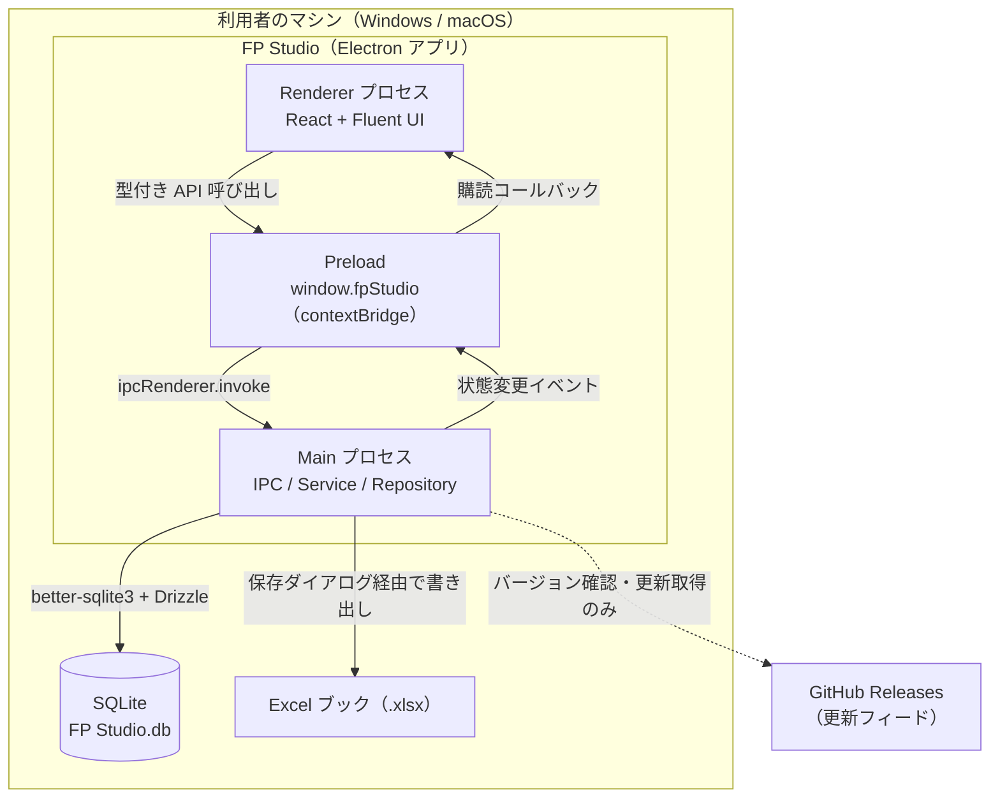
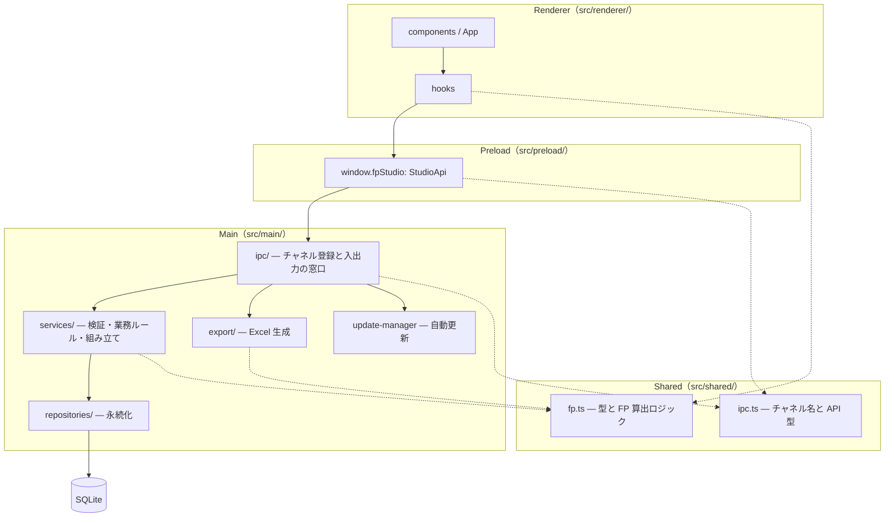

# アーキテクチャ

「どの構造・制約で実現するか、なぜか」の方針。開発者と AI エージェントが**常時読む**文書。全体方針に加え、機能固有でも守るべき責務・制約・設計理由を置く。

利用者に見える動作は [specification.md](specification.md)、目的と受け入れ基準は [requirements.md](requirements.md) に書く。**現在のクラス・関数の一覧や内部の呼び出し順序はこの文書に書かない。** 必要になったら、その時点のコードを読んで説明する（ADR-010）。

## 全体構成図

Electron の三プロセス構成。1台のマシンで完結し、業務データはローカルの SQLite ファイルから出ない。

データ格納先（`app.getPath('appData')/FP Studio/`）。

| OS | パス |
| :--- | :--- |
| macOS | `~/Library/Application Support/FP Studio/` |
| Windows | `~/AppData/Roaming/FP Studio/` |

同ディレクトリに DB 本体（`FP Studio.db`）とスキーマ移行時のバックアップ（`migration-backups/`）を置く。環境変数 `FP_STUDIO_APP_DATA_PATH` を設定すると格納先を差し替えられる（E2E テストで使用）。

## 技術選定と理由（ADR）

**追記のみのログ。** 一度書いた記録は編集しない。決定が変わったら新しい記録を足し、古い記録から新しい記録へリンクする。

ADR番号は決定した順（git履歴上の実装順）に振っている。

### ADR-001 デスクトップアプリ（Electron）を選ぶ

- **決定**: Web アプリではなく Electron 製デスクトップアプリとして作る。ビルドは `electron-vite`
- **背景**: 見積りデータは秘匿性が高く、インターネット接続なしで扱えることが要件。かつ Windows / macOS 双方へ配布したい
- **却下した選択肢**: **Web アプリ** — サーバーを置くと業務データが利用者の管理外へ出る。ローカルファイル（SQLite・Excel）への直接アクセスも得られない。**OS ネイティブ（WinUI / SwiftUI）** — 2プラットフォーム分の実装を個人開発で維持できない
- **トレードオフ**: 配布サイズと起動時間で不利。ネイティブモジュール（`better-sqlite3`）の ABI 管理という手間を引き受ける（→ ADR-003）

### ADR-002 UFP のカウントに特化し、VAF を除外する

- **決定**: 補正係数（VAF）とプロジェクト特性係数を扱わない。合計は UFP のみ
- **背景**: 14 項目の補正は学習コストが高く、見積りのスピードを損なう。まず「標準どおりに数えられる」ことに価値を置いた
- **却下した選択肢**: フル FP 対応 — 初回リリースの範囲として大きすぎ、利用者に 14 項目の判断を強いる
- **トレードオフ**: 自社見積りとの突き合わせは UFP 段階までに限られる。将来 VAF を足す場合も、**UFP の算出ロジックとは独立した掛け算のレイヤー**として組み込み、既存の見積り資産（UFP ベースの記録）に影響を与えないこと

### ADR-003 永続化は SQLite（better-sqlite3 + Drizzle ORM）

- **決定**: ローカルの SQLite ファイル1つに保存する。ドライバは `better-sqlite3`、クエリ構築は Drizzle ORM
- **背景**: オフライン完結と、プロジェクト／機能の1対多を素直に扱えること。同期 API のほうが Electron の Main プロセスで扱いやすい
- **却下した選択肢**: **JSON ファイル** — 集計と部分更新のたびに全体を読み書きすることになり、破損時の被害が大きい。**クラウド DB** — 要件（オフライン・機密性）と正面から衝突する
- **トレードオフ**: `better-sqlite3` はネイティブモジュールで、Electron 用にビルドされる（`electron-builder install-app-deps`）。そのため vitest を動かす Node とは ABI が合わず、**DB クエリ層は単体テストできない**（→「非機能の実現方式」）

### ADR-004 UI に Fluent UI React Components を使う

- **決定**: 画面は React + `@fluentui/react-components` で作る
- **背景**: 見積り担当者が業務で使うツールであり、表・フォーム・ダイアログの品質と、キーボード操作・スクリーンリーダー対応が要る
- **却下した選択肢**: 自前コンポーネント — アクセシビリティを自力で満たすコストが高い。**汎用 CSS フレームワーク** — デスクトップアプリらしい情報密度の高い表・ダイアログが不足
- **トレードオフ**: 見た目が Fluent の様式に固定される。デザイントークン（`tokens.*`）に沿わないスタイルは書きづらい

### ADR-005 Excel 出力は値ではなく数式で書き出す

- **決定**: 難易度・FP・合計を固定値ではなく Excel 数式（`LET` / `INDEX` / `MATCH`）として出力し、難易度ルールと重み表をブックに同梱する
- **背景**: 出力後に Excel 上で DET を調整して感触を見たい、という使われ方が想定される。値だけを書き出すと、そこから先は標準準拠が保証されない
- **却下した選択肢**: 計算済みの値のみ出力 — ブックが「そのときのスナップショット」に留まり、編集すると壊れる
- **トレードオフ**: **算出ロジックが TypeScript と Excel 数式の2箇所に存在する。** 片方だけ直すと静かに食い違う（実際に事故った → `AGENTS.md` の Incidents）。数式は `project-excel.test.ts` の完全一致アサーションで固定し、計算規則を変えるときは必ず両方を直す

### ADR-006 自動アップデートを electron-updater と GitHub Releases で行う

- **決定**: `electron-updater` を使い、更新フィードを GitHub Releases（`neko3cs/FP-Studio`）に置く
- **背景**: 個人開発で配布インフラを持たずに Windows / macOS へ更新を届けたい
- **却下した選択肢**: 手動ダウンロード案内のみ — 更新が行き渡らない。**自前の配信サーバー** — 運用負荷に見合わない
- **トレードオフ**: これが唯一の外部通信になる。**業務データは一切送らない**という境界を保つこと。確認処理で Main プロセスをブロックしない

### ADR-007 難易度ルールと重み表を読み取り専用にする

- **決定**: 難易度ルールと重み表を編集する UI を持たない。設定画面では参照表示のみ
- **背景**: 一度は編集 UI を実装したが、Issue #1 で意図的に差し戻した。独自値を許すと「IPA/IFPUG 標準に準拠していること」というプロダクトの中核価値が崩れ、本来解決したかった属人化を自ら持ち込むことになる
- **却下した選択肢**: 編集 UI を残す — 標準準拠と非標準テーラリングが同じ画面に同居し、見積り値がどちらの規則で出たのか判別できなくなる
- **トレードオフ**: 企業独自の重み表を使いたい要求には応えられない。将来マスター管理を入れる場合も、IPA 標準値をデフォルトとして残し、**標準準拠の見積りと企業カスタム値の見積りを区別できる**ことを条件とする。`settings` テーブルは既に `difficultyRules` / `weightTable` を JSON で保持しており、基盤だけは残っている

### ADR-008 設計ドキュメントの図を draw.io から Mermaid へ移す

- **決定**: 設計ドキュメントの図はすべて Markdown 内の Mermaid で書く。`.drawio` と書き出し `.png` の運用をやめる
- **背景**: draw.io 形式は差分が読めず、図を直すたびに PNG を書き出して2ファイルを揃える必要があった。片方だけ更新されて図と説明がずれる
- **却下した選択肢**: draw.io 継続 — レビューで図の変更点を確認できない。**画像を手描き** — 更新されなくなる
- **トレードオフ**: Mermaid はユースケース図をネイティブに描けないため、フローチャートで代用する。込み入ったレイアウトの細かい制御はできない

### ADR-009 リリースを GitHub Actions で行い、当面はコード署名しない

- **決定**: `release-*` タグの push を起点に、[Release ワークフロー](../.github/workflows/release.yml) が Windows / macOS / Linux それぞれのランナーでパッケージングし、`electron-builder --publish always` で GitHub Releases の draft に成果物と更新情報（`latest*.yml`・`.blockmap`）を上げる。公開（draft 解除）は手動で行う。コード署名・公証は行わない
- **背景**: 手動アップロードでは `latest*.yml` が添付されず、ADR-006 の自動更新が機能していなかった。`better-sqlite3` はネイティブモジュールのためクロスビルドできず、OS ごとのランナーが必要。署名証明書（Apple Developer Program、Windows のコード署名証明書）は費用がかかるため個人開発の現段階では見送る
- **却下した選択肢**: **手動ビルドとアップロードの継続** — 更新情報の添付漏れが起きる。**タグ名を electron-builder 既定の `vx.y.z` に変える** — 既存の `release-x.y.z` と並びが崩れる。`tagNamePrefix` で接頭辞を合わせられるため、変える理由がない。**最初から署名する** — 費用に見合う利用者規模がまだない
- **トレードオフ**: 未署名のため、Windows では初回起動時に SmartScreen の警告が出る（自動更新は動く）。macOS では Gatekeeper の許可操作が必要で、**Squirrel.Mac が署名を要求するため自動更新は動かない**。署名を導入するときは新しい ADR を足し、シークレット登録と `mac.notarize` / `win.sign` の設定を追加する。成果物名はスペースを含む `productName` ではなく `name`（`fp-studio`）を使い、GitHub 上のファイル名と `latest*.yml` の URL を一致させる

### ADR-010: 詳細設計書を廃止し、内部構造は必要時にコードから説明する

#### ステータス（Status）

Accepted

#### 意思決定内容（Decision）

詳細設計書（`docs/design.md`）を廃止し、設計文書を `requirements.md` / `specification.md` / `architecture.md` の3つにする。情報は更新頻度ではなく性質で分ける。利用者に見える動作・データ・入出力は仕様へ、責務の分担・依存の制約・設計理由・検証上の知識はアーキテクチャへ置く。現在のメソッド一覧・フック一覧、関数呼び出しを逐次追うシーケンス図、Excel ブックの内部組み立て順は保守対象の文書に持たず、必要になった時点のコードを読んで説明する。

#### 背景（Context）

詳細設計書には、現在の内部構造の写しと、仕様・設計判断・検証上の知識が混在していた。構造の写しは実装のたびに古くなり、アップデートの状態遷移の説明など、コードと食い違う記述がすでに生じていた。一方で、同じ文書にしか無い約束と理由（Excel 数式との同期、更新日時を必ず更新する理由、設定の復旧、スキーマ移行の手順、機能ごとのテスト観点）があり、文書ごと捨てることはできなかった。

#### 影響（Consequences）

- 常設の構造説明を保守する負担が無くなる。内部構造の説明は、対象コミットと確認範囲を添えた参考説明として都度作り、設計文書には加えない
- 設計の理由はコードから読み取れない。責務・制約・理由は、機能固有のものでもこの文書に書き続ける必要がある
- 利用者に見える動作を変えるときは仕様を、責務・制約・検証方針を変えるときはこの文書を更新する。更新先に迷う記述は、達成目標・期待動作・実現方式のどれを決めているかで分ける

#### 他に検討したもの（Alternatives Considered）

- **詳細設計書をそのまま削除する** — 更新日時の意図、Excel 出力の約束、設定の復旧、検証上のリスクが失われる
- **全文を `architecture.md` へ連結する** — 仕様と内部説明の混在が残る
- **古い詳細設計書を参考資料として残す** — すでに状態遷移の説明に食い違いがあり、古い前提で読まれる危険が残る

## レイヤー構成と依存の方向

依存は常に**上から下へ**の一方向。逆流させない。

**層をまたぐ呼び出しのルール**

- Renderer は Electron の API を直接触らない。外部との接点は `window.fpStudio` だけ
- `ipc/` は薄く保つ。業務ルールと検証は `services/` に置く
- `services/` は SQL を書かない。永続化は `repositories/` 経由
- `shared/` はどの層からも参照されるが、**どの層にも依存しない**。Electron・React・DB のいずれも import しない
- 新しい機能は `shared/fp.ts`（型・ロジック）→ `shared/ipc.ts`（チャネルと API 型）→ `main/ipc/handlers.ts` → `preload/index.ts` → Renderer の hooks / components の順で実装する。この順序を守ると型が先に通り、経路の付け忘れが起きない

### 責務の分担

別の実装へ置き換えても守る分担。現在のメソッド・フックの一覧はコードを参照する。

**Main プロセス**

| 責務 | 置き場所 | 守ること |
| :--- | :--- | :--- |
| チャネルの窓口 | `ipc/` | 業務ルールを持たず、`services/` へ渡すだけにする。**唯一の例外が Excel 出力**で、保存ダイアログの表示・キャンセル判定・ファイル書き込みをここで行う |
| 入力検証・派生値の確定・集計つき結果の組み立て | `services/` | 検証はすべて保存より前に終える。難易度・FP は `shared/fp.ts` に算出させ、ここで確定してから保存を依頼する。機能を操作したら必ずプロジェクトの更新日時も更新する |
| 永続化 | `repositories/` | SQL と ORM の知識をここに閉じる。業務上の判断をしない |
| 設定値の解析 | `repositories/settings-parsing.ts` | ネイティブ依存を持たない純粋関数にする（→「検証方針と重点リスク」） |
| 難易度・FP の算出と集計 | `shared/fp.ts` | どの層にも依存しない純粋関数。算出の唯一の正 |
| Excel ブックの生成 | `export/` | `shared/fp.ts` と同じ規則を Excel 数式として書き出す、意図的な二重実装（ADR-005）。ファイルの保存先を知らない |
| 自動更新 | `update-manager` | アップデート状態を1箇所で保持し、変化のたびに全ウィンドウへ通知する。業務データに触れない |

- **業務用の IPC チャネルは、登録の前に必ず解除する。** 多重登録を防ぐため、プロジェクト・機能・設定・Excel 出力の全チャネルについて解除してから登録する。アップデート用のチャネルは解除せずに登録しており、再登録を想定していない

**Renderer**

| 責務 | 守ること |
| :--- | :--- |
| アプリ全体の状態と副作用 | プロジェクト一覧・選択中プロジェクト・設定・アップデート状態の保持と、`window.fpStudio` の呼び出しを1つのフック（`useFpStudioApp`）に集約する。コンポーネントから `window.fpStudio` を直接呼ばない |
| フォームの入力状態 | フォームごとの専用フックに分ける。入力値・プレビュー・送信可否・編集モードはフォーム側のフックが持ち、保存はアプリ全体のフックへ委ねる |
| ビューの切り替えとレイアウト | `App` が担う。業務上の状態を持たない |
| 想定外の例外 | 描画中の想定外の例外は `RendererErrorBoundary` が受け止め、画面全体が白くなる代わりに再読み込みできる表示へ切り替える |

- **プロジェクトと機能に対する操作の実行は、単一の窓口（`runAction`）を通す。** 処理中フラグを立てる、直前のエラー表示を消す、例外を捕捉してメッセージへ変換する、処理中フラグを下ろす、の4つをここに集約する。個々の操作で try/catch を書かない（利用者から見た動作は [specification.md](specification.md) の「処理中の操作可否とエラー表示」）。アップデートの確認・インストールと起動時の初期読み込みは、この窓口を通らない。アップデートの結果はアップデート状態として通知カードへ、初期読み込みの失敗はメッセージバーへ出す
- **入力中のプレビューと保存時の確定に同じ関数（`analyzeFunctionPoint`）を使う。** 入力中は Renderer 内でプレビューだけを算出し、確定時に Main 側で改めて算出して保存する。プレビュー用の計算を別に書かないことで、表示と保存値の二重管理を避ける。プレビューは設定を渡さず標準値で算出し、保存時は設定の規則・重みを渡す

## 不変条件・境界

**このシステムで常に成り立つ約束。ここが最も価値の高い節。**

### 存在しないもの（意図的な不在）

- **業務データを送る外部 API 呼び出しは存在しない。** 唯一の外部通信は更新フィードへのバージョン確認とパッケージ取得（ADR-006）
- **難易度ルール・重み表を編集する UI は存在しない。** 復活させないこと（ADR-007）
- **VAF の計算は存在しない。** 合計は常に UFP（ADR-002）
- **ログイン・権限・マルチユーザーは存在しない。** アクターは単一
- **Renderer から SQLite への経路は存在しない。** DB は Main プロセスだけが触る

### 計算に関する不変条件

- **`analyzeFunctionPoint()`（`shared/fp.ts`）が難易度・FP 算出の唯一の正。** 同じ計算を別の場所で書き直さない
- **例外は Excel 出力の数式だけで、これは意図的な二重実装。** 変更時は必ず両方を同期させる（ADR-005）
- **DET は `<`、参照数は `<=` でバケット判定する。** `DifficultyRule.det` は `[中の開始値, 大の開始値]`、`reference` は `[小の上限, 中の上限]` と意味が違う。ここを揃えてしまうと境界値だけが静かにずれる
- **合計 UFP と概算工数は永続化しない。** 常に機能エントリから導出する。DB に集計値を持たせない
- **`difficulty` と `function_points` は入力値の変更に必ず追随する。** 入力を書き換えたのに派生値が古いまま、という状態を作らない

### データに関する不変条件

- **プロジェクトを消せば、属する機能も消える**（`ON DELETE CASCADE`）。孤児レコードは存在しない
- **プロジェクト一覧は `updated_at` 降順、機能一覧は `created_at` 降順。** この並び順は仕様であり、実装都合で変えない
- **生産性は小数第2位に丸めて保存する。** プロジェクト個別値が無い／非数のときのみ `settings.defaultProductivity` にフォールバックする
- **`settings` テーブルの `difficultyRules` / `weightTable` は JSON 文字列。** 型のスキーマを変えるときは移行と、`settings-parsing.ts` の後方互換の扱いをセットで考える
- **スキーマ移行は既存データを消さない。** 版数が変わるときは全テーブルを JSON へ書き出して `migration-backups/` に保存してから作り直し、トランザクションで戻す

## 永続化・整合性・移行

データの意味と利用者から見た結果は [specification.md](specification.md) の「データ定義」「業務ルール」を参照。ここには保存方式と、その理由を置く。

### 物理スキーマ

SQLite のファイル1つに4テーブルを置く。接続時に WAL モードと外部キー制約を有効にする。外部キー制約を有効にしないと `ON DELETE CASCADE` が働かない。

| テーブル | カラム | 型・制約 |
| :--- | :--- | :--- |
| `projects` | `id` | `TEXT` 主キー（UUID） |
| | `name` | `TEXT NOT NULL` |
| | `description` | `TEXT NOT NULL DEFAULT ''` |
| | `created_at` / `updated_at` | `TEXT NOT NULL`（ISO 8601） |
| | `productivity` | `REAL NOT NULL DEFAULT 1` |
| `function_entries` | `id` | `TEXT` 主キー（UUID） |
| | `project_id` | `TEXT NOT NULL`、`projects(id)` への外部キー、`ON DELETE CASCADE` |
| | `name` | `TEXT NOT NULL` |
| | `function_type` | `TEXT NOT NULL`（`EI` / `EO` / `EQ` / `ILF` / `EIF`） |
| | `det` / `reference_count` | `INTEGER NOT NULL` |
| | `difficulty` | `TEXT NOT NULL`（`Low` / `Average` / `High`） |
| | `function_points` | `INTEGER NOT NULL` |
| | `note` | `TEXT NOT NULL DEFAULT ''` |
| | `created_at` / `updated_at` | `TEXT NOT NULL`（ISO 8601） |
| `settings` | `key` | `TEXT` 主キー（`defaultProductivity` / `difficultyRules` / `weightTable`） |
| | `value` | `TEXT NOT NULL`。数値の文字列表現、または JSON 文字列 |
| | `updated_at` | `TEXT NOT NULL`（ISO 8601） |
| `schema_version` | `id` | `INTEGER` 主キー。常に `1`（1行だけを許す） |
| | `version` | `TEXT NOT NULL`。スキーマ版数 |
| | `updated_at` | `TEXT NOT NULL`（ISO 8601） |

機能種別・難易度の区分と、DET・参照数の下限はアプリ側（型と `services/` の検証）で守る。DB の CHECK 制約にはしていない。

### アクセスの方針

- **同期 API を使う。** `better-sqlite3` は同期呼び出しで、`services/` も同期で書く。IPC の窓口だけが非同期の形をとる。Renderer から見た非同期性は IPC 由来であって、DB 由来ではない
- **接続はアプリ起動時に1本開き、終了時に閉じる。** 単一プロセス・単一利用者のため、接続プールも排他制御も持たない
- **プロジェクト削除は外部キーの `ON DELETE CASCADE` に任せる。** 機能を個別に消す処理を重ねて書かない
- **集計はアプリ側で行う。** SQL に `SUM` を書かず、取得した機能の一覧を `shared/fp.ts` の集計関数へ渡す。算出規則を `shared/fp.ts` の1箇所に集めるための意図的な選択で、想定件数（1プロジェクトあたり数十〜数百件）ではこれで十分。件数の前提が変わったら見直す
- **設定はキーと値のテーブルから読み、型のある設定へ組み立てる。** 値が JSON として壊れている・欠けている場合は既定値へフォールバックし、例外にしない。設定が読めないだけでアプリが起動不能になることを避けるため

### トランザクションと整合性

- トランザクションを使っているのは、スキーマ移行時のデータ復元だけ
- 通常操作には複数の書き込みを伴うものがある。プロジェクトの複製（プロジェクト1行と機能の全行）、機能の追加・編集・削除（機能の行とプロジェクトの更新日時）がそれにあたる。これらをどの単位で原子的に扱うか: TBD

### スキーマ移行

起動時に次の順で行う。**既存データを消さないこと**を最優先にした順序である。

1. テーブルが無ければ作る
2. 記録されたスキーマ版数を読む
3. 移行の要否を決める。版数が現在値と同じなら行わない。異なる場合は、データが1行でもあるか、版数が記録済みであるときだけ行う（初回起動の空の DB では行わない）
4. 移行する場合は、全テーブルの全行を読み出し、`migration-backups/migration-backup-<タイムスタンプ>.json` として書き出す。**バックアップを書き終えてからテーブルを触る**
5. テーブルを削除して作り直し、読み出した行を1つのトランザクションで戻す。途中で失敗したら戻した分はすべて取り消される
6. 現在の版数を記録する

- バックアップファイルは消さない
- テーブルの削除と作り直しはトランザクションの外にある。復元に失敗した場合に自動で元へ戻す仕組みは無く、バックアップファイルが復旧の手段になる
- 旧データから値を読み替える規則（生産性が数値として読めない行の扱い）は [specification.md](specification.md) の「旧形式データの引き継ぎ」を参照

## 共通規約

| 対象 | 規約 |
| :--- | :--- |
| ID | `crypto.randomUUID()` による UUID 文字列 |
| 日時 | ISO 8601 文字列（`new Date().toISOString()`）で保存。DB の型は `TEXT` |
| DB のカラム名 | スネークケース（`created_at`）。TypeScript 側はキャメルケース（`createdAt`）で、Drizzle のスキーマ定義が対応付ける |
| エラー処理 | `services/` が日本語のメッセージを持つ `Error` を throw する。IPC 越しに Renderer へ伝わり、`useFpStudioApp` の `runAction` が捕捉してメッセージバーに出す。Renderer 側でメッセージを組み立て直さない |
| 利用者向け文言 | 日本語。文言の正は実装コードで、[specification.md](specification.md) の一覧は写し |
| スタイル | Fluent UI の `makeStyles` と `tokens.*`。色・余白の直値を書かない |
| 型 | Renderer と Main が共有する型は `shared/` に置く。`preload` は `StudioApi` 型に完全に従う |
| 破壊的操作 | 削除は確認ダイアログを挟む |
| テスト名 | `describe` / `it` をすべて日本語の自然文で書き、入れ子の `describe` で機能・操作ごとに束ねる。テストスイートが仕様書として読めることを狙っている |
| コミット | コミット・プッシュは利用者の明示的な許可を得てから行う |

## 非機能の実現方式

### オフライン完結・機密性

- 業務データの入出力先はローカルの SQLite ファイルと、利用者が保存先を指定した .xlsx のみ
- Renderer は `contextBridge` 経由の `window.fpStudio` しか持たない。Node の API を画面へ直接露出しない
- 外部リンクは既定ブラウザへ委譲し、アプリ内で別ウィンドウを開かない

### 可搬性

- `electron-builder` で Windows / macOS / Linux 向けにビルドする
- パス操作は必ず `path.join()` を使う。区切り文字を直書きするとテストごと Windows で落ちる（`AGENTS.md` の Gotchas 参照）

### データ保全

- スキーマが変わっても既存データを引き継ぐ。移行の要否の判定、バックアップを先に書く手順、その限界は「永続化・整合性・移行」のスキーマ移行を参照

### 見積り精度

- FP 算出ロジックは純粋関数として `shared/fp.ts` に隔離し、単体テストとプロパティベーステスト（`fast-check`）の両方をかける
- Excel 数式との同期は、生成される数式文字列の完全一致アサーションで固定する

## 検証方針と重点リスク

### テスト方針

| レベル | 対象 | ツール |
| :--- | :--- | :--- |
| 単体 | `shared/` の算出ロジック、`services/` の検証と組み立て、`ipc/` の窓口、Renderer の hooks | Vitest |
| プロパティベース | `analyzeFunctionPoint` の広い入力域にわたる性質 | Vitest + fast-check |
| コンポーネント | Fluent UI コンポーネントの表示分岐と操作可否 | Vitest + Testing Library（jsdom） |
| 変異 | 純粋ロジックのテスト強度 | Stryker |
| E2E | Electron を実際に起動した通し動作（実 SQLite を含む） | Playwright |

- **DB クエリ層は単体テストしない。** `better-sqlite3` が Electron 用にビルドされており、vitest を動かす Node と ABI が合わないため（ADR-003）。実 SQLite を通る検証は Playwright の E2E に委ねる。純粋な設定パース処理だけは `repositories/settings-parsing.ts` へ切り出し、ネイティブバインディング無しで単体・変異テストできるようにしてある
- **変異テストの対象は純粋ロジックに絞る。** Fluent UI コンポーネントと Excel ブック組み立ては、カバレッジ計測の対象には含めるが変異対象からは外す。レイアウトや書式を変異させても意味のある生存変異体にならないため。同期が要る Excel 数式は完全一致アサーションで別途守る
- 閾値は設定ファイルを正とする（`vitest.config.ts` の `coverage.thresholds`、`stryker.config.json` の `thresholds`）
- 実行手順は `test-code` スキル、コマンド一覧は `AGENTS.md` を参照
- **テストケースそのものは文書化しない。** テストコードを正とする。期待動作は [specification.md](specification.md)、何が壊れやすくどう確かめるかは次の「重点リスク」に書く

### 重点リスク

何が壊れやすく、どのレベルで確かめるか。個別のケースと手順はテストコードを正とする。ここに挙げた観点がすべてテストへ反映済みであることを、この文書は保証しない。

| 対象 | 重点リスクと確かめ方 | 限界 |
| :--- | :--- | :--- |
| 難易度・FP の算出 | **境界値が最大の急所。** DET は `<`、参照数は `<=` で判定が変わるため、各 Function Type の閾値ちょうどの値を両側から確かめる。全 Function Type × 全バケットの組み合わせを網羅する。設定由来の規則・重みを渡したときに既定値ではなくそちらが使われること、欠けた項目だけ既定値へフォールバックすることを確かめる。単体テストとプロパティベーステストの両方をかける | — |
| 集計 | 機能 0 件の合計と、概算工数の丸めの桁 | — |
| Excel 出力 | **生成される数式文字列の完全一致を確かめる。** TypeScript 実装との同期を守る唯一の仕掛けで、数式を変えるときは `project-excel.test.ts` の完全一致アサーションを必ず一緒に直す。シート名・参照範囲・`Summary` の生産性セル参照が崩れていないこと、ファイル名の整形も確かめる | 文字列の一致は、数式と TypeScript 実装の計算結果が全入力域で一致することの証明ではない。Excel 上で実際に再計算した結果との突き合わせは自動検証の範囲外 |
| `services/` の検証 | 不正入力がそれぞれ固有のメッセージで弾かれること、対象が存在しないときのメッセージ、プロジェクトの更新日時が更新されること | リポジトリを差し替えた単体テストであり、実 SQLite への書き込みは確かめない |
| 生産性のフォールバック | プロジェクト個別値が未設定・非数のときだけ既定値が使われること、丸めが保存値に効くこと | 同上 |
| 複製 | 名前・説明・生産性・全機能の引き継ぎと、ID が新しくなること | 同上 |
| フォームのフック | プレビューが出る条件と出ない条件、送信可否の判定、編集モードの開始・キャンセル・リセットで状態が戻ること、現在値と同じ生産性を保存できないこと | フック単体の検証であり、画面との結線は保証しない |
| 機能入力フォーム（コンポーネント） | モードによる見出しの切り替え、プレビューの有無による表示、処理中と送信可否によるボタンの無効化、編集モード中は折りたたまれないこと | jsdom 上の検証であり、実際の Electron ウィンドウでの表示は E2E の範囲 |
| IPC 登録 | 業務用の全チャネルが登録され、登録の前に解除されていること（多重登録の防止） | アップデート用のチャネルは対象外 |
| 設定の解析 | 壊れた JSON・欠損キーのときに既定値へフォールバックし、例外を投げないこと。型違いの値の扱いは仕様で TBD | ネイティブ依存なしで確かめられるのは解析だけ。設定の読み書きのクエリは E2E の範囲 |
| パス解決 | 期待値を `join()` で組み立てて比較する。区切り文字を直書きすると Windows で落ちる | — |
| E2E | 起動 → プロジェクト作成 → 機能登録 → 集計表示 → 再起動後もデータが残っていること | **実 SQLite を通る唯一の検証。** DB クエリ・外部キーによる連鎖削除・スキーマ移行は、E2E のシナリオが通る範囲でしか確かめられない |

### CI での実行

[Tests ワークフロー](../.github/workflows/test.yml) は、PR の作成・更新、`main` への push、手動実行（`workflow_dispatch`）、Release ワークフローからの呼び出し（`workflow_call`）を起点とする。ローカルの検証と同じスクリプトを使用し、独立した検証にはジョブ間の依存を設けず、以下の10ジョブを並列に実行する。

| ジョブ                                     | 環境                                   | 検証内容                                             |
| :----------------------------------------- | :------------------------------------- | :--------------------------------------------------- |
| format / lint / typecheck / pbt（4ジョブ） | Ubuntu 24.04                           | 書式、静的解析、型、PBT                              |
| unit（3ジョブ）                            | Ubuntu 24.04 / Windows 2025 / macOS 15 | 全単体テストとカバレッジ（PBTを含む）                |
| mutation（1ジョブ）                        | Ubuntu 24.04                           | 純粋ロジックの変異テスト。ジョブ内は2ワーカー        |
| e2e（2ジョブ）                             | Windows 2025 / macOS 15                | フルビルドと Electron の通し動作（実 SQLite を含む） |

- **失敗しても他の検証結果を収集する。** matrix の `fail-fast` は無効。同じブランチの新しい実行が始まった場合は古い実行をキャンセルし、更新前の検証にランナーを使い続けない
- **環境を揃え、ネイティブ依存を混在させない。** 共通の [セットアップ Action](../.github/actions/setup/action.yml) で Node.js を固定し、`package.json` の `packageManager` に指定した pnpm とロックファイルで復元する。キャッシュは pnpm ストアに限定し、OS と Electron ABI に依存する `node_modules` はジョブ間で共有しない
- **取得時間を E2E のテスト時間に含めない。** Electron バイナリは最初のテストより前に取得し、ネイティブ依存を Electron 向けに再構築してからビルド・テストする
- **書式検査はファイルを書き換えない。** アプリと `.github/` を検査し、カバレッジ・変異レポート・E2E 結果・Stryker の一時ファイルは除外する
- **合否の基準はローカルと共通。** カバレッジと変異スコアは既存の設定ファイルに従う。全単体テストはカバレッジ計測時に実行し、同じジョブで重複実行しない
- **失敗を調査できる成果物を残す。** カバレッジ、変異レポート、E2E 結果（失敗時の trace を含む）は失敗時もアップロードを試み、7日間保存する
- **実行権限を限定する。** 標準の GitHub ホストランナーを使用し、権限は `contents: read`、外部 Actions はコミット SHA に固定する

実行コマンドと結果の確認方法は [AGENTS.md](../AGENTS.md#commands) を参照する。ジョブ構成、ランナー、バージョン、タイムアウト、保存期間の正はワークフローと共通セットアップ Action とする。
