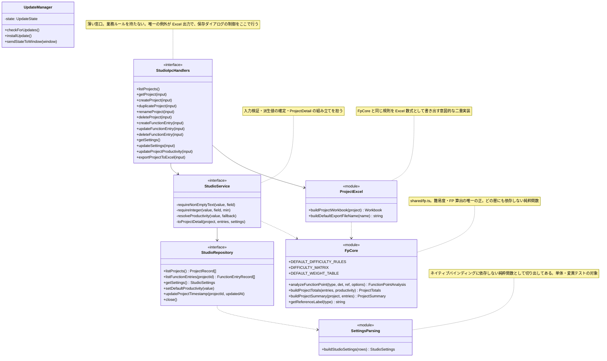
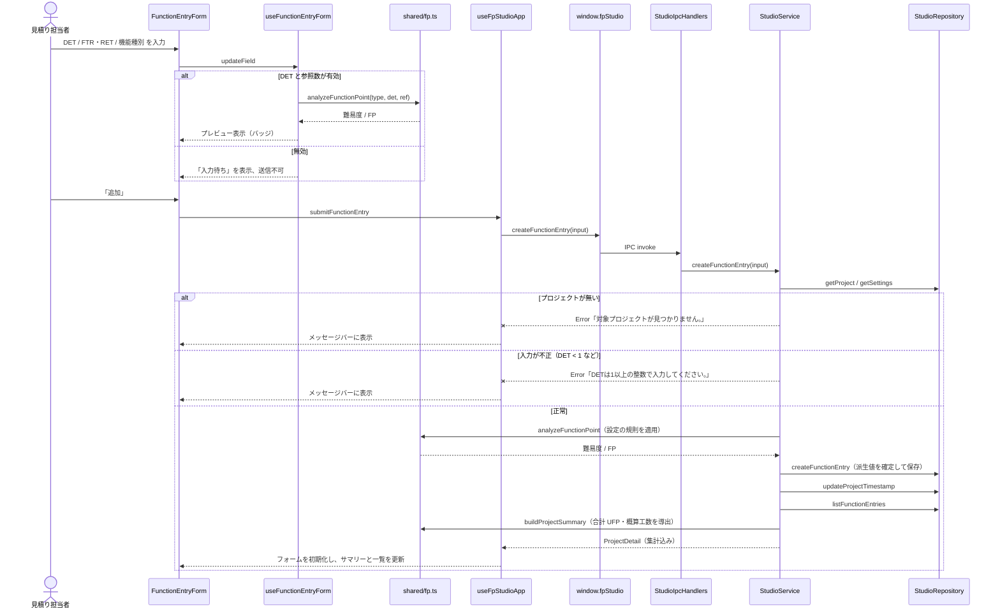
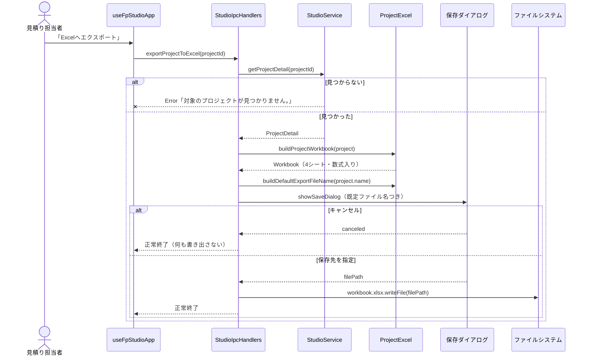
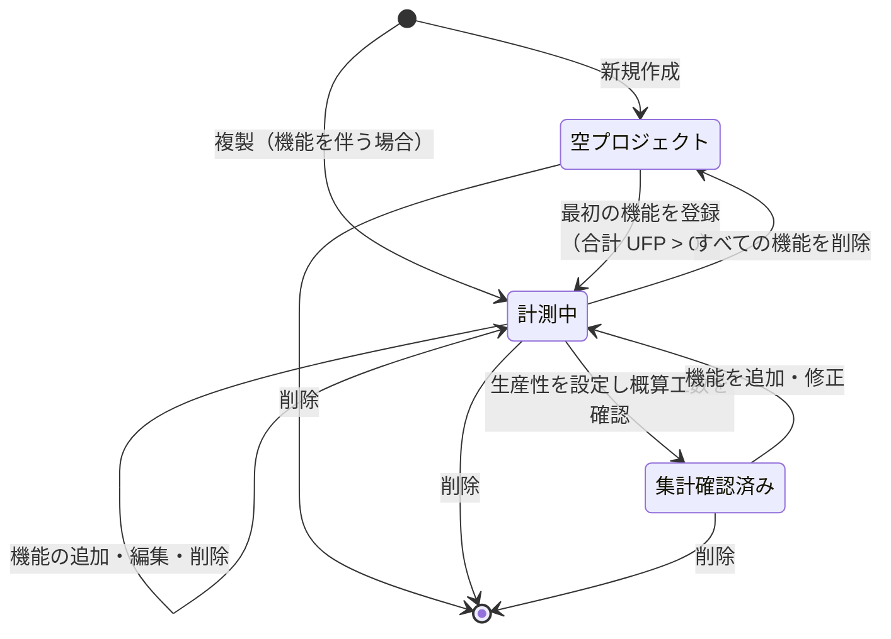
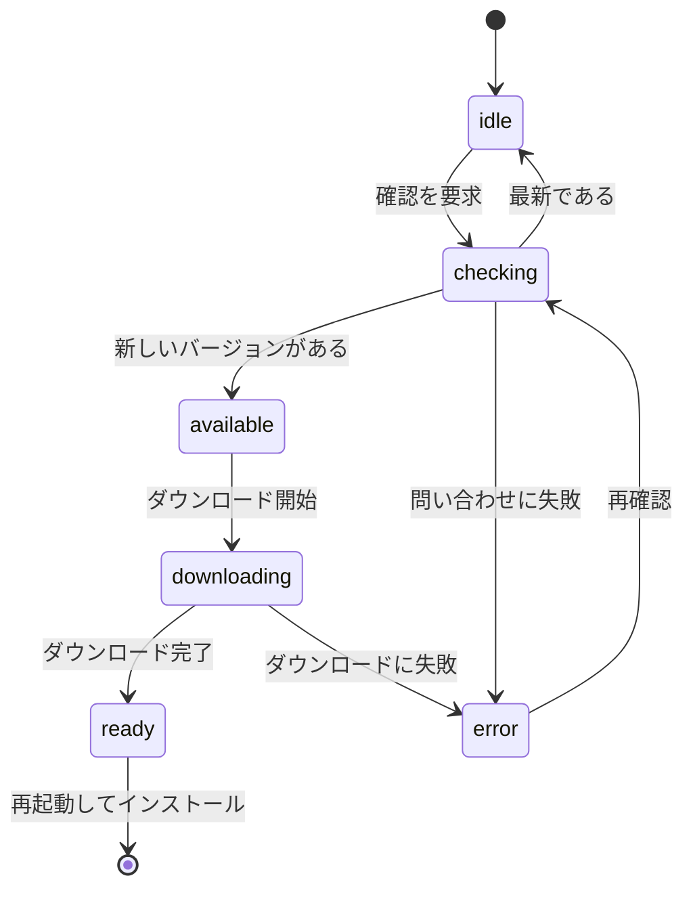

# 詳細設計

「どう作るか」の詳細。着手する機能に応じて読む文書。コードと一緒に動く前提で書く。全機能に効く方針は [architecture.md](architecture.md)、作るものの定義は [specification.md](specification.md) を参照。

## モジュール・クラス構成

Main プロセスの主要な責務と依存。属性・メソッドは論点になる箇所だけ書く。

Renderer 側は、状態と副作用を `useFpStudioApp` に集約し、フォームごとの入力状態を専用フックへ分ける。

| モジュール | 責務 |
| :--- | :--- |
| `useFpStudioApp` | プロジェクト一覧・選択中プロジェクト・設定・更新状態の保持。`window.fpStudio` の呼び出しと例外のメッセージ化 |
| `useProjectForm` | 新規作成ダイアログの入力状態 |
| `useFunctionEntryForm` | 機能入力フォームの入力状態、難易度・FP のプレビュー算出、送信可否、編集モードの保持 |
| `useProjectProductivityForm` | 生産性の入力状態。現在値（baseline）と比較して「変更があるときだけ保存可」を判定する |
| `App` | ビューの切り替え（プロジェクト／設定）とレイアウト。ナビゲーションの開閉 |
| `RendererErrorBoundary` | Renderer の想定外例外の受け止め |

**`useFpStudioApp` の `runAction`** が Renderer 側の例外処理の単一窓口。`isBusy` を立て、`errorMessage` をクリアし、例外を捕捉してメッセージへ変換する。個々のアクションで try/catch を書かない。

## 主要な処理の流れ

### 機能の追加（難易度・FP の自動算出と再集計）

本アプリを特徴づける流れ。入力中はプレビューだけを Renderer 内で算出し、確定時に Main 側で改めて算出して保存する。**プレビューと保存値が同じ関数から出る**ため二重管理にならない。

編集（`updateFunctionEntry`）は「対象の機能が存在するか」を追加で確認したうえで、同じ経路をたどる。削除も同様に、削除後に `updateProjectTimestamp` を打ってから再集計する。

**`updated_at` を必ず打つ理由**: プロジェクト一覧の並び順が `updated_at` 降順であるため。機能を触ったのにプロジェクトが一覧の先頭へ来ないと、利用者は「保存されていない」と受け取る。

### Excel 出力

出力ブックは4シート構成。

| シート | 内容 |
| :--- | :--- |
| `Summary` | プロジェクト名・生産性・合計 UFP・概算工数。生産性セルを他シートが参照する |
| `Function Entries` | 機能ごとの入力値と、難易度・FP・工数の**数式** |
| `Weights` | 重み表。FP の数式が `INDEX` / `MATCH` で引く |
| `Difficulty Rules` | 難易度ルール。難易度の数式が閾値を引く |

**数式を変更するときは `project-excel.test.ts` の完全一致アサーションを必ず一緒に直す。** そこが TypeScript 実装との同期を守る唯一の仕掛け。

## 状態遷移

### プロジェクトのライフサイクル

記録の充足度から導かれる概念的な段階であり、状態区分をデータとして持つわけではない。

各段階は前後へ自由に行き来できる。**「確定して以後編集できない」状態は存在しない** — 見積りは繰り返し見直すもの、という前提を設計に入れている。

### アップデート状態

`UpdateState.status` が実際に持つ状態。画面左下の通知カードはこの状態にそのまま従う。

**起きてはいけない遷移**: `ready` を経ずにインストールへ進むこと。ダウンロード未完了でインストールを要求された場合は状態を変えず、「アップデートはまだダウンロードされていません。」を返す。

`idle` のときは通知カード自体を表示しない。

## データアクセス設計

- **同期 API を使う。** `better-sqlite3` は同期呼び出しで、`StudioService` も同期。IPC ハンドラだけが `async` の皮をかぶせる。Renderer から見た非同期性は IPC 由来であって、DB 由来ではない
- **接続はアプリ起動時に1本開き、終了時に閉じる。** 単一プロセス・単一利用者のため接続プールも排他制御も持たない
- **プロジェクト削除は外部キーの `ON DELETE CASCADE` に任せる。** 機能エントリを個別に消すコードを書かない
- **トランザクションを張るのはスキーマ移行時のデータ復元のみ。** 通常操作は単一行の更新で完結する
- **集計はアプリ側で行う。** SQL に `SUM` を書かず、`listFunctionEntries` の結果を `buildProjectTotals` に渡す。算出規則を `shared/fp.ts` の1箇所に集めるための意図的な選択で、想定件数（1プロジェクトあたり数十〜数百件）ではこれで十分
- **設定は KV テーブルから読み、`buildStudioSettings()` で型のある `StudioSettings` に組み立てる。** 値が壊れていたり欠けていたりする場合は既定値へフォールバックし、例外にしない。設定が読めないだけでアプリが起動不能になることを避ける
- **スキーマ移行**（`ensureDatabaseSchema`）: テーブルを作成 → 版数を読む → 移行要否を判定 → 必要なら全テーブルを JSON へ書き出し、`migration-backups/migration-backup-<timestamp>.json` を残してからテーブルを作り直し、トランザクションで復元する。`productivity` が数値として読めない行は `1` に寄せる

## 機能ごとのテスト観点

何が壊れやすく、何を確かめるべきか。テストケースそのものはテストコードを正とする。

| 対象 | 観点 |
| :--- | :--- |
| 難易度・FP 算出（`analyzeFunctionPoint`） | **境界値が最大の急所。** DET は `<`、参照数は `<=` で判定が変わるため、各 Function Type の閾値ちょうどの値を両側から確かめる。全 Function Type × 全バケット組み合わせを網羅する。設定由来の規則・重みを渡したときに既定値ではなくそちらが使われること、欠けた項目だけ既定値へフォールバックすること |
| 集計（`buildProjectTotals`） | 機能 0 件で合計 0。概算工数の丸めが小数第2位であること |
| Excel 出力 | **生成される数式文字列が期待どおりであること（完全一致）。** ここが TypeScript 実装との同期を守る唯一の砦。シート名・参照範囲・`Summary` の生産性セル参照が崩れていないこと。ファイル名のサニタイズ |
| `StudioService` の検証 | 空白のみの名前、DET < 1、参照数 < 0、生産性 ≤ 0 がそれぞれ固有のメッセージで弾かれること。対象が存在しないときのメッセージ。`updated_at` が更新されること |
| 生産性のフォールバック | プロジェクト個別値が未設定・非数のときだけ既定値が使われること。丸めが保存値に効くこと |
| 複製 | 名前に「 コピー」が付き、説明・生産性・全機能が引き継がれ、ID が新しくなること |
| `useFunctionEntryForm` | プレビューが出る条件と出ない条件。送信可否の判定（空白のみの名前、不正な数値）。編集モードの開始・キャンセル・リセットで状態が正しく戻ること |
| `useProjectProductivityForm` | 値が baseline と同じ間は保存できないこと。0 以下・非数で保存できないこと |
| `FunctionEntryForm` | 追加／編集モードで見出しが変わること。プレビューの有無で表示が切り替わること。`isBusy` と送信可否でボタンが無効化されること。編集モード中は折りたたまれないこと |
| IPC 登録（`register-handlers`） | 全チャネルが登録され、再登録前に `removeHandler` されていること（多重登録の防止） |
| 設定パース（`settings-parsing`） | 壊れた JSON・欠損キー・型違いのときに既定値へフォールバックし、例外を投げないこと |
| パス解決（`app-paths`） | 期待値を `join()` で組み立てて比較する。区切り文字を直書きすると Windows で落ちる |
| E2E | 起動 → プロジェクト作成 → 機能登録 → 集計表示 → 再起動後もデータが残っていること。実 SQLite を通る唯一の検証 |
