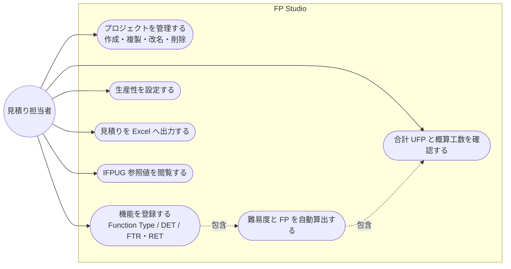
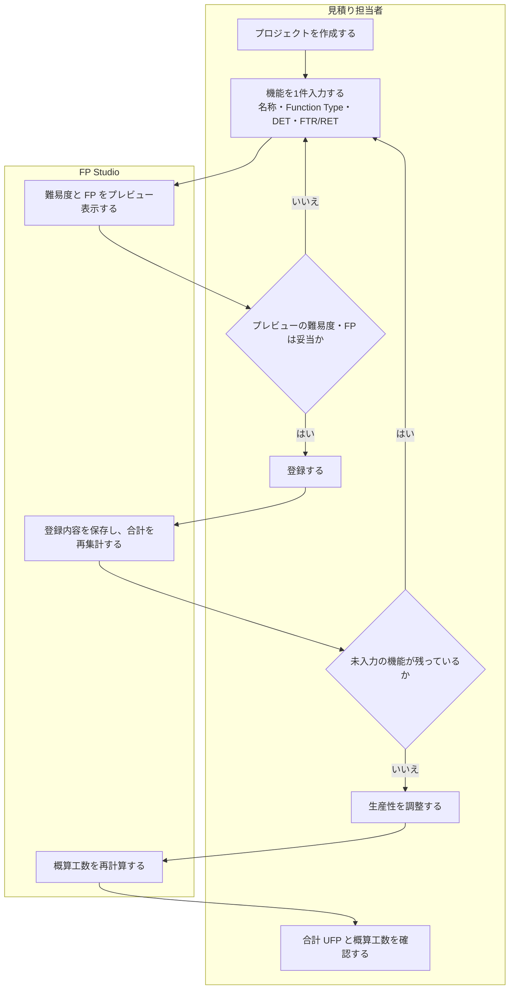

# 要件定義

FP Studio が「なぜ・誰のために」存在するかを定める文書。要件そのものが変わったときだけ更新する。

## 目的・背景

ソフトウェア開発の見積りにおいて、ファンクションポイント（FP）法は客観的な指標である。しかし企業内でのテーラリングによって計算規則が独自進化し、本来の客観性が失われている。自社の見積り値を「IPA/IFPUG 標準ではいくつになるか」と突き合わせる手段が無い。

現場で起きている困りごとは4つ。

| 課題 | 具体的に何が起きているか |
| :--- | :--- |
| 属人化 | 見積り根拠が不明確で、担当者によって工数が大きく変わる |
| 学習コスト | 計算ルールが複雑で、FP 法に不慣れな担当者には見積りの難易度が高い |
| 作業性 | 既存ツールでは「難易度マトリクス」を都度参照して手計算する必要があり、手間がかかる |
| データの散逸 | 過去の見積りが Excel ファイルなどに散らばり、再利用できない |

FP Studio はこれらに対し、**IPA/IFPUG 標準に忠実な計算を自動で行い、結果をローカルに蓄積する**デスクトップアプリケーションとして応える。

## 想定利用者

**見積り担当者**（単一ロール・単独利用）。

- ソフトウェア開発案件の規模と工数を見積もる人。開発リーダー、PM、営業技術など
- FP 法の熟練者とは限らない。難易度マトリクスを暗記していなくても正しく見積もれることを期待する
- 達成したいこと: 機能を洗い出して分類・数値入力するだけで、標準準拠の合計 FP（UFP）と概算工数を得ること。過去の見積りをいつでも引き出せること

管理者・承認者・他システムといった第二のアクターは存在しない。アクセス制御も権限もこのプロダクトの関心事ではない。

## 機能要件

システムの範囲（何が FP Studio の内側で、誰が使うか）。

基本業務フロー（プロジェクト作成から工数確認まで）。

### FR-1 プロジェクト管理

見積り対象をプロジェクト単位で作成・保存・一覧表示・複製・改名・削除できる。

**受け入れ基準**

- プロジェクト名が空文字または空白のみのときは作成・改名できず、理由が画面に表示される
- 削除したプロジェクトに属する機能もすべて消える。孤児レコードが残らない
- 複製するとプロジェクト名末尾に「 コピー」が付き、説明・生産性・全機能が引き継がれる
- アプリを再起動しても、保存したプロジェクトと機能がすべて復元される

### FR-2 FP 計測（機能の登録と自動算出）

機能ごとに Function Type（EI / EO / EQ / ILF / EIF）を選び、DET と FTR/RET を入力すると、難易度と FP が自動で決まる。

**受け入れ基準**

- Function Type に応じて参照数の呼称が切り替わる（EI/EO/EQ は FTR、ILF/EIF は RET）
- 登録前に、入力値から導かれる難易度（Low / Average / High）と FP がプレビューとして見える
- 難易度と FP は IPA/IFPUG 標準の閾値・重みのみから決まる。利用者が上書きする手段は無い
- DET が 1 以上の整数でない、または FTR/RET が 0 以上の整数でないときは登録できず、理由が表示される
- 機能名が空文字または空白のみのときは登録できない
- 登録済みの機能は編集・削除でき、編集すると難易度と FP が再計算される

### FR-3 集計

プロジェクト全体の機能件数・合計 FP（UFP）・概算工数を、常に最新の状態で表示する。

**受け入れ基準**

- 機能の追加・編集・削除の直後に、合計 UFP と概算工数が更新される
- 概算工数 = 合計 UFP × 生産性（人日/FP）
- 機能が 0 件のプロジェクトでは合計 UFP が 0 になる

### FR-4 生産性の設定

生産性（人日/FP）を、アプリ全体のデフォルトとプロジェクト個別の両方で持てる。

**受け入れ基準**

- プロジェクトに個別の生産性が設定されていないときは、デフォルト生産性が使われる
- 生産性が 0 以下または数値でないときは保存できず、理由が表示される
- 保存された生産性は小数第2位までに丸められる

### FR-5 Excel 出力

プロジェクトの見積り結果を Excel ブック（.xlsx）として保存できる。

**受け入れ基準**

- 保存先はネイティブの保存ダイアログで選ぶ。キャンセルすると何も書き出さない
- 出力したブックは単体で完結する。Excel 上で DET や FTR/RET を書き換えると、難易度・FP・合計がブック内の数式で再計算される
- ブック内の数式による再計算結果は、アプリ内の算出結果と全入力域で一致する

### FR-6 IFPUG 参照値の閲覧

適用中の難易度ルールと重みを設定画面で確認できる。

**受け入れ基準**

- 難易度ルールと重みは読み取り専用として表示される。編集する UI が存在しない

### FR-7 自動アップデート

新しいバージョンの有無を確認し、ダウンロードとインストールを行える。

**受け入れ基準**

- 確認・ダウンロード・インストール準備完了・エラーの各状態が画面に表示される
- アップデートの確認中もアプリの操作がブロックされない

## 非機能要件

| 区分 | 要件 |
| :--- | :--- |
| 操作性 | 1つの機能を **10 秒以内** に追加できる。難易度マトリクスを別途参照する必要が無い |
| オフライン動作 | 見積りデータの読み書きにインターネット接続を必要としない。業務データを外部へ送信しない |
| 可搬性 | Windows / macOS のデスクトップアプリとして配布・実行できる |
| データ保存 | ローカル DB に永続化し、アプリを閉じても失われない。スキーマ変更時は既存データを保全する |
| 見積り精度 | 難易度・FP の算出結果が IPA/IFPUG 標準と一致する。アプリ内と Excel 出力先で結果が食い違わない |
| 機密性 | 見積りデータは利用者のローカル環境に留まる。クラウドへ同期しない |

実現方式は [architecture.md](architecture.md) の「非機能の実現方式」を参照。

## スコープ外

**今回は作らない**（将来の検討余地あり）

- **VAF（補正係数）**: IPA の 14 項目による補正係数、およびプロジェクト特性係数の掛け算。UFP のカウントに特化して学習コストを抑え、見積りスピードを上げる判断による。追加する場合の設計方針は [architecture.md](architecture.md) の ADR に記載
- **企業独自の重みテーブル差し替え（マスター管理画面）**: 標準準拠という価値を損なわないための判断。詳細は同 ADR

**永久に作らない**

- クラウド同期・アカウント・共同編集。オフライン完結と機密性を前提に据えているため
- 業務データを外部 API へ送信する機能。アップデート確認のみが唯一の外部通信

## 用語集

| 用語 | 意味 |
| :--- | :--- |
| FP（ファンクションポイント） | ソフトウェアの機能規模を表す指標 |
| UFP（未調整ファンクションポイント） | 補正係数を掛ける前の合計 FP。本アプリが扱う唯一の合計値 |
| VAF（補正係数） | UFP に掛けてFPを求める調整係数。本アプリのスコープ外 |
| Function Type | 機能の 5 分類。EI / EO / EQ / ILF / EIF |
| EI（External Input） | 外部入力。アプリ外部からデータを取り込む機能 |
| EO（External Output） | 外部出力。加工・演算を伴ってデータを外部へ出す機能 |
| EQ（External Inquiry） | 外部照会。加工を伴わずデータを検索・表示する機能 |
| ILF（Internal Logical File） | 内部論理ファイル。アプリが自ら維持するデータ群 |
| EIF（External Interface File） | 外部インタフェースファイル。他アプリが維持し、参照のみするデータ群 |
| DET（Data Element Type） | データ項目数。ユーザーが識別できる重複しない項目の数 |
| FTR（File Type Referenced） | 参照ファイル数。EI / EO / EQ で使う参照数の呼称 |
| RET（Record Element Type） | レコード種類数。ILF / EIF で使う参照数の呼称 |
| 難易度 | Low / Average / High の 3 段階。DET と参照数から自動決定される |
| 重み | Function Type と難易度の組み合わせごとに定められた FP の値 |
| 生産性 | 1 FP あたりの工数（人日/FP）。概算工数 = 合計 UFP × 生産性 |
| プロジェクト | 見積りの単位。名称・説明・生産性・機能の集合を持つ |
| 機能（機能エントリ） | プロジェクトに属する計測単位。Function Type・DET・参照数を入力値に持つ |
