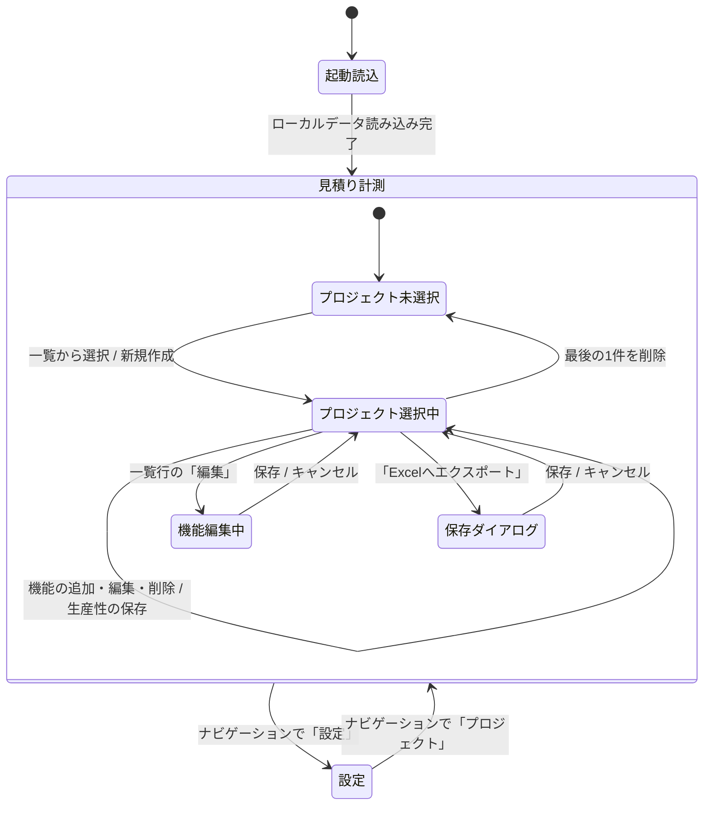
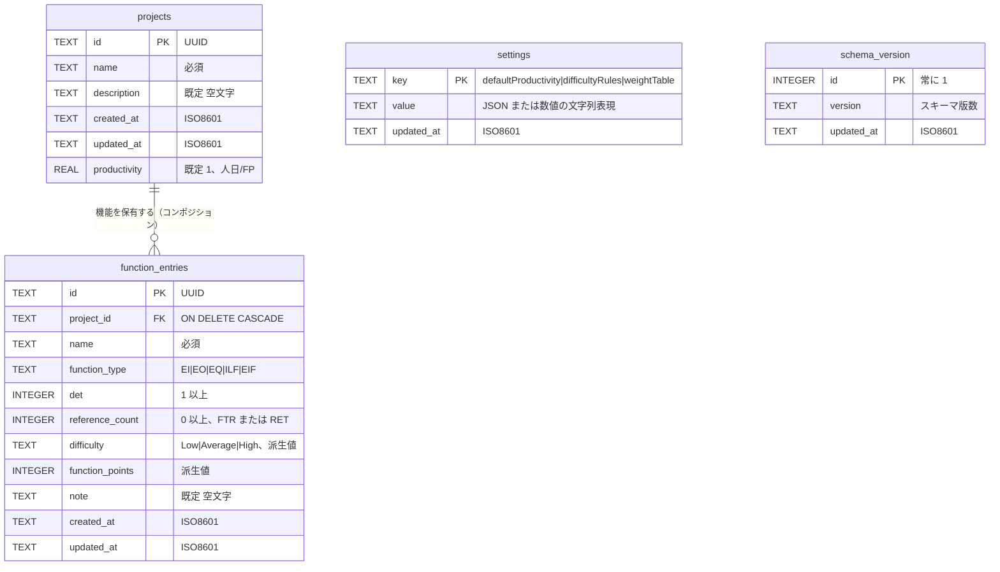
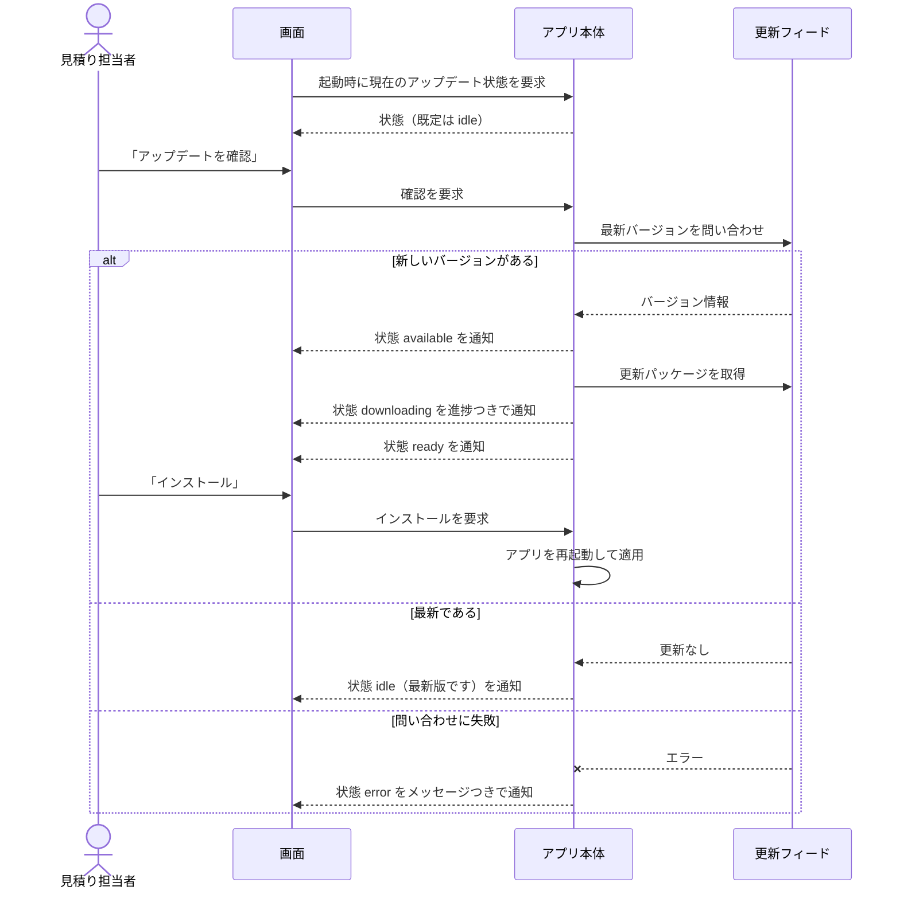

# 仕様

「何を作るか」を定める文書。[requirements.md](requirements.md) の機能要件を、画面・データ・出力の具体像まで分解する。機能・画面・データが変わったときに更新する。

## 機能一覧

| ID | 機能 | 対応する要件 | 概要 |
| :--- | :--- | :--- | :--- |
| F-01 | プロジェクト新規作成 | FR-1 | 名称と説明を入力して見積り単位を作る |
| F-02 | プロジェクト一覧表示 | FR-1 | 保存済みプロジェクトを更新日時の新しい順に並べる |
| F-03 | プロジェクト選択 | FR-1 | 一覧から1件を選び、計測対象にする |
| F-04 | プロジェクト複製 | FR-1 | 説明・生産性・全機能ごとコピーする |
| F-05 | プロジェクト名変更 | FR-1 | 名称のみを変更する |
| F-06 | プロジェクト削除 | FR-1 | 確認のうえ、属する機能ごと削除する |
| F-07 | 機能の追加 | FR-2 | Function Type・DET・FTR/RET・名称・備考を登録する |
| F-08 | 難易度・FP のプレビュー | FR-2 | 登録前に入力値から難易度と FP を表示する |
| F-09 | 機能の編集 | FR-2 | 登録済みの機能を書き換え、難易度と FP を再計算する |
| F-10 | 機能の削除 | FR-2 | 1件を削除する |
| F-11 | 機能一覧表示 | FR-2 | プロジェクトに属する機能を作成日時の新しい順に並べる |
| F-12 | 集計表示 | FR-3 | 機能件数・合計 UFP・概算工数を表示する |
| F-13 | プロジェクト生産性の設定 | FR-4 | プロジェクト個別の生産性（人日/FP）を保存する |
| F-14 | Excel 出力 | FR-5 | 保存ダイアログで指定した先に .xlsx を書き出す |
| F-15 | IFPUG 参照値の閲覧 | FR-6 | 難易度ルールと重みを読み取り専用で表示する |
| F-16 | アップデート確認・適用 | FR-7 | 新バージョンの確認、ダウンロード、再起動によるインストール |

**未実装の枝**: デフォルト生産性（アプリ全体のフォールバック値）を変更する画面は存在しない。値は初期値 `1` のまま固定で、変更用の API 経路（`updateSettings`）だけが実装済み。プロジェクト個別の生産性（F-13）は画面から設定できる。

## 画面仕様

単一ウィンドウ。左端に常設のナビゲーションがあり、2つのビューを切り替える。ウィンドウ最小サイズは 1200×760、初期サイズは 1440×900。

| 画面 | 役割 |
| :--- | :--- |
| ナビゲーション | 「プロジェクト」「設定」の切り替え。折りたたみ・展開ができる |
| 見積り計測ビュー | プロジェクトの選択・管理と、機能の入力・集計。本アプリの主画面 |
| 設定ビュー | IFPUG 難易度ルールと重みの参照表示 |
| アップデート通知 | 画面左下に重ねて表示される。アップデート状態が `idle` 以外のときだけ現れる |

### 見積り計測ビュー

左に**プロジェクト一覧ペイン**、右に**計測ペイン**を並べる。

プロジェクト一覧ペインの各行には、Excel エクスポート・複製・名前変更・削除のアクションが付く。

計測ペインはプロジェクト未選択のとき案内表示だけを出し、選択中は上から順に次を並べる。

1. **集計サマリー** — プロジェクト名 / 合計 UFP / 概算工数（人日）/ 機能数
2. **生産性パネル** — プロジェクト個別の生産性の入力と保存
3. **機能入力フォーム** — 追加・編集の両モードを兼ねる。折りたたみ可（編集モード中は閉じない）
4. **機能一覧テーブル** — 登録済み機能と、行ごとの編集・削除

#### 入出力項目と入力チェック

**機能入力フォーム**

| 項目 | 入力形式 | 必須 | 初期値 | 入力チェック |
| :--- | :--- | :--- | :--- | :--- |
| 機能名 | テキスト | ○ | 空 | 空白のみ不可。前後の空白は除去して保存 |
| 機能種別 | 選択（EI/EO/EQ/ILF/EIF） | ○ | `EI` | — |
| DET | 数値 | ○ | `4` | 1 以上の整数 |
| FTR / RET | 数値 | ○ | `1` | 0 以上の整数。ラベルは機能種別により切り替わる |
| 備考 | テキスト | — | 空 | 前後の空白は除去して保存 |

- 機能名が入力済みかつ DET・FTR/RET が有効なときだけ登録ボタンが押せる
- DET・FTR/RET が有効なときは、難易度と FP をバッジでプレビューする。無効なときは「入力待ち」と表示する
- 見出しは追加モードで「機能を追加」、編集モードで「機能を編集」

**生産性パネル**

| 項目 | 入力形式 | 必須 | 初期値 | 入力チェック |
| :--- | :--- | :--- | :--- | :--- |
| 生産性（人日/FP） | 数値 | ○ | 選択中プロジェクトの現在値（小数第2位表示） | 0 より大きい数値。現在値から変化したときだけ保存できる |

**プロジェクト新規作成ダイアログ / 名前変更ダイアログ**

| 項目 | 入力形式 | 必須 | 入力チェック |
| :--- | :--- | :--- | :--- |
| プロジェクト名 | テキスト | ○ | 空白のみ不可 |
| 説明 | テキスト | — | 新規作成ダイアログのみ |

**プロジェクト削除ダイアログ** — 破壊的操作のため確認を挟む。「この操作は元に戻せません」を明示する。

### 画面遷移

ダイアログ（新規作成・名前変更・削除確認・用語ヘルプ）はビューを遷移させず、閉じると元の状態へ戻る。

## データモデル

### 派生値（保持しない値）

次の値はテーブルに持たず、機能エントリの集合から都度導出する。

| 派生値 | 導出方法 |
| :--- | :--- |
| 機能件数 | プロジェクトに属する機能エントリの件数 |
| 合計 UFP | 機能エントリの `function_points` の総和 |
| 概算工数（人日） | 合計 UFP × 生産性。小数第2位に丸める |
| 有効な生産性 | プロジェクトの `productivity`。未設定・非数のときは `settings.defaultProductivity` |

`difficulty` と `function_points` は入力値からの派生値だが、集計と出力の整合を保つため登録時に確定して保存する。入力値を書き換えると再計算・再保存される。

### 難易度と FP の決定規則

Function Type ごとに DET と参照数をそれぞれ 3 段階のバケットへ振り分け、3×3 のマトリクスで難易度を決め、重み表から FP を引く。

| Function Type | DET 境界 | 参照数 境界 | 参照数の呼称 |
| :--- | :--- | :--- | :--- |
| EI | 5, 16 | 1, 2 | FTR |
| EO | 6, 20 | 1, 3 | FTR |
| EQ | 6, 20 | 1, 3 | FTR |
| ILF | 20, 51 | 1, 5 | RET |
| EIF | 20, 51 | 1, 5 | RET |

**境界の扱いが DET と参照数で異なる。** DET は境界値を「次のバケットの開始値」とみなし `<` で判定する（EI で DET=5 はバケット1）。参照数は境界値を「そのバケットの上限」とみなし `<=` で判定する（EI で FTR=1 はバケット0）。

難易度マトリクス（行=参照数バケット、列=DET バケット）は全 Function Type で共通。

| | DET 小 | DET 中 | DET 大 |
| :--- | :--- | :--- | :--- |
| **参照数 小** | Low | Low | Average |
| **参照数 中** | Low | Average | High |
| **参照数 大** | Average | High | High |

重み表（IFPUG 標準値）。

| Function Type | Low | Average | High |
| :--- | :--- | :--- | :--- |
| EI | 3 | 4 | 6 |
| EO | 4 | 5 | 7 |
| EQ | 3 | 4 | 6 |
| ILF | 7 | 10 | 15 |
| EIF | 5 | 7 | 10 |

### 並び順

| 対象 | 並び順 |
| :--- | :--- |
| プロジェクト一覧 | `updated_at` の降順 |
| 機能一覧 | `created_at` の降順 |

## 外部連携仕様

業務データを送信する外部連携は無い。ファイル出力と、アップデート確認のためのネットワークアクセスのみが外部との接点。

### Excel 出力

| 項目 | 内容 |
| :--- | :--- |
| 出力先 | ネイティブの保存ダイアログで利用者が指定。既定ファイル名はプロジェクト名から生成 |
| 形式 | Excel ブック（.xlsx） |
| 内容 | 機能一覧（名称・機能種別・DET・FTR/RET・難易度・FP・備考）と集計 |
| 失敗時 | ダイアログをキャンセルしたときは何も書き出さず、正常終了として扱う。書き込みに失敗したときはエラーメッセージを画面に表示する |

**出力ブックは自己完結する。** 難易度・FP・合計は固定値ではなく Excel 数式（`LET` / `INDEX` / `MATCH`）として書き出され、ブック内に難易度ルールと重み表を同梱する。利用者が Excel 上で DET や FTR/RET を書き換えると、アプリと同じ規則で再計算される。

### 自動アップデート

| 項目 | 内容 |
| :--- | :--- |
| 連携先 | 配布物のリリース公開先（`electron-updater` の更新フィード） |
| 送受信 | バージョン情報の取得と、更新パッケージのダウンロード。利用者の見積りデータは一切送信しない |
| 失敗時 | 状態を `error` にしてメッセージを通知カードに表示する。アプリの操作は継続できる |

## エラー・メッセージ仕様

利用者に見せる文言。入力チェックのエラーはアプリ本体側で検出し、計測ビュー上部のメッセージバーに表示する。

| 区分 | 発生条件 | 文面 |
| :--- | :--- | :--- |
| 入力エラー | プロジェクト名が空白のみ | プロジェクト名は必須です。 |
| 入力エラー | 機能名が空白のみ | 機能名は必須です。 |
| 入力エラー | DET が 1 以上の整数でない | DETは1以上の整数で入力してください。 |
| 入力エラー | FTR/RET が 0 以上の整数でない | FTR/RETは0以上の整数で入力してください。 |
| 入力エラー | 生産性が 0 以下または非数 | 生産性は0より大きい数値で入力してください。 |
| 対象なし | 操作対象のプロジェクトが存在しない | 対象プロジェクトが見つかりません。 |
| 対象なし | 削除対象のプロジェクトが存在しない | 削除対象のプロジェクトが見つかりません。 |
| 対象なし | 複製元のプロジェクトが存在しない | 複製対象のプロジェクトが見つかりません。 |
| 対象なし | Excel 出力対象のプロジェクトが存在しない | 対象のプロジェクトが見つかりません。 |
| 対象なし | 更新対象の機能が存在しない | 更新対象の機能が見つかりません。 |
| 対象なし | 削除対象の機能が存在しない | 削除対象の機能が見つかりません。 |
| 想定外 | 上記以外の例外 | 予期しないエラーが発生しました。 |
| 進行中 | 起動直後のデータ読み込み中 | ローカルデータを読み込んでいます… |
| 進行中 | アップデート状態の取得中 | アップデート状態を確認しています… |
| 進行中 | アップデート確認中 | アップデートを確認しています… |
| 情報 | 最新バージョンを使用中 | 最新版です。 |
| 情報 | ダウンロード未完了でインストールを要求 | アップデートはまだダウンロードされていません。 |
| エラー | アップデート確認に失敗 | アップデートの確認に失敗しました。／アップデートの確認でエラーが発生しました。 |
| 確認 | プロジェクト削除の確認ダイアログ | プロジェクトを削除しますか？／「〈プロジェクト名〉」を削除します。この操作は元に戻せません。 |

文面の正は実装コード。この表と食い違ったらコード側を正としてこの表を直す。
