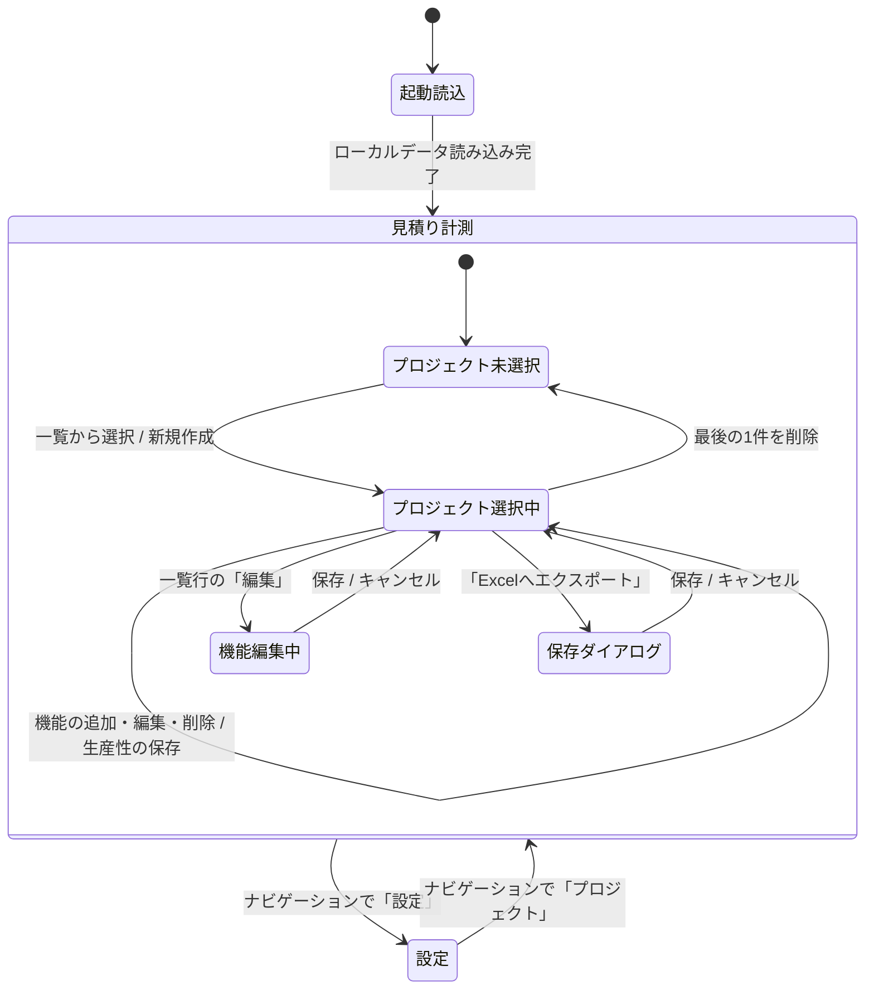
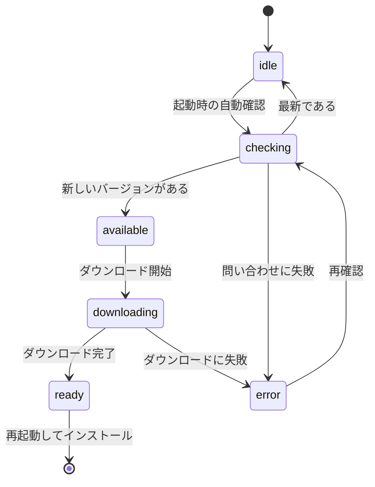
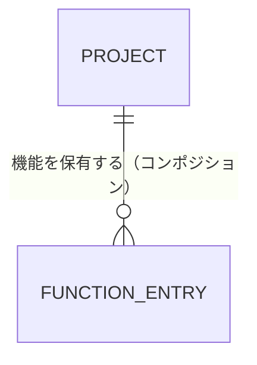
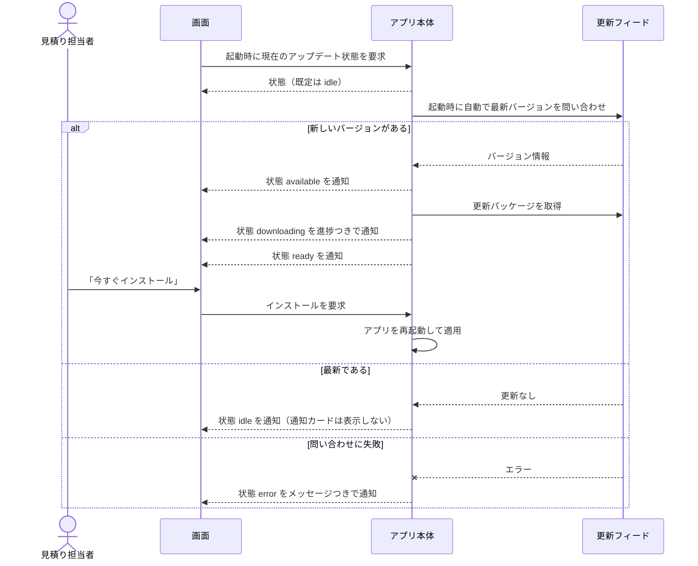

# 仕様

「どの条件で、何が起きるべきか」を定める文書。利用者と合意する動作・業務ルール・データ・入出力・通知の正本とする。[requirements.md](requirements.md) の機能要件を、業務ルール・画面・状態・データ・入出力の具体像まで分解する。実現方式と設計理由は [architecture.md](architecture.md) を参照。

## 機能一覧

| ID | 機能 | 対応する要件 | 概要 | 詳細 |
| :--- | :--- | :--- | :--- | :--- |
| F-01 | プロジェクト新規作成 | FR-1 | 名称と説明を入力して見積り単位を作る | [入力の検証](#入力の検証) |
| F-02 | プロジェクト一覧表示 | FR-1 | 保存済みプロジェクトを更新日時の新しい順に並べる | [更新日時と並び順](#更新日時と並び順) |
| F-03 | プロジェクト選択 | FR-1 | 一覧から1件を選び、計測対象にする | [見積り計測ビュー](#見積り計測ビュー) |
| F-04 | プロジェクト複製 | FR-1 | 説明・生産性・全機能ごとコピーする | [プロジェクトの複製と削除](#プロジェクトの複製と削除) |
| F-05 | プロジェクト名変更 | FR-1 | 名称のみを変更する | [入力の検証](#入力の検証) |
| F-06 | プロジェクト削除 | FR-1 | 確認のうえ、属する機能ごと削除する | [プロジェクトの複製と削除](#プロジェクトの複製と削除) |
| F-07 | 機能の追加 | FR-2 | Function Type・DET・FTR/RET・名称・備考を登録する | [機能の登録・編集・削除](#機能の登録編集削除) |
| F-08 | 難易度・FP のプレビュー | FR-2 | 登録前に入力値から難易度と FP を表示する | [難易度と FP の決定規則](#難易度と-fp-の決定規則) |
| F-09 | 機能の編集 | FR-2 | 登録済みの機能を書き換え、難易度と FP を再計算する | [機能の登録・編集・削除](#機能の登録編集削除) |
| F-10 | 機能の削除 | FR-2 | 1件を削除する | [機能の登録・編集・削除](#機能の登録編集削除) |
| F-11 | 機能一覧表示 | FR-2 | プロジェクトに属する機能を作成日時の新しい順に並べる | [更新日時と並び順](#更新日時と並び順) |
| F-12 | 集計表示 | FR-3 | 機能件数・合計 UFP・概算工数を表示する | [集計](#集計) |
| F-13 | プロジェクト生産性の設定 | FR-4 | プロジェクト個別の生産性（人日/FP）を保存する | [生産性](#生産性) |
| F-14 | Excel 出力 | FR-5 | 保存ダイアログで指定した先に .xlsx を書き出す | [Excel 出力](#excel-出力) |
| F-15 | IFPUG 参照値の閲覧 | FR-6 | 難易度ルールと重みを読み取り専用で表示する | [設定の読み取りと復旧](#設定の読み取りと復旧) |
| F-16 | アップデート確認・適用 | FR-7 | 新バージョンの確認、ダウンロード、再起動によるインストール | [アップデート状態](#アップデート状態)、[自動アップデート](#自動アップデート) |
| F-17 | デフォルト生産性の設定 | FR-4 | アプリ全体のデフォルト生産性を保存する | [生産性](#生産性)、[設定ビュー](#設定ビュー) |

## 業務ルール

入力や条件から結果が決まる規則。利用者に見せる文面は [エラー・通知仕様](#エラー通知仕様) に置き、ここには書き写さない。

**1つの操作は、すべて反映されるか、まったく反映されないかのどちらかになる。** 複製の途中や、機能を保存してからプロジェクトの更新日時を更新するまでの間で失敗した場合、その操作による変更は残らない。

### 入力の検証

検証は画面側の操作可否とは別に、保存の直前にも必ず行う。**検証に失敗した操作は何も保存せず、プロジェクトの更新日時も変えない。**

| 対象 | 入力 | 結果 |
| :--- | :--- | :--- |
| プロジェクト名（作成・名前変更） | 空文字または空白のみ | 保存しない。入力エラーを表示する |
| プロジェクト名（作成・名前変更） | 上記以外 | 前後の空白を除去して保存する |
| プロジェクトの説明 | 任意の文字列 | 前後の空白を除去して保存する |
| 機能名 | 空文字または空白のみ | 保存しない。入力エラーを表示する |
| 機能名 | 上記以外 | 前後の空白を除去して保存する |
| DET | 整数でない、または 1 未満 | 保存しない。入力エラーを表示する |
| FTR / RET | 整数でない、または 0 未満 | 保存しない。入力エラーを表示する |
| 備考 | 任意の文字列 | 前後の空白を除去して保存する |
| 生産性 | 数値でない、または 0 以下 | 保存しない。入力エラーを表示する |
| 生産性 | 0 より大きいが、丸めると 0 になる（例: 0.004） | 保存しない。入力エラーを表示する。検証は丸めた後の値に対して行う |
| 生産性 | 丸めると 0.01 以上になる（例: 0.005 → 0.01） | 丸めた値を保存する |

### 対象が存在しない操作

操作対象が存在しないときは何も変更せず、操作ごとに固有の文面を表示する。右列は [エラー・通知仕様](#エラー通知仕様) の区分「対象なし」の発生条件を指す。

| 操作 | 存在しないもの | 表示する「対象なし」の発生条件 |
| :--- | :--- | :--- |
| 名前変更、機能の追加・編集・削除、生産性の保存 | プロジェクト | 操作対象のプロジェクトが存在しない |
| プロジェクト削除 | プロジェクト | 削除対象のプロジェクトが存在しない |
| プロジェクト複製 | 複製元のプロジェクト | 複製元のプロジェクトが存在しない |
| Excel 出力 | プロジェクト | Excel 出力対象のプロジェクトが存在しない |
| 機能の編集 | 機能（プロジェクトは存在する） | 更新対象の機能が存在しない |
| 機能の削除 | 機能（プロジェクトは存在する） | 削除対象の機能が存在しない |

### 難易度と FP の決定規則

Function Type ごとに DET と参照数をそれぞれ 3 段階のバケットへ振り分け、3×3 のマトリクスで難易度を決め、重み表から FP を引く。

| Function Type | DET 境界 | 参照数 境界 | 参照数の呼称 |
| :--- | :--- | :--- | :--- |
| EI | 5, 16 | 1, 2 | FTR |
| EO | 6, 20 | 1, 3 | FTR |
| EQ | 6, 20 | 1, 3 | FTR |
| ILF | 20, 51 | 1, 5 | RET |
| EIF | 20, 51 | 1, 5 | RET |

**境界の扱いが DET と参照数で異なる。** DET は境界値を「次のバケットの開始値」とみなし `<` で判定する（EI で DET=5 はバケット1）。参照数は境界値を「そのバケットの上限」とみなし `<=` で判定する（EI で FTR=1 はバケット0）。

難易度マトリクス（行=参照数バケット、列=DET バケット）は全 Function Type で共通。

| | DET 小 | DET 中 | DET 大 |
| :--- | :--- | :--- | :--- |
| **参照数 小** | Low | Low | Average |
| **参照数 中** | Low | Average | High |
| **参照数 大** | Average | High | High |

重み表（IFPUG 標準値）。

| Function Type | Low | Average | High |
| :--- | :--- | :--- | :--- |
| EI | 3 | 4 | 6 |
| EO | 4 | 5 | 7 |
| EQ | 3 | 4 | 6 |
| ILF | 7 | 10 | 15 |
| EIF | 5 | 7 | 10 |

境界の例（EI）。

| DET | FTR | DET バケット | 参照数バケット | 難易度 | FP |
| :--- | :--- | :--- | :--- | :--- | :--- |
| 4 | 1 | 小 | 小 | Low | 3 |
| 5 | 1 | 中 | 小 | Low | 3 |
| 15 | 2 | 中 | 中 | Average | 4 |
| 16 | 2 | 大 | 中 | High | 6 |
| 16 | 1 | 大 | 小 | Average | 4 |
| 4 | 3 | 小 | 大 | Average | 4 |

適用する難易度ルールと重みは設定に保持された値で、初期値は上の IFPUG 標準値。設定の値が部分的に欠けている場合の扱いは次のとおり。

| 設定の状態 | 適用する値 |
| :--- | :--- |
| ある Function Type の難易度ルールが無い | その Function Type だけ標準値 |
| ある Function Type・難易度の重みが無い、または数値でない | その項目だけ標準値 |
| 難易度ルール・重みが揃っている | 設定の値（標準値ではなく設定を優先する） |

現在のアプリは難易度ルールと重みを設定に書き込まず、利用者が書き換える手段も無い（FR-6）。そのため設定の値は通常 IFPUG 標準値と同じになる。編集する画面があった時期に保存された値が設定に残っている場合は、その値を適用する。

### 機能の登録・編集・削除

- **登録前のプレビューと保存される値は同じ規則と同じ値から決まる。** プレビューも保存時も、設定に保持された難易度ルールと重みで算出する。入力中に見えた難易度・FP と、登録後の値が食い違わない
- 難易度と FP は入力値から決まる値だが、集計と出力の整合を保つため登録時に確定して保存する。入力値を編集すると再計算して保存し直す
- 追加・編集・削除のいずれも、成功するとプロジェクトの更新日時を更新し、集計を作り直して画面へ反映する
- 編集と削除は、プロジェクトの存在を確かめた後に、対象の機能がそのプロジェクトに存在するかを確かめる
- 編集しても機能の作成日時は変わらない。機能一覧の中での位置は変わらない

### 集計

次の値は保存せず、機能の集合から都度導出する。

| 値 | 導出方法 |
| :--- | :--- |
| 機能件数 | プロジェクトに属する機能の件数 |
| 合計 UFP | 機能の FP の総和。機能が 0 件のときは 0 |
| 概算工数（人日） | 合計 UFP × 有効な生産性。小数第2位に丸める |

### 生産性

| 条件 | 結果 |
| :--- | :--- |
| 生産性を保存する | 小数第3位を四捨五入し、小数第2位までの値を保存する |
| プロジェクトに生産性が設定されている | その値を有効な生産性とする |
| プロジェクトの生産性が未設定、または数値として読めない | デフォルト生産性を有効な生産性とする。それ以外の場合にデフォルト生産性は使わない |
| プロジェクトを新規作成する | その時点のデフォルト生産性をプロジェクトの生産性とする |
| デフォルト生産性の初期値 | 1 |
| デフォルト生産性を変更する | 設定ビューから保存できる。プロジェクトの生産性と同じ検証と丸めを適用する（[入力の検証](#入力の検証)）。以後に新規作成するプロジェクトの生産性になる。既存のプロジェクトに保存済みの生産性は変えない。生産性が読めないプロジェクトだけは、上の規則によりその時点のデフォルト生産性を使う |

### 更新日時と並び順

| 対象 | 並び順 |
| :--- | :--- |
| プロジェクト一覧 | 更新日時の降順 |
| 機能一覧 | 作成日時の降順 |

プロジェクトの更新日時は、次の操作が成功するたびに現在時刻へ更新する。

| 操作 | プロジェクトの更新日時 |
| :--- | :--- |
| 新規作成 | 作成日時と同じ値で記録する |
| 名前変更 | 更新する |
| 生産性の保存 | 更新する |
| 機能の追加・編集・削除 | 更新する |
| 複製 | 複製先は複製した時刻で記録する。複製元は変えない |

**機能を操作したときも必ずプロジェクトの更新日時を更新する。** プロジェクト一覧は更新日時の降順であり、機能を触ったのにプロジェクトが一覧の先頭へ来ないと、利用者は「保存されていない」と受け取るため。

### プロジェクトの複製と削除

| 操作 | 結果 |
| :--- | :--- |
| 複製 | 名前は複製元の名前の末尾に「 コピー」を付ける。説明・生産性・すべての機能を引き継ぐ。プロジェクトと各機能には新しい ID を振り、作成日時・更新日時は複製した時刻にする。複製元は変更しない |
| 複製（複製元の生産性が未設定） | デフォルト生産性を複製先の生産性にする |
| 削除 | プロジェクトと、属するすべての機能を削除する。元に戻せない |

### 設定の読み取りと復旧

設定（デフォルト生産性・難易度ルール・重み）が読めない場合でも、エラーにせず既定値で動作を続ける。設定が読めないことを理由にアプリが起動できなくなることはない。

| 保存されている設定 | 結果 |
| :--- | :--- |
| デフォルト生産性が無い、または数値として読めない | 1 を使う |
| 難易度ルールが無い、または JSON として壊れている | IFPUG 標準の難易度ルールを使う |
| 重みが無い、または JSON として壊れている | IFPUG 標準の重みを使う |
| 難易度ルールが JSON としては正しいが、一覧（配列）でない | IFPUG 標準の難易度ルールを使う |
| 重みが JSON としては正しいが、表（オブジェクト）でない | IFPUG 標準の重みを使う |
| ある Function Type の難易度ルールで、DET 境界・参照数境界が数値2つの組でない | その Function Type だけ IFPUG 標準値を使う |

JSON として読めた設定のうち一部の項目だけが欠けている場合は、[難易度と FP の決定規則](#難易度と-fp-の決定規則) の表に従い、欠けた項目だけ標準値を使う。

### 旧形式データの引き継ぎ

保存形式の版が変わっても、既存のプロジェクト・機能・設定は引き継ぐ。

| 旧データの状態 | 引き継ぎ後 |
| :--- | :--- |
| プロジェクトの生産性が数値、または数値として読める文字列 | その数値 |
| プロジェクトの生産性が数値として読めない | 1 |

引き継ぎの前に、それまでの全データをバックアップファイルとして残す（[移行バックアップ](#移行バックアップ)）。

## 画面・操作仕様

単一ウィンドウ。左端に常設のナビゲーションがあり、2つのビューを切り替える。ウィンドウ最小サイズは 1200×760、初期サイズは 1440×900。

| 画面 | 役割 |
| :--- | :--- |
| ナビゲーション | 「プロジェクト」「設定」の切り替え。折りたたみ・展開ができる |
| 見積り計測ビュー | プロジェクトの選択・管理と、機能の入力・集計。本アプリの主画面 |
| 設定ビュー | IFPUG 難易度ルールと重みの参照表示と、デフォルト生産性の入力と保存 |
| アップデート通知 | 画面左下に重ねて表示される。アップデート状態が `idle` 以外のときだけ現れる |

### 見積り計測ビュー

左に**プロジェクト一覧ペイン**、右に**計測ペイン**を並べる。

プロジェクト一覧ペインの各行には、Excel エクスポート・複製・名前変更・削除のアクションが付く。

計測ペインはプロジェクト未選択のとき案内表示だけを出し、選択中は上から順に次を並べる。

1. **集計サマリー** — プロジェクト名 / 合計 UFP / 概算工数（人日）/ 機能数
2. **生産性パネル** — プロジェクト個別の生産性の入力と保存
3. **機能入力フォーム** — 追加・編集の両モードを兼ねる。折りたたみ可（編集モード中は閉じない）
4. **機能一覧テーブル** — 登録済み機能と、行ごとの編集・削除

#### 入出力項目と入力チェック

**機能入力フォーム**

| 項目 | 入力形式 | 必須 | 初期値 | 入力チェック |
| :--- | :--- | :--- | :--- | :--- |
| 機能名 | テキスト | ○ | 空 | 空白のみ不可。前後の空白は除去して保存 |
| 機能種別 | 選択（EI/EO/EQ/ILF/EIF） | ○ | `EI` | — |
| DET | 数値 | ○ | `4` | 1 以上の整数 |
| FTR / RET | 数値 | ○ | `1` | 0 以上の整数。ラベルは機能種別により切り替わる |
| 備考 | テキスト | — | 空 | 前後の空白は除去して保存 |

- 機能名が入力済みかつ DET・FTR/RET が有効なときだけ登録ボタンが押せる
- DET・FTR/RET が有効なときは、難易度と FP をバッジでプレビューする。無効なときは「入力待ち」と表示する
- 見出しは追加モードで「機能を追加」、編集モードで「機能を編集」

追加モードと編集モードの切り替え。

| 操作 | フォームの状態 |
| :--- | :--- |
| 機能一覧の行で「編集」 | その機能の値を読み込み、編集モードになる。フォームが折りたたまれていても開く |
| 編集モードでキャンセル | 入力値を初期値へ戻し、追加モードになる。保存内容は変えない |
| 追加または編集の保存に成功 | 入力値を初期値へ戻し、追加モードになる。サマリーと機能一覧を更新する |
| 追加または編集の保存に失敗 | 入力値とモードを保ち、メッセージバーに理由を表示する |
| 編集中の機能を一覧から削除 | 入力値を初期値へ戻し、追加モードになる |
| 別のプロジェクトを選択、プロジェクトを新規作成・削除 | 入力値を初期値へ戻し、追加モードになる |

編集モード中はフォームを折りたためない。

**生産性パネル**

| 項目 | 入力形式 | 必須 | 初期値 | 入力チェック |
| :--- | :--- | :--- | :--- | :--- |
| 生産性（人日/FP） | 数値 | ○ | 選択中プロジェクトの現在値（小数第2位表示） | 0 より大きい数値。現在値から変化したときだけ保存できる |

- 入力値が現在値と同じ間、0 以下、または数値でない間は保存ボタンが押せない
- 保存に成功すると、保存後の値が新しい現在値になる

**プロジェクト新規作成ダイアログ / 名前変更ダイアログ**

| 項目 | 入力形式 | 必須 | 入力チェック |
| :--- | :--- | :--- | :--- |
| プロジェクト名 | テキスト | ○ | 空白のみ不可 |
| 説明 | テキスト | — | 新規作成ダイアログのみ |

**プロジェクト削除ダイアログ** — 破壊的操作のため確認を挟む。「この操作は元に戻せません」を明示する。

#### 処理中の操作可否とエラー表示

プロジェクトと機能に対する操作（作成・複製・名前変更・削除・選択、機能の追加・編集・削除、生産性の保存、Excel 出力）とデフォルト生産性の保存は、どれも次の共通の扱いに従う。アップデートの確認とインストールはこの扱いに含まれず、結果は通知カードに表示する（[アップデート状態](#アップデート状態)）。

| タイミング | 画面の扱い |
| :--- | :--- |
| 操作を開始したとき | 直前のエラー表示を消す。処理が終わるまで、入力欄と操作ボタンを無効にする |
| 操作が成功したとき | 結果を画面へ反映し、入力欄と操作ボタンを有効に戻す |
| 操作が失敗したとき | 画面上部のメッセージバー（計測ビューと設定ビューで共通）に理由を表示し、入力欄と操作ボタンを有効に戻す。利用者は入力を直して再度操作できる |

### 設定ビュー

IFPUG 難易度ルールと重みは読み取り専用で表示する。編集する手段は無い（FR-6）。

**デフォルト生産性**

| 項目 | 入力形式 | 必須 | 初期値 | 入力チェック |
| :--- | :--- | :--- | :--- | :--- |
| デフォルト生産性（人日/FP） | 数値 | ○ | 現在のデフォルト生産性（小数第2位表示） | 0 より大きい数値。現在値から変化したときだけ保存できる |

- 保存に成功すると、保存後の値が新しい現在値になる
- 保存に失敗したときは、画面上部のメッセージバーに理由を表示する

### 画面遷移

ダイアログ（新規作成・名前変更・削除確認・用語ヘルプ）はビューを遷移させず、閉じると元の状態へ戻る。

## 状態と遷移

### プロジェクトと機能

**プロジェクトと機能は、操作を制限する状態を持たない。** 「確定して以後編集できない」状態は存在せず、プロジェクトも機能もいつでも追加・編集・削除できる。見積りは繰り返し見直すもの、という前提による。

[requirements.md](requirements.md) の利用シナリオにある「空のプロジェクト」「計測中」「工数確認」は説明上の段階であり、データとして保存されず、入力順の強制や編集の制限には対応しない。

### アップデート状態

アップデートは次の状態を実際に持ち、画面左下の通知カードはこの状態にそのまま従う。状態はアプリの起動ごとに `idle` から始まり、保存されない。

| 状態 | 意味 | 通知カード | 「更新を確認」 | 「今すぐインストール」 |
| :--- | :--- | :--- | :--- | :--- |
| `idle` | 確認前、または最新である | 表示しない | — | — |
| `checking` | 更新フィードへ問い合わせ中 | 表示する | 押せない | 押せない |
| `available` | 新しいバージョンがあり、取得を始める | 表示する（バージョンを表示） | 押せない | 押せない |
| `downloading` | 更新パッケージを取得中 | 表示する（進捗を表示） | 押せない | 押せない |
| `ready` | 取得が完了し、インストールできる | 表示する（バージョンを表示） | 押せない | 押せる |
| `error` | 確認または取得に失敗した | 表示する（理由を表示） | 押せる | 押せない |

- **`ready` を経ずにインストールへ進むことはない。** 画面上も「今すぐインストール」は `ready` のときだけ押せる
- **確認はアプリの起動時に自動で始まる。** `idle` では通知カードを表示せず、画面から確認を要求する入口は設けない。最新と判定された後の再確認は、次にアプリを起動したときに行われる
- 「更新を確認」は `error` のときだけ押せ、`checking` へ戻る。アップデートが失敗しても、アプリのほかの操作は継続できる
- ダウンロードが完了していない状態でインストールを要求された場合は、インストールを行わず、状態を `error` にして「アップデートはまだダウンロードされていません。」を通知カードに表示する。画面上は `ready` 以外で「今すぐインストール」を押せないため、通常の操作では起きない。画面から到達しない経路のため、上の図には含めていない

## データ定義

プロジェクトを削除すると、属する機能もすべて削除される。プロジェクトに属さない機能は存在しない。物理的な保存方式は [architecture.md](architecture.md#永続化整合性移行) を参照。

**プロジェクト**

| 項目 | 型 | 必須 | 既定値 | 意味・制約 |
| :--- | :--- | :--- | :--- | :--- |
| ID | 文字列（UUID） | ○ | — | プロジェクトを識別する |
| 名前 | 文字列 | ○ | — | 空白のみ不可 |
| 説明 | 文字列 | ○ | 空文字 | — |
| 生産性 | 数値 | ○ | 1 | 人日/FP。0 より大きい。小数第2位まで |
| 作成日時 | 日時（ISO 8601） | ○ | — | — |
| 更新日時 | 日時（ISO 8601） | ○ | — | [更新日時と並び順](#更新日時と並び順) に従って更新する |

**機能（機能エントリ）**

| 項目 | 型 | 必須 | 既定値 | 意味・制約 |
| :--- | :--- | :--- | :--- | :--- |
| ID | 文字列（UUID） | ○ | — | 機能を識別する |
| 所属プロジェクト | プロジェクトの ID | ○ | — | — |
| 名前 | 文字列 | ○ | — | 空白のみ不可 |
| 機能種別 | 区分 | ○ | — | `EI` / `EO` / `EQ` / `ILF` / `EIF` |
| DET | 整数 | ○ | — | 1 以上 |
| 参照数 | 整数 | ○ | — | 0 以上。機能種別により FTR または RET |
| 難易度 | 区分 | ○ | — | `Low` / `Average` / `High`。入力値から決まる値を確定して保存する |
| FP | 整数 | ○ | — | 入力値から決まる値を確定して保存する |
| 備考 | 文字列 | ○ | 空文字 | — |
| 作成日時 | 日時（ISO 8601） | ○ | — | 編集しても変わらない |
| 更新日時 | 日時（ISO 8601） | ○ | — | 編集のたびに更新する |

**設定**（アプリ全体で1組）

| 項目 | 型 | 既定値 | 意味・制約 |
| :--- | :--- | :--- | :--- |
| デフォルト生産性 | 数値 | 1 | プロジェクトの生産性が使えないときの値（[生産性](#生産性)） |
| 難易度ルール | Function Type ごとの DET 境界2値・参照数境界2値 | IFPUG 標準値 | [難易度と FP の決定規則](#難易度と-fp-の決定規則) の境界 |
| 重み | Function Type × 難易度ごとの FP | IFPUG 標準値 | 同上の重み表 |

機能件数・合計 UFP・概算工数は保存せず、[集計](#集計) の規則で導出する。

## 入出力・外部連携仕様

業務データを送信する外部連携は無い。ファイル出力と、アップデート確認のためのネットワークアクセスのみが外部との接点。

### Excel 出力

| 項目 | 内容 |
| :--- | :--- |
| 出力先 | ネイティブの保存ダイアログ（タイトル「Excelへエクスポート」）で利用者が指定する |
| 形式 | Excel ブック（.xlsx） |
| 内容 | 機能一覧（名称・機能種別・DET・FTR/RET・難易度・FP・備考）と集計 |
| 対象なし | 対象のプロジェクトが存在しないときは保存ダイアログを開かず、エラーメッセージを画面に表示する |
| キャンセル | ダイアログをキャンセルしたときは何も書き出さず、正常終了として扱う |
| 失敗時 | 書き込みに失敗したときはエラーメッセージを画面に表示する |

**既定ファイル名**は `<プロジェクト名>-<出力日>.xlsx`。出力日は `YYYY-MM-DD` 形式（UTC）。プロジェクト名は次のとおり整える。

| プロジェクト名の内容 | ファイル名での扱い |
| :--- | :--- |
| `<` `>` `:` `"` `/` `\` `\|` `?` `*` と NUL 文字 | `_` に置き換える |
| 前後の空白 | 除去する |
| 連続する空白 | 1つの空白にまとめる |
| 整えた結果が空になる | `project` を使う |

**出力ブックは自己完結する。** 難易度・FP・合計は固定値ではなく Excel 数式（`LET` / `INDEX` / `MATCH`）として書き出され、ブック内に難易度ルールと重み表を同梱する。利用者が Excel 上で DET や FTR/RET を書き換えると、アプリと同じ規則で再計算される。ブックは開いたときに全体を再計算する。

ブックは次の4シートで構成する。シート名は数式の参照先になるため変えない。

| シート | 内容 |
| :--- | :--- |
| `Summary` | プロジェクト名・説明・生産性・合計 FP・合計工数。生産性セルをほかのシートが参照する |
| `Function Entries` | 機能ごとの入力値と、難易度・重み・FP・工数の**数式** |
| `Weights` | 重み表。FP の数式が引く |
| `Difficulty Rules` | 難易度ルール。難易度の数式が閾値を引く |

`Summary`（A 列が見出し、B 列が値）。

| セル | 見出し | 値 |
| :--- | :--- | :--- |
| B1 | プロジェクト名 | プロジェクト名 |
| B2 | 説明 | 説明（無ければ空） |
| B3 | 生産性（人日/FP） | 有効な生産性。`Function Entries` の数式が参照する |
| B4 | 合計 FP | 数式。`Function Entries` の FP 列（H 列の2行目以降すべて）の合計 |
| B5 | 合計 工数（人日） | 数式。B4 × B3 |

`Function Entries`（1行目が見出し、2行目以降が機能。並びは機能一覧と同じ）。

| 列 | 見出し | 値 |
| :--- | :--- | :--- |
| A | No. | 1 からの連番 |
| B | 機能名 | 入力値 |
| C | 機能種別 | 入力値 |
| D | DET | 入力値 |
| E | FTR/RET | 入力値 |
| F | 難易度 | 数式。C・D・E 列と `Difficulty Rules` から決める |
| G | 重み | 数式。C 列と F 列で `Weights` を引く |
| H | FP | 数式。G 列と同じ値 |
| I | 生産性（人日/FP） | 数式。`Summary` の B3 |
| J | 工数（人日） | 数式。H 列 × `Summary` の B3 |
| K | 備考 | 入力値。数式からは参照しない |

`Weights`（1行目が見出し「機能種別」「Low」「Average」「High」、2〜6行目が EI・EO・EQ・ILF・EIF の重み）。

`Difficulty Rules`（1行目が見出し、2〜6行目が EI・EO・EQ・ILF・EIF）。

| 列 | 見出し | 意味 |
| :--- | :--- | :--- |
| A | 機能種別 | Function Type |
| B | DET バケット0 最大値 | DET が「中」になる開始値 |
| C | DET バケット1 最大値 | DET が「大」になる開始値 |
| D | FTR/RET バケット0 最大値 | 参照数が「小」である上限 |
| E | FTR/RET バケット1 最大値 | 参照数が「中」である上限 |

`Weights` と `Difficulty Rules` に同梱する値は、アプリが算出に使う値と同じもの。設定に保持された重みと難易度ルールを使い、欠けた項目は IFPUG 標準値で補ったうえで書き出す。空のセルは作らない。

難易度の数式は [難易度と FP の決定規則](#難易度と-fp-の決定規則) と同じ規則を表す。DET は B・C 列の値と `<` で比べ、参照数は D・E 列の値と `<=` で比べてバケットを決め、数式内に持つ難易度マトリクスから難易度を引く。数式の文字列そのものは実装とそのテストを正とする。

### 自動アップデート

| 項目 | 内容 |
| :--- | :--- |
| 連携先 | 配布物のリリース公開先（`electron-updater` の更新フィード） |
| 対応 OS | Windows と Linux（AppImage、要件外のベストエフォート配布）。macOS は配布物が未署名のためインストールまで進めず、新しい版は手動で入れ直す（[ADR-009](architecture.md#adr-009-リリースを-github-actions-で行い当面はコード署名しない)） |
| 送受信 | バージョン情報の取得と、更新パッケージのダウンロード。利用者の見積りデータは一切送信しない |
| 失敗時 | 状態を `error` にしてメッセージを通知カードに表示する。アプリの操作は継続できる |

状態と操作可否は [アップデート状態](#アップデート状態) を参照。

### 移行バックアップ

保存形式の版が変わり既存データを引き継ぐとき、引き継ぎ前の全データ（プロジェクト・機能・設定）を JSON ファイルとして書き出す。

| 項目 | 内容 |
| :--- | :--- |
| 出力先 | データ格納先の `migration-backups/migration-backup-<タイムスタンプ>.json` |
| 内容 | 移行元の版（不明なら `null`）、書き出し日時、テーブルごとの全行 |
| 保持 | アプリは自動で削除しない |

## エラー・通知仕様

利用者に見せる通知・エラーの正本。入力エラーおよび対象なしエラーではデータを変更しない。発生条件の規則は [業務ルール](#業務ルール) を参照。

| 区分 | 発生条件 | 表示内容 | 表示場所 | 利用者が次にできること |
| :--- | :--- | :--- | :--- | :--- |
| 入力エラー | プロジェクト名が空白のみ | プロジェクト名は必須です。 | 画面上部のメッセージバー | 入力を訂正して再実行（データ変化なし） |
| 入力エラー | 機能名が空白のみ | 機能名は必須です。 | 画面上部のメッセージバー | 入力を訂正して再実行（データ変化なし） |
| 入力エラー | DET が 1 以上の整数でない | DETは1以上の整数で入力してください。 | 画面上部のメッセージバー | 入力を訂正して再実行（データ変化なし） |
| 入力エラー | FTR/RET が 0 以上の整数でない | FTR/RETは0以上の整数で入力してください。 | 画面上部のメッセージバー | 入力を訂正して再実行（データ変化なし） |
| 入力エラー | 生産性が 0 以下または非数、または小数第2位に丸めると 0 になる | 生産性は0より大きい数値で入力してください。 | 画面上部のメッセージバー | 入力を訂正して再実行（データ変化なし） |
| 対象なし | 操作対象のプロジェクトが存在しない | 対象プロジェクトが見つかりません。 | 画面上部のメッセージバー | 一覧から別のプロジェクトを選択（データ変化なし） |
| 対象なし | 削除対象のプロジェクトが存在しない | 削除対象のプロジェクトが見つかりません。 | 画面上部のメッセージバー | 一覧を確認して操作をやり直す（データ変化なし） |
| 対象なし | 複製元のプロジェクトが存在しない | 複製対象のプロジェクトが見つかりません。 | 画面上部のメッセージバー | 一覧から対象を選び直す（データ変化なし） |
| 対象なし | Excel 出力対象のプロジェクトが存在しない | 対象のプロジェクトが見つかりません。 | 画面上部のメッセージバー | 一覧から対象を選び直す（出力なし） |
| 対象なし | 更新対象の機能が存在しない | 更新対象の機能が見つかりません。 | 画面上部のメッセージバー | 機能一覧を確認してやり直す（データ変化なし） |
| 対象なし | 削除対象の機能が存在しない | 削除対象の機能が見つかりません。 | 画面上部のメッセージバー | 機能一覧を確認してやり直す（データ変化なし） |
| 想定外 | 上記以外の例外 | 予期しないエラーが発生しました。 | 画面上部のメッセージバー | 操作を再試行するかアプリを再起動 |
| 進行中 | 起動直後のデータ読み込み中 | ローカルデータを読み込んでいます… | 起動ローディング画面 | 読み込み完了を待つ |
| 進行中 | アップデート状態の取得中 | アップデート状態を確認しています… | 状態 `idle` に付く文面（通知カード非表示） | 取得完了を待つ |
| 進行中 | アップデート確認中 | アップデートを確認しています… | アップデート通知カード | 確認完了を待つ（アプリ操作は継続可） |
| 情報 | 最新バージョンを使用中 | 最新版です。 | 状態 `idle` に付く文面（通知カード非表示） | そのまま利用を継続 |
| 情報 | ダウンロード未完了でインストールを要求 | アップデートはまだダウンロードされていません。 | アップデート通知カード（状態は `error`） | 「更新を確認」で再試行または完了を待つ |
| エラー | アップデート確認に失敗 | アップデートの確認に失敗しました。／アップデートの確認でエラーが発生しました。 | アップデート通知カード | 「更新を確認」で再試行（アプリ操作は継続可） |
| 確認 | プロジェクト削除の確認ダイアログ | プロジェクトを削除しますか？／「〈プロジェクト名〉」を削除します。この操作は元に戻せません。 | プロジェクト削除ダイアログ | 「削除する」で確定、または「キャンセル」で中止 |

「アップデート状態を確認しています…」と「最新版です。」は状態 `idle` に付く文面である。`idle` では通知カードを表示しないため、画面には現れない。
