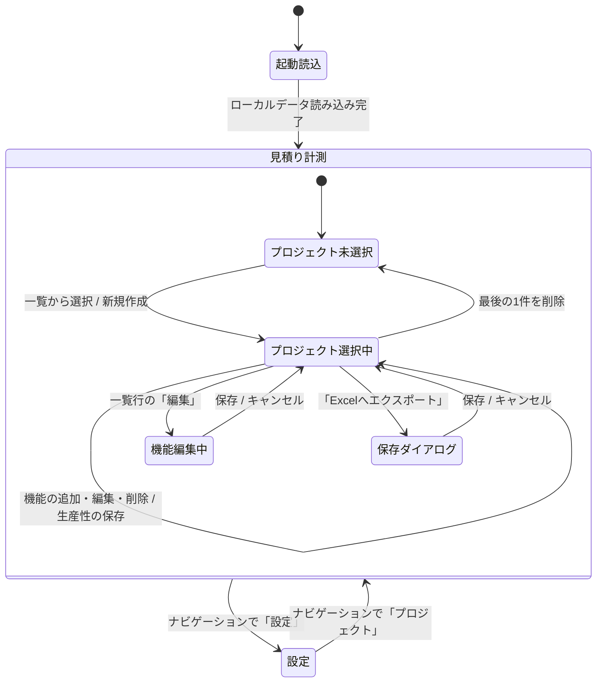
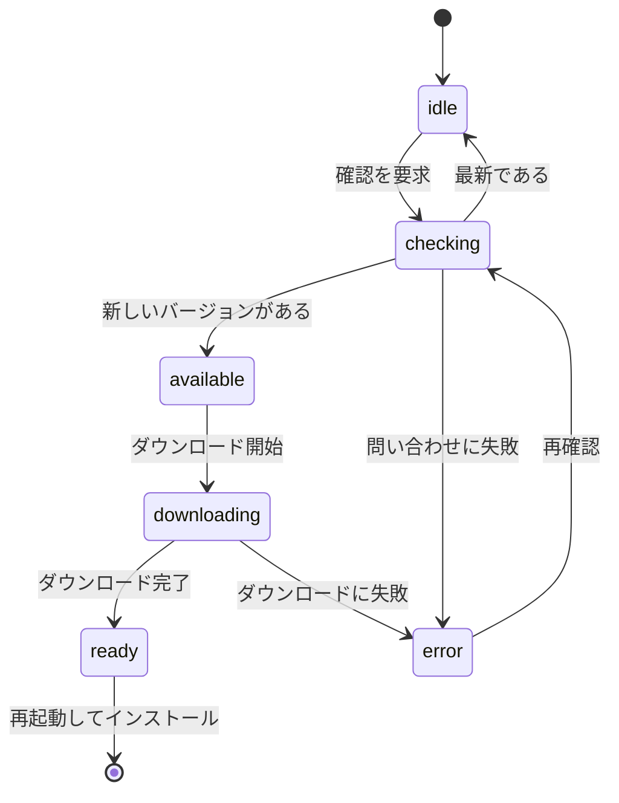
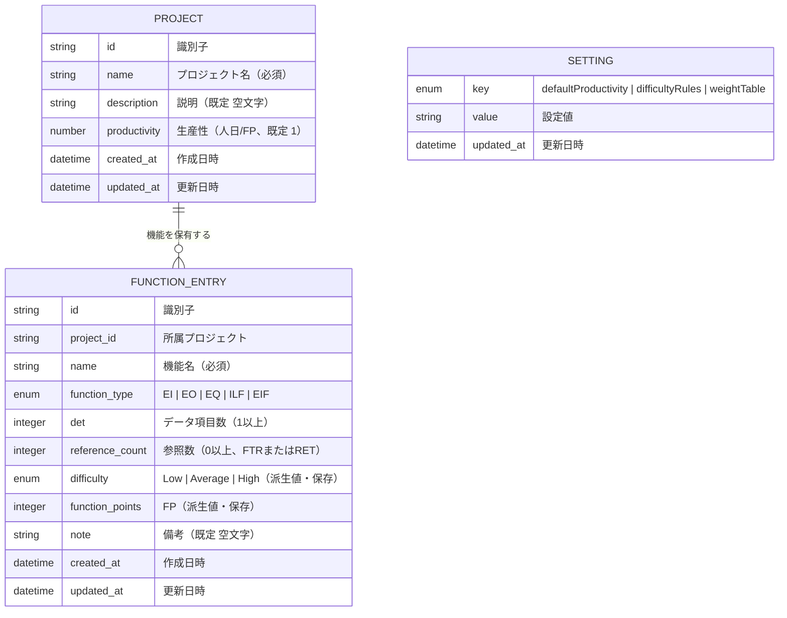
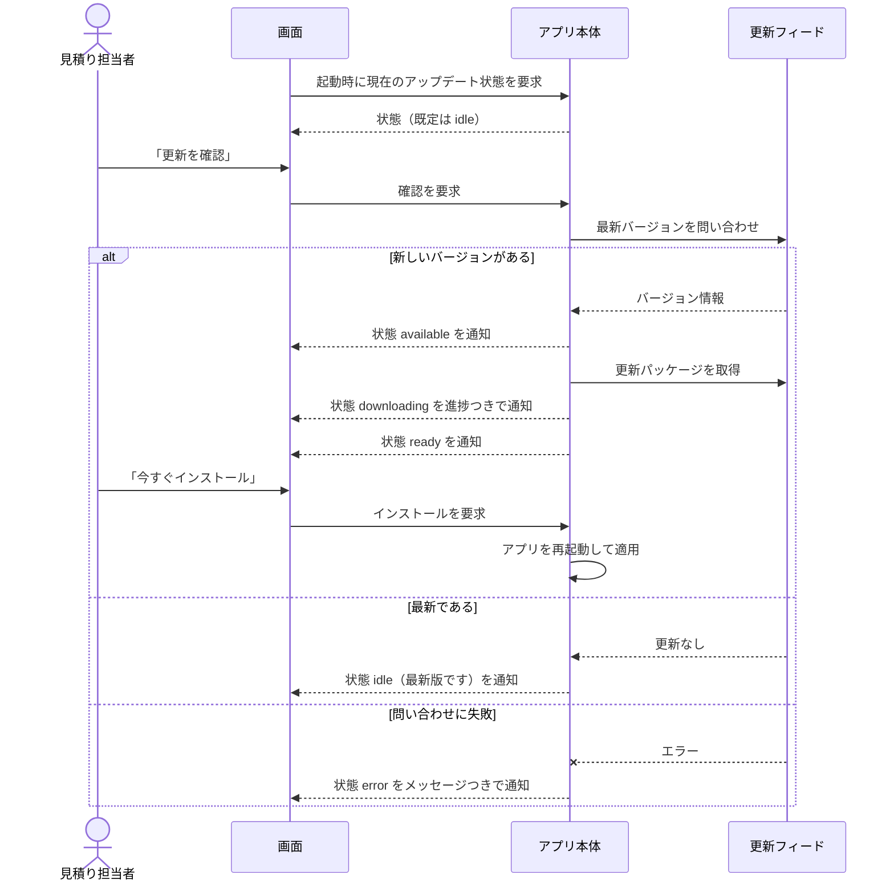

# 仕様

「どの条件で、何が起きるべきか」を定める文書。利用者と合意する動作・業務ルール・データ・入出力・通知の正本とする。目的と受け入れ基準は [requirements.md](requirements.md)、内部の実現方式と設計理由は [architecture.md](architecture.md) を参照する。

## 機能一覧

| ID | 機能 | 対応する要件 | 概要 | 詳細 |
| :--- | :--- | :--- | :--- | :--- |
| F-01 | プロジェクト新規作成 | FR-1 | 名称と説明を入力して見積り単位を作る | [業務ルール](#入力検証正規化規則) / [画面・操作仕様](#見積り計測ビュー) |
| F-02 | プロジェクト一覧表示 | FR-1 | 保存済みプロジェクトを更新日時の新しい順に並べる | [業務ルール](#一覧の並び順) / [画面・操作仕様](#見積り計測ビュー) |
| F-03 | プロジェクト選択 | FR-1 | 一覧から1件を選び、計測対象にする | [画面・操作仕様](#見積り計測ビュー) |
| F-04 | プロジェクト複製 | FR-1 | 説明・生産性・全機能ごとコピーする | [業務ルール](#更新複製削除の規則) / [画面・操作仕様](#見積り計測ビュー) |
| F-05 | プロジェクト名変更 | FR-1 | 名称のみを変更する | [業務ルール](#入力検証正規化規則) / [画面・操作仕様](#見積り計測ビュー) |
| F-06 | プロジェクト削除 | FR-1 | 確認のうえ、属する機能ごと削除する | [業務ルール](#更新複製削除の規則) / [画面・操作仕様](#見積り計測ビュー) |
| F-07 | 機能の追加 | FR-2 | Function Type・DET・FTR/RET・名称・備考を登録する | [業務ルール](#難易度と-fp-の決定規則) / [画面・操作仕様](#見積り計測ビュー) |
| F-08 | 難易度・FP のプレビュー | FR-2 | 登録前に入力値から難易度と FP を表示する | [業務ルール](#難易度と-fp-の決定規則) / [画面・操作仕様](#見積り計測ビュー) |
| F-09 | 機能の編集 | FR-2 | 登録済みの機能を書き換え、難易度と FP を再計算する | [業務ルール](#更新複製削除の規則) / [画面・操作仕様](#見積り計測ビュー) |
| F-10 | 機能の削除 | FR-2 | 1件を削除する | [業務ルール](#更新複製削除の規則) / [画面・操作仕様](#見積り計測ビュー) |
| F-11 | 機能一覧表示 | FR-2 | プロジェクトに属する機能を作成日時の新しい順に並べる | [業務ルール](#一覧の並び順) / [画面・操作仕様](#見積り計測ビュー) |
| F-12 | 集計表示 | FR-3 | 機能件数・合計 UFP・概算工数を表示する | [業務ルール](#集計と丸め規則) / [画面・操作仕様](#見積り計測ビュー) |
| F-13 | プロジェクト生産性の設定 | FR-4 | プロジェクト個別の生産性（人日/FP）を保存する | [業務ルール](#集計と丸め規則) / [画面・操作仕様](#見積り計測ビュー) |
| F-14 | Excel 出力 | FR-5 | 保存ダイアログで指定した先に .xlsx を書き出す | [入出力・外部連携仕様](#excel-出力) |
| F-15 | IFPUG 参照値の閲覧 | FR-6 | 難易度ルールと重みを読み取り専用で表示する | [業務ルール](#難易度と-fp-の決定規則) / [画面・操作仕様](#画面一覧) |
| F-16 | アップデート確認・適用 | FR-7 | 新バージョンの確認、ダウンロード、再起動によるインストール | [状態と遷移](#状態と遷移) / [入出力・外部連携仕様](#自動アップデート) |

アプリ全体のデフォルト生産性は既定値 `1`（人日/FP）を保持し、設定画面からの変更は行わない。画面から変更できるのはプロジェクト個別の生産性（F-13）のみとする。

## 業務ルール

### 難易度と FP の決定規則

Function Type ごとに DET と参照数をそれぞれ 3 段階のバケット（小 / 中 / 大）へ振り分け、3×3 のマトリクスで難易度を決め、重み表から FP を引く。

**Function Type ごとの境界値と呼称**

| Function Type | DET 小 | DET 中 | DET 大 | 参照数 小 | 参照数 中 | 参照数 大 | 参照数の呼称 |
| :--- | :--- | :--- | :--- | :--- | :--- | :--- | :--- |
| EI | `< 5`（1〜4） | `5 <= DET < 16`（5〜15） | `>= 16` | `<= 1`（0〜1） | `1 < 参照数 <= 2`（2） | `> 2`（3以上） | FTR |
| EO | `< 6`（1〜5） | `6 <= DET < 20`（6〜19） | `>= 20` | `<= 1`（0〜1） | `1 < 参照数 <= 3`（2〜3） | `> 3`（4以上） | FTR |
| EQ | `< 6`（1〜5） | `6 <= DET < 20`（6〜19） | `>= 20` | `<= 1`（0〜1） | `1 < 参照数 <= 3`（2〜3） | `> 3`（4以上） | FTR |
| ILF | `< 20`（1〜19） | `20 <= DET < 51`（20〜50） | `>= 51` | `<= 1`（0〜1） | `1 < 参照数 <= 5`（2〜5） | `> 5`（6以上） | RET |
| EIF | `< 20`（1〜19） | `20 <= DET < 51`（20〜50） | `>= 51` | `<= 1`（0〜1） | `1 < 参照数 <= 5`（2〜5） | `> 5`（6以上） | RET |

**境界の扱いは DET と参照数で異なる。** DET は境界値を「次のバケットの開始値」とみなし `<` で判定する（例: EI で DET=5 は中）。参照数は境界値を「そのバケットの上限」とみなし `<=` で判定する（例: EI で FTR=1 は小）。

**難易度マトリクス（全 Function Type 共通）**

| | DET 小 | DET 中 | DET 大 |
| :--- | :--- | :--- | :--- |
| **参照数 小** | Low | Low | Average |
| **参照数 中** | Low | Average | High |
| **参照数 大** | Average | High | High |

**重み表（IFPUG 標準値）**

| Function Type | Low | Average | High |
| :--- | :--- | :--- | :--- |
| EI | 3 | 4 | 6 |
| EO | 4 | 5 | 7 |
| EQ | 3 | 4 | 6 |
| ILF | 7 | 10 | 15 |
| EIF | 5 | 7 | 10 |

### 集計と丸め規則

| 項目 | 条件 | 期待結果 |
| :--- | :--- | :--- |
| 機能件数 | プロジェクトに属する機能が 0 件 | `0` |
| 機能件数 | プロジェクトに属する機能が 1 件以上 | 属する機能エントリの件数 |
| 合計 UFP | プロジェクトに属する機能が 0 件 | `0` |
| 合計 UFP | プロジェクトに属する機能が 1 件以上 | 属する機能エントリの FP の総和 |
| 有効な生産性 | プロジェクト個別の生産性が有限数値 | プロジェクト個別の生産性 |
| 有効な生産性 | プロジェクト個別の生産性が未設定または非数 | 設定のデフォルト生産性（既定値 `1`） |
| 概算工数（人日） | 任意 | `合計 UFP × 有効な生産性` を小数第2位（四捨五入）に丸めた値 |
| 生産性の保存値 | 0 より大きい有限数値 | 小数第2位に丸めて保存する |

### 入力検証・正規化規則

不正入力時はデータを一切変更せず、対応するエラーメッセージを返す（文面は [エラー・通知仕様](#エラー通知仕様) を参照）。

| 対象 | 入力条件 | 期待結果 |
| :--- | :--- | :--- |
| プロジェクト名 | 前後に空白がある非空文字列 | 前後の空白を除去して保存 |
| プロジェクト名 | 空文字または空白のみ | 登録・改名不可（入力エラー） |
| 説明 | 任意文字列（空含む） | 前後の空白を除去して保存 |
| 機能名 | 前後に空白がある非空文字列 | 前後の空白を除去して保存 |
| 機能名 | 空文字または空白のみ | 登録・更新不可（入力エラー） |
| DET | 1 以上の整数 | 有効 |
| DET | 0 以下、小数、非数、未入力 | 登録・更新不可（入力エラー）。プレビューは「入力待ち」 |
| FTR / RET | 0 以上の整数 | 有効 |
| FTR / RET | 負数、小数、非数、未入力 | 登録・更新不可（入力エラー）。プレビューは「入力待ち」 |
| 備考 | 任意文字列（空含む） | 前後の空白を除去して保存 |
| 生産性 | 0 より大きい有限数値 | 小数第2位に丸めて保存 |
| 生産性 | 0 以下、非数、未入力 | 保存不可（入力エラー） |

### 更新・複製・削除の規則

| 操作 | 条件 | 期待結果 |
| :--- | :--- | :--- |
| プロジェクト新規作成 | 名称が有効 | 新規 ID を採番し、デフォルト生産性・機能 0 件で作成する |
| プロジェクト複製 | 複製元プロジェクトが存在する | 新規 ID を採番し、名称を「〈元の名称〉 コピー」とする。説明・生産性・属する全機能を引き継ぎ、各機能にも新規 ID を採番する |
| プロジェクト名変更 | 対象が存在し、名称が有効 | 名称とプロジェクトの更新日時を更新する。説明・生産性・機能は保持する |
| プロジェクト削除 | 対象が存在し、確認ダイアログで実行 | プロジェクトと、属するすべての機能エントリを削除する |
| 機能の追加 | 対象プロジェクトが存在し、入力が有効 | 難易度と FP を算出・確定して保存し、親プロジェクトの更新日時を更新して再集計する |
| 機能の編集 | 対象プロジェクト・機能が存在し、入力が有効 | 入力値で更新し、難易度と FP を再算出・再保存する。親プロジェクトの更新日時を更新して再集計する |
| 機能の削除 | 対象プロジェクト・機能が存在する | 該当機能のみ削除し、親プロジェクトの更新日時を更新して再集計する |
| 生産性の更新 | 対象プロジェクトが存在し、値が有効 | 小数第2位に丸めて保存し、親プロジェクトの更新日時を更新して概算工数を再計算する |
| 対象が存在しない操作 | 指定 ID のプロジェクトまたは機能が存在しない | 何も変更せず、対象なしエラーを返す |

### 一覧の並び順

| 対象 | 並び順 |
| :--- | :--- |
| プロジェクト一覧 | 更新日時の降順（新しいものが先頭） |
| 機能一覧 | 作成日時の降順（新しいものが先頭） |

### 設定値の欠損・破損時の扱い

| 対象 | 条件 | 期待結果 |
| :--- | :--- | :--- |
| デフォルト生産性 | 値が未設定または数値として解釈不能 | 既定値 `1` にフォールバックし、エラーにしない |
| 難易度ルール / 重み表 | JSON が未設定・破損・項目欠損 | 欠損または破損した箇所のみ IFPUG 標準の既定値にフォールバックし、エラーにしない |

## 画面・操作仕様

### 画面一覧

単一ウィンドウ。左端に常設のナビゲーションがあり、2つのビューを切り替える。ウィンドウ最小サイズは 1200×760、初期サイズは 1440×900。

| 画面 | 役割 |
| :--- | :--- |
| ナビゲーション | 「プロジェクト」「設定」の切り替え。折りたたみ・展開ができる |
| 見積り計測ビュー | プロジェクトの選択・管理と、機能の入力・集計。本アプリの主画面 |
| 設定ビュー | IFPUG 難易度ルールと重みの読み取り専用表示 |
| アップデート通知 | 画面左下に重ねて表示される。アップデート状態が `idle` 以外のときだけ現れる |

### 見積り計測ビュー

左に**プロジェクト一覧ペイン**、右に**計測ペイン**を並べる。

プロジェクト一覧ペインの上部に「プロジェクト新規作成」ボタンを置き、各行のオプションメニューから「Excelへエクスポート」「このプロジェクトを複製」「プロジェクト名を変更」「このプロジェクトを削除」を実行できる。

計測ペインはプロジェクト未選択のとき案内表示だけを出し、選択中は上から順に次を並べる。

1. **集計サマリー** — プロジェクト名 / 合計 UFP / 概算工数（人日）/ 機能数
2. **生産性パネル** — プロジェクト個別の生産性の入力と保存
3. **機能入力フォーム** — 追加・編集の両モードを兼ねる。折りたたみ可（編集モード中は折りたためない）。Function Type / DET / FTR・RET の横に用語ヘルプボタン（`?`）を持つ
4. **機能一覧テーブル** — 登録済み機能と、備考の詳細表示・行ごとの編集・削除

#### 入出力項目と操作可否

共通の検証・正規化規則は [業務ルール](#入力検証正規化規則) に従う。処理実行中（通信・保存中）は各操作ボタン・入力欄を無効化する。

**機能入力フォーム**

| 項目 | 入力形式 | 必須 | 初期値 | 画面上の振る舞い |
| :--- | :--- | :--- | :--- | :--- |
| 機能名 | テキスト | ○ | 空 | 空白のみ不可 |
| 機能種別 | 選択（EI/EO/EQ/ILF/EIF） | ○ | `EI` | 選択に応じて参照数ラベルを切り替える |
| DET | 数値 | ○ | `4` | 1 以上の整数 |
| FTR / RET | 数値 | ○ | `1` | 0 以上の整数。ラベルは機能種別により切り替わる |
| 備考 | テキスト | — | 空 | 任意入力 |

- 機能名が入力済み、かつ DET・FTR/RET が有効なときだけ登録・保存ボタンが押せる
- DET・FTR/RET が有効なときは、難易度と FP をバッジでプレビューする。無効なときは「入力待ち」と表示する
- 見出しは追加モードで「機能を追加」、編集モードで「機能を編集」とする。編集モードでは「編集をキャンセル」ボタンを表示し、キャンセルすると変更を破棄して追加モードに戻る
- 編集中の機能を一覧から削除した場合は、編集状態を解除してフォームを初期化する

**生産性パネル**

| 項目 | 入力形式 | 必須 | 初期値 | 画面上の振る舞い |
| :--- | :--- | :--- | :--- | :--- |
| 生産性（人日/FP） | 数値 | ○ | 選択中プロジェクトの現在値（小数第2位表示） | 0 より大きい数値で、かつ現在値から変化したときだけ保存ボタンが押せる |

**プロジェクト新規作成ダイアログ / 名前変更ダイアログ**

| 項目 | 入力形式 | 必須 | 対象ダイアログ | 画面上の振る舞い |
| :--- | :--- | :--- | :--- | :--- |
| プロジェクト名 | テキスト | ○ | 新規作成・名前変更 | 空白のみのときは確定ボタンが無効 |
| 説明 | テキスト | — | 新規作成のみ | 任意入力 |

**プロジェクト削除ダイアログ** — 破壊的操作のため確認を挟む。「この操作は元に戻せません」を明示し、キャンセル時は何も変更しない。

### 画面遷移

ダイアログ（新規作成・名前変更・削除確認・備考詳細・用語ヘルプ）はビューを遷移させず、閉じると元の状態へ戻る。

## 状態と遷移

### アップデート状態

自動アップデートの進行を管理する保存・通知対象の状態（`idle` / `checking` / `available` / `downloading` / `ready` / `error`）。画面左下のアップデート通知カードの表示と操作可否はこの状態に従う。

| 状態 | 通知カード表示 | 「更新を確認」操作 | 「今すぐインストール」操作 |
| :--- | :--- | :--- | :--- |
| `idle` | 非表示 | —（カード非表示） | —（カード非表示） |
| `checking` | 表示 | 無効 | 無効 |
| `available` | 表示 | 有効 | 無効 |
| `downloading` | 表示（進捗バー付き） | 無効 | 無効 |
| `ready` | 表示 | 有効 | 有効 |
| `error` | 表示 | 有効 | 無効 |

**禁止する遷移**: `ready` 以外の状態からインストールへ進むことはできない。ダウンロード未完了でインストールを要求された場合は状態を変えず、「アップデートはまだダウンロードされていません。」を返す。

## データ定義

論理的なエンティティと関連。物理テーブル定義や保存方式は [architecture.md](architecture.md#永続化整合性移行) を参照する。

- **削除の連動**: プロジェクトを削除すると、属する機能エントリもすべて削除される。
- **保存する派生値**: 機能エントリの `difficulty` と `function_points` は入力値から導出される派生値だが、集計と出力の整合を保つため登録・編集時に確定して保存する。入力値を書き換えると必ず再計算・再保存される。
- **保持しない派生値**: 機能件数・合計 UFP・概算工数・有効な生産性は保存せず、機能エントリと設定から都度導出する（導出規則は [集計と丸め規則](#集計と丸め規則) を参照）。

## 入出力・外部連携仕様

業務データを送信する外部連携は存在しない。ファイル出力（Excel）と、アップデート確認・取得のためのネットワークアクセスのみが外部との接点となる。

### Excel 出力

| 項目 | 仕様 |
| :--- | :--- |
| 出力先 | ネイティブの保存ダイアログで利用者が指定する |
| 既定ファイル名 | `<サニタイズ済みプロジェクト名>-YYYY-MM-DD.xlsx`。ファイル名禁止文字（`< > : " / \ | ? *`・NUL 文字）は `_` に置換し、連続空白は半角スペース1つへ正規化する。空になった場合は `project` を使う |
| 形式 | Excel ブック（`.xlsx`） |
| シート構成 | 4シート（下表）。ブックを開いたときに数式を再計算する設定を付与する |
| キャンセル・失敗時 | ダイアログをキャンセルしたときは何も書き出さず、正常終了として扱う。対象プロジェクトが無い場合や書き込み失敗時はエラーメッセージを画面に表示する |

**出力シート構成**

| シート名 | 内容 |
| :--- | :--- |
| `Summary` | プロジェクト名・説明・生産性（人日/FP）・合計 FP（数式）・合計工数（数式）。生産性セルを他シートが参照する |
| `Function Entries` | 機能一覧（No.・機能名・機能種別・DET・FTR/RET・難易度・重み・FP・生産性・工数・備考）。難易度・重み・FP・生産性・工数は数式で出力する |
| `Weights` | IFPUG 標準の重み表。`Function Entries` の重み数式が `INDEX` / `MATCH` で参照する |
| `Difficulty Rules` | IFPUG 標準の難易度ルール。`Function Entries` の難易度数式が閾値を参照する |

**自己完結性**: 難易度・FP・合計は固定値ではなく Excel 数式（`LET` / `INDEX` / `MATCH` / `SUM`）として書き出され、難易度ルールと重み表をブックに同梱する。利用者が Excel 上で DET や FTR/RET を書き換えると、アプリと同じ規則で再計算される。

### 自動アップデート

| 項目 | 仕様 |
| :--- | :--- |
| 連携先 | 配布物のリリース公開先（GitHub Releases の更新フィード） |
| 対応 OS | Windows と Linux（AppImage）。macOS は配布物が未署名のためアプリ内インストールを行わず、新しい版は手動で入れ直す（[ADR-009](architecture.md#adr-009-リリースを-github-actions-で行い当面はコード署名しない)） |
| 送受信データ | バージョン情報・リリースノート・更新パッケージの取得のみ。利用者の見積りデータは一切送信しない |
| 失敗時 | 状態を `error` にしてメッセージを通知カードに表示する。アプリの通常操作は継続できる |

## エラー・通知仕様

利用者に見せる通知・エラーの正本。入力エラーおよび対象なしエラーではデータを変更しない。

| 区分 | 発生条件 | 表示内容 | 表示場所 | 利用者が次にできること |
| :--- | :--- | :--- | :--- | :--- |
| 入力エラー | プロジェクト名が空白のみ | プロジェクト名は必須です。 | 計測ビュー上部のメッセージバー | 入力を訂正して再実行（データ変化なし） |
| 入力エラー | 機能名が空白のみ | 機能名は必須です。 | 計測ビュー上部のメッセージバー | 入力を訂正して再実行（データ変化なし） |
| 入力エラー | DET が 1 以上の整数でない | DETは1以上の整数で入力してください。 | 計測ビュー上部のメッセージバー | 入力を訂正して再実行（データ変化なし） |
| 入力エラー | FTR/RET が 0 以上の整数でない | FTR/RETは0以上の整数で入力してください。 | 計測ビュー上部のメッセージバー | 入力を訂正して再実行（データ変化なし） |
| 入力エラー | 生産性が 0 以下または非数 | 生産性は0より大きい数値で入力してください。 | 計測ビュー上部のメッセージバー | 入力を訂正して再実行（データ変化なし） |
| 対象なし | 操作対象のプロジェクトが存在しない | 対象プロジェクトが見つかりません。 | 計測ビュー上部のメッセージバー | 一覧から別のプロジェクトを選択（データ変化なし） |
| 対象なし | 削除対象のプロジェクトが存在しない | 削除対象のプロジェクトが見つかりません。 | 計測ビュー上部のメッセージバー | 一覧を確認して操作をやり直す（データ変化なし） |
| 対象なし | 複製元のプロジェクトが存在しない | 複製対象のプロジェクトが見つかりません。 | 計測ビュー上部のメッセージバー | 一覧から対象を選び直す（データ変化なし） |
| 対象なし | Excel 出力対象のプロジェクトが存在しない | 対象のプロジェクトが見つかりません。 | 計測ビュー上部のメッセージバー | 一覧から対象を選び直す（出力なし） |
| 対象なし | 更新対象の機能が存在しない | 更新対象の機能が見つかりません。 | 計測ビュー上部のメッセージバー | 機能一覧を確認してやり直す（データ変化なし） |
| 対象なし | 削除対象の機能が存在しない | 削除対象の機能が見つかりません。 | 計測ビュー上部のメッセージバー | 機能一覧を確認してやり直す（データ変化なし） |
| 想定外 | 上記以外の例外 | 予期しないエラーが発生しました。 | 計測ビュー上部のメッセージバー | 操作を再試行するかアプリを再起動 |
| 進行中 | 起動直後のデータ読み込み中 | ローカルデータを読み込んでいます… | 起動ローディング画面 | 読み込み完了を待つ |
| 進行中 | アップデート状態の取得中 | アップデート状態を確認しています… | アップデート通知カード（表示時） | 取得完了を待つ |
| 進行中 | アップデート確認中 | アップデートを確認しています… | アップデート通知カード | 確認完了を待つ（アプリ操作は継続可） |
| 情報 | 最新バージョンを使用中 | 最新版です。 | アップデート通知（状態は `idle` へ復帰） | そのまま利用を継続 |
| 情報 | ダウンロード未完了でインストールを要求 | アップデートはまだダウンロードされていません。 | アップデート通知カード | ダウンロード完了を待つ |
| エラー | アップデート確認に失敗 | アップデートの確認に失敗しました。／アップデートの確認でエラーが発生しました。 | アップデート通知カード | 「更新を確認」で再試行（アプリ操作は継続可） |
| 確認 | プロジェクト削除の実行前 | プロジェクトを削除しますか？／「〈プロジェクト名〉」を削除します。この操作は元に戻せません。 | プロジェクト削除ダイアログ | 「削除する」で確定、または「キャンセル」で中止 |
